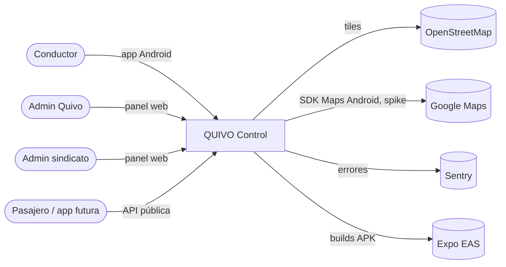
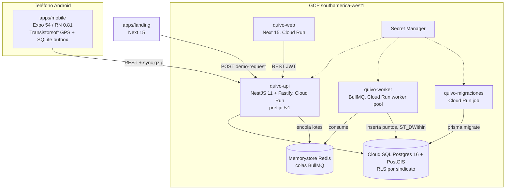

# Arquitectura — visión general

> Estado al 2026-10-10 (`main@64125f7`). Requisitos: [SRS](../srs/README.md). Datos: [modelo](../datos/modelo.md). Decisiones: [`../adr/`](../adr/).

## 1. Contexto (C4 nivel 1)

## 2. Contenedores (C4 nivel 2)

- **OSRM:** está en `docker-compose.yml`, pero no en prod. `RuteoService` cae a `localhost:5001` y la app dibuja una línea recta.
- **Deploy:** manual con `scripts/deploy-gcp.sh`. No hay workflow de deploy. El APK sale de EAS (`apps/mobile/eas.json`).

## 3. Monorepo

| Unidad | Rol | Depende de |
|---|---|---|
| `apps/api` | REST, auth web (Better-Auth) y móvil (token opaco), sync, worker | `@quivo/shared`, `@quivo/db` |
| `apps/web` | Panel admin | `@quivo/shared`, `@quivo/design-system` |
| `apps/mobile` | App del conductor | `@quivo/shared` |
| `apps/landing` | Sitio comercial | `@quivo/design-system` |
| `packages/db` | Prisma 7, cliente, contexto de tenant, Better-Auth | — |
| `packages/shared` | Contratos Zod, enums, tipos, OpenAPI, geo | — |
| `packages/design-system` | Componentes y tokens CSS del panel y la landing | — |

pnpm 11 + turbo 2. Node 22. CI único en `.github/workflows/ci.yml`.

**Módulos de la API** (`apps/api/src/modules`): auditoria, auth, auth-movil, conductores, control-points, demo-requests, ingesta-worker, lineas, media, public-mobility, reglas, reportes, retencion-gps, rotaciones, rutas, sindicatos, socios, sync, tracking, vehiculos.

**Convención declarada** (`apps/api/src/modules/README.md`): un módulo solo importa de otro a través de su `index.ts`. **No se cumple**: `tracking`, `sync` e `ingesta-worker` hacen deep-imports. Plan de saneamiento, Fase 4.2.

## 4. Flujos críticos

Las secuencias detalladas están en el SRS:
- Login móvil y web: [§1, secuencias](../srs/01-auth-tenant-auditoria.md).
- Fix GPS → outbox → sync → cola → worker → cumplimiento → panel: [§4, secuencia de extremo a extremo](../srs/04-operacion-gps-sync.md).
- Máquinas de estado:
  - detección de PC y outbox: [§4](../srs/04-operacion-gps-sync.md);
  - rotación, sanción y frescura: [§3](../srs/03-rotaciones-reglas-reportes.md);
  - vehículo y publicación: [§2](../srs/02-catalogo.md).

## 5. Decisiones de arquitectura vigentes

- **Multi-tenant:** una base, `sindicatoId` y RLS. Runtime con `quivo_app` sin BYPASSRLS. 5 tablas sin RLS (SRS §6).
- **Offline-first:** eventos inmutables con `eventId` UUIDv7, outbox SQLite y sync idempotente por lotes de hasta 500 eventos, en gzip.
- **Validación doble del cumplimiento:** la app avisa; el worker decide con `ST_DWithin`, que es la fuente de verdad.
- **Particionado diario de `gps_points`** con retención de 6 meses. El archivado está construido pero deshabilitado.
- **Contratos en `packages/shared`** con Zod. Hay deuda: zod 3 en shared y api, zod 4 en mobile y db.

## 6. Deuda estructural conocida

La lista priorizada está en [`../plan-saneamiento.md`](../plan-saneamiento.md):
- god files de 1.3k a 1.9k líneas (núcleo móvil y formularios web);
- reglas de negocio duplicadas: jornada, haversine, radios;
- React 18 en design-system vs 19 en mobile;
- CSS duplicado entre web, landing y design-system;
- guards de autorización opt-in por controlador.
