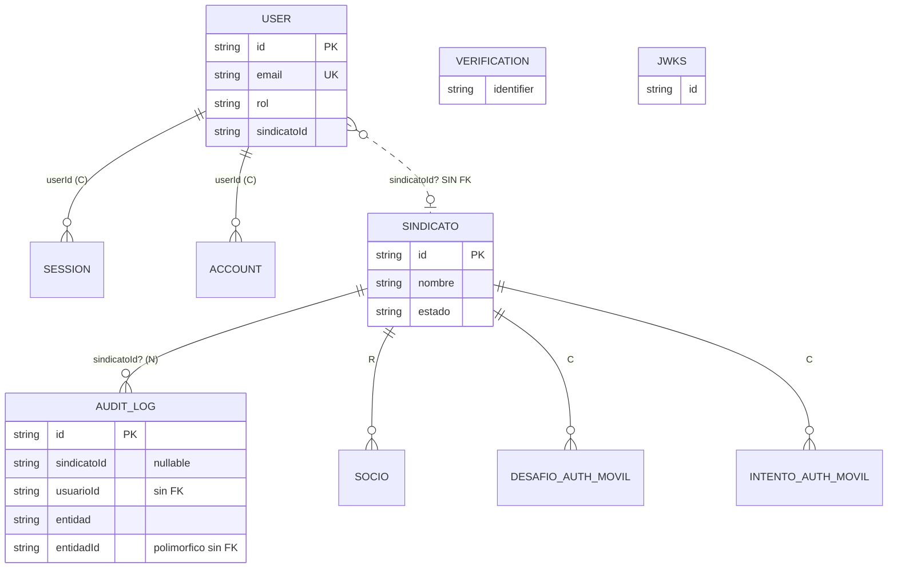
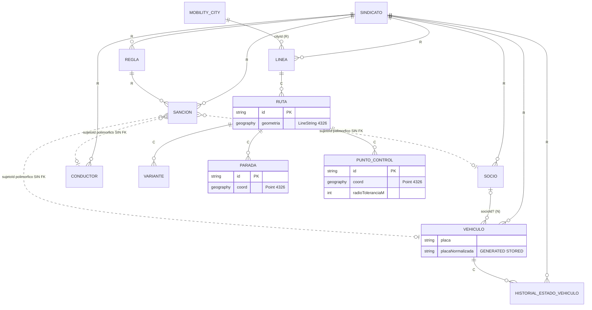
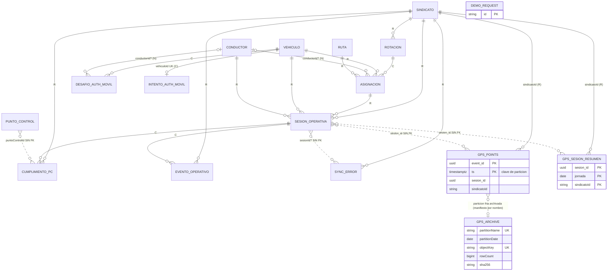

# Modelo de datos — QUIVO Control

> Fuente: `packages/db/prisma/schema.prisma` (793 líneas, 29 modelos Prisma) y `packages/db/prisma/migrations/*` (36 migraciones + `migration_lock.toml`), leído sobre `main@64125f7` el 2026-10-10. Relacionado: [SRS](../srs/README.md).
> Motor: PostgreSQL 16 + PostGIS (imagen local `postgis/postgis:16-3.4-alpine`, migración `20260730030000_habilitar_postgis`). ORM: Prisma 7 con driver adapter `@prisma/adapter-pg` (`packages/db/src/client.ts`).
> Convenciones de tipos Prisma → SQL: `String` → `TEXT`, `DateTime` → `TIMESTAMP(3)` (sin zona), `@db.Date` → `DATE`, `Int` → `INTEGER`, `Float` → `DOUBLE PRECISION`, `Json` → `JSONB`, `String[]` → `TEXT[]`. Los `id` con `@default(uuid())` se generan en el cliente Prisma (no hay `DEFAULT` en la columna SQL; verificable en `20260730151939_core_entities`). Las columnas son camelCase entre comillas (sin `@map` por campo) salvo las tablas crudas `gps_points`/`gps_sesion_resumen` (snake_case).

---

## 1. ERD

Notación de `onDelete`: `R` = Restrict, `C` = Cascade, `N` = SetNull. Todas las FKs usan `ON UPDATE CASCADE`.

### 1.1 Auth y tenant

`User.sindicatoId` es un `String?` **sin relación Prisma ni FK** hacia `sindicatos` (schema.prisma líneas 36-42): el vínculo usuario→tenant se resuelve por claim JWT, no por constraint (ver §7).

### 1.2 Catálogo (flota, líneas, rutas, reglas)

### 1.3 Operación (rotaciones, sesiones, ingesta, evidencia)

`gps_points` y `gps_sesion_resumen` no son modelos Prisma; se dibujan porque forman parte del flujo (sus relaciones son lógicas, **sin FK** sobre `sesion_id`).

`DemoRequest` (`demo_requests`) y `MobilityCity` no se relacionan con el tenant operativo (la primera no tiene FK alguna; la segunda sólo con `Linea`).

---

## 2. Diccionario de datos

Notas generales:
- "Null" = `NO` es `NOT NULL`; `SÍ` es nullable.
- Todos los `id` de modelos de negocio son `TEXT` PK con UUID generado por Prisma (`@default(uuid())`); los de Better-Auth no tienen default (los emite la librería).
- Todos los `createdAt` son `DEFAULT CURRENT_TIMESTAMP`; los `updatedAt` son `@updatedAt` (sin default SQL, los fija Prisma).
- Los textos "estado"/"tipo" son `TEXT` libres: los valores válidos viven en `packages/shared` (Zod), no en la DB (schema.prisma líneas 107-111). Salvo los `CHECK` listados explícitamente, la DB no valida dominios.

### 2.1 Better-Auth (generados; no editar a mano — schema.prisma líneas 1-17)

#### `User` → tabla `user`
| Campo | Tipo | Null | Default | Restricciones | Descripción |
|---|---|---|---|---|---|
| id | TEXT | NO | — | PK | — |
| name | TEXT | NO | — | — | — |
| email | TEXT | NO | — | UNIQUE (`email`) | Login web. |
| emailVerified | BOOLEAN | NO | `false` | — | — |
| image | TEXT | SÍ | — | — | — |
| createdAt | TIMESTAMP(3) | NO | `now()` | — | — |
| updatedAt | TIMESTAMP(3) | NO | `@updatedAt` | — | — |
| rol | TEXT | NO | — | — | `additionalFields` de Better-Auth (`packages/db/src/auth.ts`); p. ej. `admin_quivo`, `admin_sindicato` (valores observables en `seed.ts` líneas 132-145). |
| sindicatoId | TEXT | SÍ | — | sin FK | `null` para `admin_quivo` (seed.ts línea 132). Claim del JWT que luego alimenta `app.sindicato_id`. |

#### `Session` → `session`
| Campo | Tipo | Null | Default | Restricciones | Descripción |
|---|---|---|---|---|---|
| id | TEXT | NO | — | PK | — |
| expiresAt | TIMESTAMP(3) | NO | — | — | — |
| token | TEXT | NO | — | UNIQUE | — |
| createdAt / updatedAt | TIMESTAMP(3) | NO | `now()` / `@updatedAt` | — | — |
| ipAddress, userAgent | TEXT | SÍ | — | — | — |
| userId | TEXT | NO | — | FK → `user.id` ON DELETE CASCADE; INDEX(`userId`) | — |

#### `Account` → `account`
| Campo | Tipo | Null | Default | Restricciones | Descripción |
|---|---|---|---|---|---|
| id | TEXT | NO | — | PK | — |
| accountId, providerId | TEXT | NO | — | — | — |
| userId | TEXT | NO | — | FK → `user.id` CASCADE; INDEX | — |
| accessToken, refreshToken, idToken, scope | TEXT | SÍ | — | — | — |
| accessTokenExpiresAt, refreshTokenExpiresAt | TIMESTAMP(3) | SÍ | — | — | — |
| password | TEXT | SÍ | — | — | Hash scrypt de Better-Auth. |
| createdAt / updatedAt | TIMESTAMP(3) | NO | `now()` / `@updatedAt` | — | — |

#### `Verification` → `verification`
| Campo | Tipo | Null | Default | Restricciones | Descripción |
|---|---|---|---|---|---|
| id | TEXT | NO | — | PK | — |
| identifier, value | TEXT | NO | — | INDEX(`identifier`) | — |
| expiresAt | TIMESTAMP(3) | NO | — | — | — |
| createdAt / updatedAt | TIMESTAMP(3) | NO | `now()` / `@updatedAt` | — | — |

#### `Jwks` → `jwks`
| Campo | Tipo | Null | Default | Restricciones | Descripción |
|---|---|---|---|---|---|
| id | TEXT | NO | — | PK | Claves del plugin `jwt()` de Better-Auth (`auth.ts` línea 4). |
| publicKey, privateKey | TEXT | NO | — | — | — |
| createdAt | TIMESTAMP(3) | NO | — (sin default) | — | — |
| expiresAt | TIMESTAMP(3) | SÍ | — | — | — |

### 2.2 Tenant y entidades núcleo

#### `Sindicato` → `sindicatos`
| Campo | Tipo | Null | Default | Restricciones | Descripción |
|---|---|---|---|---|---|
| id | TEXT | NO | uuid (cliente) | PK | Tenant raíz. |
| nombre | TEXT | NO | — | — | — |
| estado | TEXT | NO | `'activo'` | — | — |
| createdAt / updatedAt | TIMESTAMP(3) | NO | `now()` / `@updatedAt` | — | — |

RLS: ver §4. Es el padre de 15 modelos (relaciones inversas, schema.prisma líneas 120-134).

#### `Socio` → `socios`
| Campo | Tipo | Null | Default | Restricciones | Descripción |
|---|---|---|---|---|---|
| id | TEXT | NO | uuid | PK | — |
| sindicatoId | TEXT | NO | — | FK → `sindicatos` RESTRICT; INDEX | — |
| nombre | TEXT | NO | — | — | — |
| documentoIdentidad | TEXT | NO | — | UNIQUE(`sindicatoId`,`documentoIdentidad`) (migr. `20260802224500_ci_unico_por_sindicato`) | CI. |
| estado | TEXT | NO | `'activo'` | — | — |
| createdAt / updatedAt | TIMESTAMP(3) | NO | — | — | — |

#### `Vehiculo` → `vehiculos`
| Campo | Tipo | Null | Default | Restricciones | Descripción |
|---|---|---|---|---|---|
| id | TEXT | NO | uuid | PK | — |
| sindicatoId | TEXT | NO | — | FK RESTRICT; INDEX | — |
| socioId | TEXT | SÍ | — | FK → `socios` SET NULL | — |
| placa | TEXT | NO | — | — | Placa cruda, tal cual la ingresa el usuario. |
| placaNormalizada | TEXT | NO | `GENERATED ALWAYS AS (regexp_replace(upper(btrim(placa)), '[^A-Z0-9]', '', 'g')) STORED` | UNIQUE parcial `vehiculos_placa_norm_vigente_key` `WHERE estado <> 'inactivo'`; INDEX plano `vehiculos_placaNormalizada_idx`; CHECK `vehiculos_placa_norm_check` (`~ '^[A-Z0-9]{3,20}$'`) | Columna generada por Postgres; no se puede escribir (SQLSTATE 428C9). Migr. `20260908151800_unicidad_placa_generada`. Lookup del login móvil por placa. |
| tipo | TEXT | NO | — | INDEX | Normalizado a `taxi_trufi/trufi/minibus/micro/bus_urbano/omnibus/otro` en `20260801153000_mejora_entidad_vehiculo`. |
| marca, modelo, color | TEXT | NO | — | — | `color` normalizado a paleta fija en `20260801153000`. |
| colorSecundario | TEXT | SÍ | — | — | — |
| numeroInterno | TEXT | SÍ | — | — | Identidad visual (migr. `20260817161000_line_identity_markers`). |
| distintivo | TEXT | SÍ | — | — | idem |
| cartelSuperior | TEXT | SÍ | — | — | idem |
| capacidad | INTEGER | NO | — | — | — |
| estado | TEXT | NO | `'pendiente'` | INDEX | Default cambiado a `pendiente` en `20260801153000`. `inactivo` = "ya no es mío" (migr. `20260908151800`). |
| credencialHash | TEXT | SÍ | — | — | Credencial emitida por el sindicato para login por vehículo (M3); scrypt de Better-Auth, nunca plano (schema líneas 184-187). |
| createdAt / updatedAt | TIMESTAMP(3) | NO | — | — | — |

#### `HistorialEstadoVehiculo` → `historial_estados_vehiculo`
| Campo | Tipo | Null | Default | Restricciones | Descripción |
|---|---|---|---|---|---|
| id | TEXT | NO | uuid | PK | — |
| sindicatoId | TEXT | NO | — | FK RESTRICT; INDEX(`sindicatoId`,`createdAt`) | — |
| vehiculoId | TEXT | NO | — | FK → `vehiculos` CASCADE; INDEX(`vehiculoId`,`createdAt`) | — |
| estadoDesde | TEXT | SÍ | — | — | `null` en el alta. |
| estadoHasta | TEXT | NO | — | — | — |
| motivo, observacion | TEXT | SÍ | — | — | — |
| retornoEstimado | TIMESTAMP(3) | SÍ | — | — | — |
| actorId | TEXT | NO | — | sin FK | `'migracion'` en el backfill inicial. |
| origen | TEXT | NO | `'web'` | — | `'migracion'` para el backfill de `20260801153000`. |
| createdAt | TIMESTAMP(3) | NO | `now()` | — | — |

#### `Conductor` → `conductores`
| Campo | Tipo | Null | Default | Restricciones | Descripción |
|---|---|---|---|---|---|
| id | TEXT | NO | uuid | PK | — |
| sindicatoId | TEXT | NO | — | FK RESTRICT; INDEX | — |
| nombre | TEXT | NO | — | — | — |
| documentoIdentidad | TEXT | NO | — | UNIQUE(`sindicatoId`,`documentoIdentidad`) | CI. |
| licenciaConducir | TEXT | NO | — | — | — |
| estado | TEXT | NO | `'activo'` | — | — |
| credencialHash | TEXT | SÍ | — | — | PIN personal (segundo paso / login de un paso), scrypt; migr. `20260801090000_auth_movil_operativa`. |
| createdAt / updatedAt | TIMESTAMP(3) | NO | — | — | — |

#### `MobilityCity` → `mobility_cities`
Catálogo nacional de ciudades (schema líneas 258-262). Migr. `20260819100000_mobility_city_scope` (siembra 9 ciudades bolivianas por `INSERT`: cochabamba, la-paz-el-alto, santa-cruz, tarija, sucre, potosi, trinidad, oruro, cobija).
| Campo | Tipo | Null | Default | Restricciones | Descripción |
|---|---|---|---|---|---|
| id | TEXT | NO | — (slug, no UUID) | PK | — |
| nombre | TEXT | NO | — | — | — |
| departamentoCodigo, departamentoNombre | TEXT | SÍ | — | — | — |
| paisCodigo | TEXT | NO | `'BO'` | — | — |
| zonaHoraria | TEXT | NO | `'America/La_Paz'` | — | — |
| estadoCobertura | TEXT | NO | `'coming_soon'` | INDEX | `ready`, `community`, `coming_soon` (visto en el INSERT). |
| fuenteTipo, fuenteNombre, fuenteLicencia | TEXT | SÍ | — | — | Procedencia de datos de movilidad. |
| fuenteActualizadaAt | TIMESTAMP(3) | SÍ | — | — | — |
| modosDisponibles, serviciosAuxiliares | TEXT[] | NO | `{}` | — | — |
| createdAt | TIMESTAMP(3) | NO | `now()` | — | — |
| updatedAt | TIMESTAMP(3) | NO | `now()` + `@updatedAt` | — | — |

#### `Linea` → `lineas`
| Campo | Tipo | Null | Default | Restricciones | Descripción |
|---|---|---|---|---|---|
| id | TEXT | NO | uuid | PK | — |
| sindicatoId | TEXT | NO | — | FK RESTRICT; INDEX; UNIQUE(`sindicatoId`,`codigo`) | — |
| cityId | TEXT | NO | `'cochabamba'` | FK → `mobility_cities` RESTRICT; INDEX(`cityId`,`publicStatus`) | — |
| codigo, nombre | TEXT | NO | — | INDEX(`publicStatus`,`codigo`), INDEX(`publicStatus`,`nombre`) | — |
| color, colorSecundario, colorTexto, colorTerciario, colorFondo | TEXT | SÍ | — | — | Branding (migr. `20260817160000_linea_branding`, `20260817161000_line_identity_markers`). |
| nombreCorto, lema, descripcion, logoUrl | TEXT | SÍ | — | — | — |
| distintivoTipo, distintivoValor, cartelSuperior | TEXT | SÍ | — | — | Identidad visual del cartel. |
| cartelFormato, cartelTitulo, cartelDetalle, cartelNumeroPosicion, cartelLogoPosicion | TEXT | SÍ | — | — | Editor de cartel (`20260817162000_linea_cartel_editor`). |
| cartelColorTitulo, cartelColorDetalle, cartelColorNumero, cartelColorBorde | TEXT | SÍ | — | — | idem |
| publicStatus | TEXT | NO | `'borrador'` | INDEX(`publicStatus`) | Publicación a movilidad pública (`20260817163000_public_mobility_publication`). |
| publishedAt | TIMESTAMP(3) | SÍ | — | — | — |
| createdAt / updatedAt | TIMESTAMP(3) | NO | — | — | — |

#### `Ruta` → `rutas`
| Campo | Tipo | Null | Default | Restricciones | Descripción |
|---|---|---|---|---|---|
| id | TEXT | NO | uuid | PK | — |
| lineaId | TEXT | NO | — | FK → `lineas` CASCADE; INDEX | — |
| sentido | TEXT | NO | — | — | ida/vuelta. |
| geometria | `geography(LineString,4326)` | NO | — | GiST `rutas_geometria_gist_idx` (migr. `20260818163000`; no está en el schema) | `Unsupported` en Prisma; se lee/escribe con SQL crudo (`ST_AsGeoJSON`). |
| estado | TEXT | NO | `'activo'` | — | — |
| publicStatus | TEXT | NO | `'borrador'` | INDEX(`publicStatus`), INDEX(`publicStatus`,`estado`,`lineaId`) | — |
| publishedAt | TIMESTAMP(3) | SÍ | — | — | — |
| createdAt / updatedAt | TIMESTAMP(3) | NO | — | — | — |

#### `Variante` → `variantes`
| Campo | Tipo | Null | Default | Restricciones | Descripción |
|---|---|---|---|---|---|
| id | TEXT | NO | uuid | PK | — |
| rutaId | TEXT | NO | — | FK → `rutas` CASCADE; INDEX | — |
| nombre | TEXT | NO | — | — | — |
| estado | TEXT | NO | `'activo'` | — | Soft-delete (migr. `20260810172532`). |
| publicStatus | TEXT | NO | `'borrador'` | INDEX; INDEX(`publicStatus`,`estado`,`rutaId`) | — |
| publishedAt | TIMESTAMP(3) | SÍ | — | — | — |
| createdAt / updatedAt | TIMESTAMP(3) | NO | — | — | — |

#### `Parada` → `paradas`
| Campo | Tipo | Null | Default | Restricciones | Descripción |
|---|---|---|---|---|---|
| id | TEXT | NO | uuid | PK | — |
| rutaId | TEXT | NO | — | FK → `rutas` CASCADE; INDEX | — |
| tipo | TEXT | NO | — | — | `origen`, `intermedia`, … (ver seed). |
| orden | INTEGER | NO | — | INDEX(`publicStatus`,`estado`,`rutaId`,`orden`) | — |
| nombre, referencia | TEXT | SÍ | — | — | Migr. `20260817163000`. |
| coord | `geography(Point,4326)` | NO | — | GiST `paradas_coord_gist_idx` (migr. `20260818163000`) | — |
| estado | TEXT | NO | `'activo'` | — | Soft-delete. |
| publicStatus | TEXT | NO | `'borrador'` | INDEX | — |
| publishedAt | TIMESTAMP(3) | SÍ | — | — | — |
| createdAt / updatedAt | TIMESTAMP(3) | NO | — | — | — |

#### `PuntoControl` → `puntos_control`
| Campo | Tipo | Null | Default | Restricciones | Descripción |
|---|---|---|---|---|---|
| id | TEXT | NO | uuid | PK | — |
| rutaId | TEXT | NO | — | FK → `rutas` CASCADE; INDEX | — |
| orden | INTEGER | NO | — | — | — |
| coord | `geography(Point,4326)` | NO | — | **sin índice GiST** | — |
| radioToleranciaM | INTEGER | NO | — (sin default) | — | Radio de cumplimiento en metros; se escribe vía SQL crudo (`control-points.service.ts` líneas 59-63). Ver §7 sobre 100 vs 150. |
| obligatorio | BOOLEAN | NO | `true` | — | — |
| estado | TEXT | NO | `'activo'` | — | Soft-delete: `cumplimientos_pc.puntoControlId` apunta aquí sin FK (schema líneas 405-407). |
| createdAt / updatedAt | TIMESTAMP(3) | NO | — | — | — |

#### `AuditLog` → `audit_log`
| Campo | Tipo | Null | Default | Restricciones | Descripción |
|---|---|---|---|---|---|
| id | TEXT | NO | uuid | PK | — |
| sindicatoId | TEXT | SÍ | — | FK → `sindicatos` SET NULL; INDEX(`sindicatoId`,`ts`) | Nullable: acciones de `admin_quivo` sin tenant (schema línea 416). |
| usuarioId | TEXT | NO | — | sin FK | — |
| entidad, entidadId | TEXT | NO | — | sin FK | Referencia polimórfica. |
| accion | TEXT | NO | — | — | — |
| diff | JSONB | SÍ | — | — | — |
| ts | TIMESTAMP(3) | NO | `now()` | — | — |

### 2.3 Operación (rotaciones, auth móvil, sesiones)

#### `Rotacion` → `rotaciones`
| Campo | Tipo | Null | Default | Restricciones | Descripción |
|---|---|---|---|---|---|
| id | TEXT | NO | uuid | PK | — |
| sindicatoId | TEXT | NO | — | FK RESTRICT; INDEX | — |
| periodo | TEXT | NO | — | — | Texto libre, p. ej. `"2026-08"`. |
| estado | TEXT | NO | `'borrador'` | — | `borrador | publicada`; sólo las publicadas alimentan la app móvil. |
| createdAt / updatedAt | TIMESTAMP(3) | NO | — | — | — |

#### `Asignacion` → `asignaciones`
| Campo | Tipo | Null | Default | Restricciones | Descripción |
|---|---|---|---|---|---|
| id | TEXT | NO | uuid | PK | — |
| rotacionId | TEXT | NO | — | FK → `rotaciones` CASCADE; INDEX | — |
| vehiculoId | TEXT | NO | — | FK → `vehiculos` RESTRICT | — |
| conductorId | TEXT | SÍ | — | FK → `conductores` SET NULL | Puede confirmarse después. |
| rutaId | TEXT | NO | — | FK → `rutas` RESTRICT | — |
| fecha | DATE | NO | — | UNIQUE(`vehiculoId`,`fecha`,`horario`) | Barrera contra doble asignación. |
| horario | TEXT | NO | — | idem | Texto libre (mañana/tarde/noche). |
| horaSalida, horaPresentacion | TIMESTAMP(3) | SÍ | — | — | Despacho/presentación (migr. `20260810034050`). |
| orden | INTEGER | NO | — | — | — |
| venceAt | TIMESTAMP(3) | NO | — | INDEX(`estado`,`venceAt`), INDEX(`rutaId`,`estado`,`venceAt`) | — |
| estado | TEXT | NO | `'vigente'` | — | `vigente | vencida`; la marca un job BullMQ (`RotacionesModule`). |
| createdAt / updatedAt | TIMESTAMP(3) | NO | — | — | — |

No tiene `sindicatoId` propio (migr. `20260731060000_rotaciones_asignaciones`, línea 61: hereda vía `rotacion`).

#### `DesafioAuthMovil` → `desafios_auth_movil`
Token opaco del login móvil encadenado; en DB sólo el hash SHA-256 (schema líneas 493-494).
| Campo | Tipo | Null | Default | Restricciones | Descripción |
|---|---|---|---|---|---|
| id | TEXT | NO | uuid | PK | — |
| sindicatoId | TEXT | NO | — | FK CASCADE; INDEX | — |
| vehiculoId | TEXT | NO | — | FK CASCADE; INDEX(`vehiculoId`,`expiresAt`) | — |
| conductorId | TEXT | SÍ | — | FK SET NULL | — |
| tokenHash | TEXT | NO | — | UNIQUE | — |
| deviceId | TEXT | NO | — | — | — |
| expiresAt | TIMESTAMP(3) | NO | — | — | — |
| consumedAt | TIMESTAMP(3) | SÍ | — | — | — |
| intentosConductor | INTEGER | NO | `0` | — | — |
| createdAt / updatedAt | TIMESTAMP(3) | NO | — | — | — |

#### `IntentoAuthMovil` → `intentos_auth_movil`
Lockout progresivo por vehículo (no por IP, por CGNAT); schema líneas 516-519.
| Campo | Tipo | Null | Default | Restricciones | Descripción |
|---|---|---|---|---|---|
| id | TEXT | NO | uuid | PK | — |
| sindicatoId | TEXT | NO | — | FK CASCADE; INDEX | — |
| vehiculoId | TEXT | NO | — | FK CASCADE; UNIQUE | 1:1 con vehículo. |
| fallos | INTEGER | NO | `0` | — | — |
| bloqueadoHasta | TIMESTAMP(3) | SÍ | — | — | — |
| createdAt / updatedAt | TIMESTAMP(3) | NO | — | — | — |

#### `SesionOperativa` → `sesiones_operativas`
| Campo | Tipo | Null | Default | Restricciones | Descripción |
|---|---|---|---|---|---|
| id | TEXT | NO | uuid | PK | — |
| sindicatoId | TEXT | NO | — | FK RESTRICT; INDEX | — |
| asignacionId | TEXT | NO | — | FK RESTRICT; INDEX(`asignacionId`,`estado`) | — |
| vehiculoId | TEXT | NO | — | FK RESTRICT; INDEX(`vehiculoId`,`estado`); INDEX(`vehiculoId`,`estado`,`fin`,`inicio` DESC) | — |
| conductorId | TEXT | NO | — | FK RESTRICT | — |
| deviceId | TEXT | NO | — | INDEX(`deviceId`,`estado`) | — |
| inicio | TIMESTAMP(3) | NO | `now()` | — | — |
| fin | TIMESTAMP(3) | SÍ | — | — | Fin de la sesión de LOGIN (sólo lo toca `logout`). |
| estado | TEXT | NO | `'activa'` | — | Estado de la sesión de login. |
| accessTokenHash | TEXT | NO | — | UNIQUE | — |
| refreshTokenHash | TEXT | NO | — | UNIQUE | — |
| refreshTokenHashAnterior | TEXT | SÍ | — | — | Hash rotado hacia afuera; prueba de posesión en el fallback de `logout()` (migr. `20260923090000_refresh_token_hash_anterior`). |
| accessExpiresAt, refreshExpiresAt | TIMESTAMP(3) | NO | — | — | — |
| revokedAt | TIMESTAMP(3) | SÍ | — | — | — |
| recorridoEstado | TEXT | SÍ | — | CHECK `sesiones_operativas_recorrido_estado_check` (`IS NULL OR IN ('en_curso','finalizado')`) | Estado DERIVADO del recorrido, mantenido por `insertarEventoOperativoEnTx` (migr. `20260926120000_sesion_recorrido_estado`). |
| recorridoEstadoTs | TIMESTAMP(3) | SÍ | — | — | Guard de orden para sync fuera de secuencia. |
| createdAt / updatedAt | TIMESTAMP(3) | NO | — | — | — |

### 2.4 Reglas y sanciones

#### `Regla` → `reglas`
| Campo | Tipo | Null | Default | Restricciones | Descripción |
|---|---|---|---|---|---|
| id | TEXT | NO | uuid | PK | — |
| sindicatoId | TEXT | NO | — | FK RESTRICT; INDEX | — |
| nombre | TEXT | NO | — | — | Agregado "por usabilidad admin" (asunción del equipo, schema 586-590). |
| tipo | TEXT | NO | — | — | — |
| gravedad | TEXT | NO | — | — | `leve/grave/gravisima` (asunción, schema 589-590). |
| aplicaA | TEXT | NO | — | — | Mismo dominio que `Sancion.sujetoTipo`. |
| descripcion | TEXT | SÍ | — | — | — |
| estado | TEXT | NO | `'activo'` | — | — |
| createdAt / updatedAt | TIMESTAMP(3) | NO | — | — | — |

#### `Sancion` → `sanciones`
| Campo | Tipo | Null | Default | Restricciones | Descripción |
|---|---|---|---|---|---|
| id | TEXT | NO | uuid | PK | — |
| sindicatoId | TEXT | NO | — | FK RESTRICT; INDEX | — |
| reglaId | TEXT | NO | — | FK → `reglas` RESTRICT; INDEX | — |
| sujetoTipo | TEXT | NO | — | INDEX(`sujetoTipo`,`sujetoId`) | `vehiculos`/`conductores`/`socios`. |
| sujetoId | TEXT | NO | — | sin FK | Polimórfico (schema 611-612). |
| motivo | TEXT | NO | — | — | — |
| fechaHecho | DATE | NO | — | **sin índice** | — |
| evidenciaRef | TEXT | SÍ | — | — | Texto libre; la "evidencia auto-vinculada" no se implementó (schema 613-615). |
| estado | TEXT | NO | `'pendiente'` | — | — |
| createdAt / updatedAt | TIMESTAMP(3) | NO | — | — | — |

### 2.5 Ingesta, evidencia y archivo

#### `CumplimientoPc` → `cumplimientos_pc`
| Campo | Tipo | Null | Default | Restricciones | Descripción |
|---|---|---|---|---|---|
| id | TEXT | NO | uuid | PK | — |
| eventId | TEXT | NO | — | UNIQUE | `event_id` UUIDv7 del outbox móvil; idempotencia RF-72 (migr. `20260802163000`). |
| sindicatoId | TEXT | NO | — | FK RESTRICT; INDEX | — |
| sesionId | TEXT | NO | — | FK → `sesiones_operativas` CASCADE (migr. `20260802162000`); INDEX; INDEX(`sesionId`,`puntoControlId`,`ts`) | — |
| puntoControlId | TEXT | NO | — | INDEX; **sin FK** | — |
| ts | TIMESTAMP(3) | NO | — | — | — |
| distanciaM | DOUBLE PRECISION | NO | — | — | — |
| cumplido | BOOLEAN | NO | — | — | — |
| validadoPor | TEXT | NO | — | — | `'app'` (detección local) o `'worker'` (server-side, fuente de verdad, RF-39). |
| pasada | INTEGER | SÍ | — | **sin UNIQUE a propósito** | Nº de pasada multi-vuelta; null en APKs viejas (migr. `20260817140000`). |
| receivedAt | TIMESTAMP(3) | NO | `now()` | — | — |

#### `EventoOperativo` → `eventos_operativos`
| Campo | Tipo | Null | Default | Restricciones | Descripción |
|---|---|---|---|---|---|
| id | TEXT | NO | uuid | PK | — |
| eventId | TEXT | NO | — | UNIQUE | Idempotencia por `event_id`. |
| sindicatoId | TEXT | NO | — | FK RESTRICT; INDEX | — |
| sesionId | TEXT | NO | — | FK → `sesiones_operativas` CASCADE; INDEX | — |
| deviceId | TEXT | NO | — | — | — |
| tipo | TEXT | NO | — | — | `inicio_recorrido`, `fin_recorrido`, `observacion`. |
| ts | TIMESTAMP(3) | NO | — | — | — |
| payload | JSONB | NO | — | — | — |
| receivedAt | TIMESTAMP(3) | NO | `now()` | — | — |

#### `SyncError` → `sync_errors`
| Campo | Tipo | Null | Default | Restricciones | Descripción |
|---|---|---|---|---|---|
| id | TEXT | NO | uuid | PK | — |
| sindicatoId | TEXT | NO | — | FK RESTRICT; INDEX | — |
| deviceId | TEXT | NO | — | INDEX | — |
| sesionId | TEXT | SÍ | — | INDEX; sin FK | Best-effort desde `payload.sesionId`. |
| eventId | TEXT | SÍ | — | — | — |
| payload | JSONB | NO | — | — | — |
| error | TEXT | NO | — | — | Motivo del rechazo (RNF-35). |
| ts | TIMESTAMP(3) | NO | `now()` | — | — |

#### `GpsArchive` → `gps_archives`
Manifiesto del archivo frío (schema 759-761). Sin `sindicatoId` (cada partición mezcla tenants).
| Campo | Tipo | Null | Default | Restricciones | Descripción |
|---|---|---|---|---|---|
| id | TEXT | NO | uuid | PK | — |
| partitionName | TEXT | NO | — | UNIQUE | `gps_points_YYYYMMDD`. |
| partitionDate | DATE | NO | — | INDEX | — |
| bucket | TEXT | NO | — | — | — |
| objectKey | TEXT | NO | — | UNIQUE | `<prefix>/gps_points/year=…/month=…/day=…/<partición>.csv.gz`. |
| rowCount | BIGINT | NO | — | — | — |
| compressedBytes | BIGINT | NO | — | — | — |
| sha256 | TEXT | NO | — | — | — |
| archivedAt | TIMESTAMP(3) | NO | `now()` | — | — |

#### `DemoRequest` → `demo_requests`
Solicitudes de la landing; no pertenecen a ningún sindicato (schema 777-778).
| Campo | Tipo | Null | Default | Restricciones | Descripción |
|---|---|---|---|---|---|
| id | TEXT | NO | uuid | PK | — |
| name, line, city | TEXT | NO | — | — | — |
| lineCount | INTEGER | NO | — | — | — |
| vehicleCount | INTEGER | SÍ | — | — | — |
| source | TEXT | NO | `'landing'` | — | — |
| status | TEXT | NO | `'new'` | INDEX(`status`,`createdAt`) | — |
| createdAt | TIMESTAMP(3) | NO | `now()` | INDEX(`createdAt`) | — |

---

## 3. Objetos fuera de Prisma

Prisma no los representa (o no los gestiona): están sólo en SQL crudo de migraciones. Un `prisma migrate dev` nuevo no los regenera desde el schema; la fuente de verdad es el SQL.

| Objeto | Tipo | Migración que lo crea / modifica | Notas |
|---|---|---|---|
| `postgis` | Extensión | `20260730030000_habilitar_postgis` | `CREATE EXTENSION IF NOT EXISTS postgis`. Necesaria en Cloud SQL (Postgres pelado). También en `prisma.config.ts` (`initShadowDb`). |
| `rutas.geometria` `geography(LineString,4326)` | Columna | `20260730151939_core_entities` | `Unsupported(...)` en el schema. |
| `paradas.coord`, `puntos_control.coord` `geography(Point,4326)` | Columnas | `20260730151939_core_entities` | idem |
| `rutas_geometria_gist_idx`, `paradas_coord_gist_idx` | Índices GiST | `20260818163000_public_mobility_indexes` | `puntos_control.coord` no tiene GiST. |
| `vehiculos.placaNormalizada` | Columna generada STORED + CHECK `vehiculos_placa_norm_check` + índice único parcial `vehiculos_placa_norm_vigente_key` (`WHERE estado <> 'inactivo'`) | `20260908151800_unicidad_placa_generada` (reemplaza la columna nullable de `20260801153000_mejora_entidad_vehiculo`) | Declarada en el schema vía `dbgenerated` + `partialIndexes` (previewFeature). |
| `sesiones_operativas_recorrido_estado_check` | CHECK | `20260926120000_sesion_recorrido_estado` | — |
| `gps_points` | Tabla `PARTITION BY RANGE (ts)` | `20260802160000_ingesta_gps_worker` | PK `(event_id, ts)`; cols `event_id uuid, sesion_id uuid, device_id text, ts timestamptz, lat, lng, accuracy, speed, received_at timestamptz DEFAULT now()`; índice `gps_points_sesion_ts_idx (sesion_id, ts)`. Sin `pg_partman` (no disponible en la imagen). |
| `gps_points."sindicatoId"` + FK `gps_points_sindicatoid_fkey` + índice `gps_points_sindicato_id_ts_idx (sindicatoId, ts)` | Columna/FK/índice | `20260815120000_gps_points_sindicato_rls`; reasegurados idempotentemente en `20260829180000_reconciliar_gps_points_sindicato_rls` | `NOT NULL`. `sesion_id` **no tiene FK** a `sesiones_operativas`. |
| Particiones `gps_points_YYYYMMDD` | Tablas hijas (diarias) | Bootstrap `CURRENT_DATE-1..+6` en `20260802160000`; luego `crear_particion_gps_points` | RLS FORCE + policy propia en cada una (§4). |
| `crear_particion_gps_points(date)` | Función plpgsql `SECURITY DEFINER` | Creada `20260802160000`; `SECURITY DEFINER`+`GRANT quivo_app` `20260802161000_particion_gps_security_definer`; redefinida con RLS por partición `20260815120000`; reescrita race-safe `20260817130000_particion_gps_points_idempotente`; **definición final** en `20260829180000_reconciliar_gps_points_sindicato_rls` | Final: `SET search_path = pg_catalog, public`, `SET TimeZone = 'UTC'`, `pg_advisory_xact_lock(hashtextextended('quivo:gps-partitions',0))`, `CREATE TABLE IF NOT EXISTS public.
 PARTITION OF public.gps_points`, ENABLE/FORCE RLS y policy `tenant_isolation` si falta. `REVOKE ALL … FROM PUBLIC`, `GRANT EXECUTE … TO quivo_app`. |
| `finalizar_archivo_gps(text)` | Función plpgsql `SECURITY DEFINER` | `20260802190000_gps_archives` | Valida nombre `^gps_points_[0-9]{8}$`, exige fila en `gps_archives`, `DETACH PARTITION` + `DROP TABLE`. `search_path` fijo; `REVOKE … FROM PUBLIC`; `GRANT EXECUTE … TO quivo_app`. |
| `gps_sesion_resumen` | Tabla (no particionada, sin modelo Prisma) | `20260922100000_gps_sesion_resumen` | PK `(sesion_id, jornada, "sindicatoId")`; `total_puntos int DEFAULT 0`, `ultimo_fix_ts`, `ultimo_ingreso_ts`, `lat`, `lng`, `accuracy`, `speed`, `updated_at`; FK `gps_sesion_resumen_sindicatoid_fkey` → `sindicatos` RESTRICT; RLS FORCE. Backfill desde `gps_points` con `set_config('app.rol','admin_quivo',false)` temporal. Mantenida por `insertarGpsPoints` (upsert `ON CONFLICT DO UPDATE`, mismo statement que el INSERT), **no por trigger**. `jornada` = fecha calendario de `ts − 4h` (Bolivia UTC−4). |
| Rol `quivo_app` | Rol `LOGIN NOSUPERUSER NOBYPASSRLS` + `GRANT`s + `ALTER DEFAULT PRIVILEGES` | `20260730152500_rls_multi_tenant` | Password de dev embebida en la migración. |
| Policies `tenant_isolation` (18 tablas + particiones) | RLS | ver §4 | — |
| Backfills / data migrations | `INSERT`/`UPDATE` | `20260801153000` (normaliza `tipo`/`color`, siembra `historial_estados_vehiculo`), `20260819100000` (siembra 9 `mobility_cities`), `20260802163000` (`eventId := id`), `20260922100000`, `20260926120000` | — |

**Triggers:** no hay ninguno en las migraciones (búsqueda de `CREATE TRIGGER` sin resultados). No hay otras funciones aparte de las dos arriba.

---

## 4. Multi-tenant y RLS

### 4.1 Mecanismo
- Cada request que toca datos de tenant corre dentro de `withTenantContext({rol, sindicatoId}, cb)` (`packages/db/src/tenant-context.ts`): abre `prisma.$transaction`, ejecuta `SELECT set_config('app.rol', $rol, true)` y `SELECT set_config('app.sindicato_id', $sid, true)` (`true` = `SET LOCAL`, se descarta al terminar la transacción, no se filtra a otras conexiones del pool). Parámetros bindeados, sin interpolación. `sindicatoId = null` se guarda como `''`.
- Las policies leen con `current_setting('app.rol', true)` / `current_setting('app.sindicato_id', true)` (el 2.º `true` devuelve NULL si nunca se seteó → la condición evalúa a falso → **fail-closed**).
- Si no se fija contexto, `NULL OR (x = NULL)` es falso: sin filas (esto ya mordió backfills; por eso `20260922100000` y `20260926120000` fijan `app.rol='admin_quivo'` a nivel sesión y lo resetean).
- Bypass de `admin_quivo`: explícito vía `app.rol`, **no** vía atributo de rol de Postgres (comentario en `20260730152500`), así queda auditable. El worker de ingesta corre siempre con `app.rol='admin_quivo'` (`CONTEXTO_ADMIN` en `ingesta-worker.service.ts`).

### 4.2 Roles de DB
| Rol | Uso | Atributos |
|---|---|---|
| `postgres` (dueño de tablas; `DATABASE_URL`) | Migraciones (`prisma migrate deploy`). | En Cloud SQL **no** es BYPASSRLS: `pg_roles.rolbypassrls = false` tanto para `postgres` como `quivo_app` (según `20260922100000`, que cita `docs/handoff.md`, "database-url NO es un rol BYPASSRLS"; no verificado contra prod desde este análisis). En dev/CI el rol de migraciones es superusuario y por eso ignora RLS (comentario de `20260730152500`). |
| `quivo_app` (`RUNTIME_DATABASE_URL`) | Runtime de `apps/api` y worker. | `LOGIN NOSUPERUSER NOBYPASSRLS`; `GRANT SELECT,INSERT,UPDATE,DELETE` sobre todas las tablas de `public` + default privileges futuros. |

`packages/db/src/client.ts`: fuera de `NODE_ENV=development`, la ausencia de `RUNTIME_DATABASE_URL` lanza error (no hay fallback silencioso a `DATABASE_URL`); en development hay fallback con `console.warn` y **RLS queda desactivado en ese modo**.

### 4.3 Tablas con RLS (`ENABLE` + `FORCE ROW LEVEL SECURITY`, policy `tenant_isolation`)
Condición de `USING` y `WITH CHECK` (idénticas) en todas salvo `sindicatos`:
`current_setting('app.rol',true) = 'admin_quivo' OR "sindicatoId"::text = current_setting('app.sindicato_id',true)`.

| Tabla | Migración | Particularidad |
|---|---|---|
| `sindicatos` | `20260730152500_rls_multi_tenant` | `USING`: `admin_quivo` OR `id::text = app.sindicato_id`; `WITH CHECK`: **sólo `admin_quivo`** (un sindicato no puede crear/modificar filas de `sindicatos`). |
| `socios`, `vehiculos`, `conductores`, `lineas`, `audit_log` | `20260730152500_rls_multi_tenant` | `audit_log.sindicatoId` es nullable: las filas con `NULL` sólo las ve `admin_quivo`. |
| `rotaciones` | `20260731060000_rotaciones_asignaciones` | — |
| `reglas`, `sanciones` | `20260731150000_reglas_sanciones` | — |
| `desafios_auth_movil`, `sesiones_operativas` | `20260801090000_auth_movil_operativa` | — |
| `historial_estados_vehiculo` | `20260801153000_mejora_entidad_vehiculo` | — |
| `cumplimientos_pc`, `eventos_operativos`, `sync_errors` | `20260802160000_ingesta_gps_worker` | — |
| `gps_points` + **cada partición** | `20260815120000_gps_points_sindicato_rls`, reconciliado en `20260829180000` | RLS del padre **no** protege acceso directo a una partición por nombre (verificado a mano según la migración), por eso la policy se repite en cada partición existente y en cada nueva (la hace `crear_particion_gps_points`). |
| `intentos_auth_movil` | `20260907100000_intento_auth_movil` | — |
| `gps_sesion_resumen` | `20260922100000_gps_sesion_resumen` | Sin loop por partición (no particionada). |

Total: **18 tablas** con RLS (16 modelos Prisma + `gps_points` + `gps_sesion_resumen`), más N particiones diarias.

### 4.4 Tablas SIN RLS y por qué
| Tabla(s) | Motivo (según migraciones/schema) |
|---|---|
| `user`, `session`, `account`, `verification`, `jwks` | El login necesita leer `user` por email antes de conocer el sindicato (chicken-and-egg); RLS complicaría el flujo ya verificado (`20260730152500`). |
| `rutas`, `variantes`, `paradas`, `puntos_control` | No tienen `sindicatoId`; heredan vía `lineaId → lineas.sindicatoId`. `20260730152500` difería la policy con subquery "junto con QUI-225/226"; **no hay migración posterior que la agregue** (ver §7). El aislamiento depende de la capa de servicio. |
| `asignaciones` | No tiene `sindicatoId`; hereda vía `rotacion` (`20260731060000`, línea 61). Misma situación. |
| `mobility_cities` | Catálogo nacional compartido (no es dato de tenant). |
| `gps_archives` | Sin `sindicatoId`: cada partición diaria mezcla tenants y sólo la procesa el worker global (schema 759-761). |
| `demo_requests` | Solicitudes públicas de la landing; no pertenecen a ningún sindicato (schema 777-778). |

---

## 5. Retención y particionado de GPS

**Diseño:** `gps_points` se particiona por rango diario de `ts` con particionado declarativo nativo. `pg_partman` no está disponible en la imagen (`20260802160000`). Constantes y runbook: `docs/runbooks/retencion-gps.md` (QUI-252).

### 5.1 Creación de particiones
- Código: `apps/api/src/modules/ingesta-worker/ingesta-worker.service.ts` (no existen archivos `particiones*.ts`; sólo el test `particiones.integration.test.ts`).
- Cola BullMQ `mantenimiento-particiones-gps`, job `crear-particiones-futuras`, scheduler `every = 24 h` (`CADA_MS_PARTICIONES`).
- `asegurarParticionesFuturas()`: para `i = 0..DIAS_ANTICIPACION_PARTICION (5)` abre **una transacción por día** (`withTenantContext(CONTEXTO_ADMIN)`), toma `pg_advisory_xact_lock(hashtextextended('quivo:gps-partitions',0))` y llama `SELECT crear_particion_gps_points((CURRENT_DATE + i)::date)`. Error por día: se loguea y no se propaga. Post-condición dura: si no existe `public.gps_points_<hoy>` lanza error (evita que toda la evidencia vaya a `sync_errors` en silencio).
- Se ejecuta en `onModuleInit` además del scheduler (de ahí la carrera 42P07 que motivó `20260817130000`, crash loop del 2026-08-17 en Cloud Run).

### 5.2 Retención 6 meses y archivo
- Código: `apps/api/src/modules/retencion-gps/retencion-gps.service.ts` + `retencion-gps.logic.ts`.
- Activación: `GPS_ARCHIVE_ENABLED=true` (por defecto **deshabilitado**; requiere `GPS_ARCHIVE_BUCKET`). Cola `retencion-gps`, job `archivar-particiones-gps`, cada `GPS_ARCHIVE_SCHEDULE_MS` (default 24 h), `concurrency: 1`.
- Elegibles: particiones hijas de `gps_points` cuyo nombre cumple `^gps_points_[0-9]{8}$`, con fecha `< CURRENT_DATE − GPS_RETENTION_MONTHS` (**default 6**), sin fila en `gps_archives`; máximo `GPS_ARCHIVE_MAX_PARTITIONS_PER_RUN` por corrida (**default 1**), orden por fecha.
- Por partición, en una transacción: `pg_try_advisory_xact_lock(hashtext('quivo-retencion-gps'))` → `LOCK TABLE <partición> ACCESS EXCLUSIVE` → export paginado (10 000 filas, `ORDER BY ts, event_id`) a CSV gzip nivel 9 con cabecera `event_id,sesion_id,device_id,ts,lat,lng,accuracy,speed,received_at,sindicatoId` (con `app.rol='admin_quivo'` local) → subida a S3/R2 con metadata (`sha256`, `row-count`, `format=quivo-gps-v1`) y verificación por re-descarga → `INSERT INTO gps_archives` → `SELECT finalizar_archivo_gps(nombre)` (`DETACH` + `DROP`) → `COMMIT`. Cualquier error hace rollback y la partición se conserva. Si el export da 0 filas pero la partición tiene datos, aborta (posible pérdida de contexto RLS).
- Clave de objeto: `<prefix>/gps_points/year=YYYY/month=MM/day=DD/gps_points_YYYYMMDD.csv.gz` (prefix default `quivo-control`).
- `gps_sesion_resumen` **no** se toca en el archivado: es agregado que sobrevive al drop de la partición (comentario final de `20260922100000`).
- Restauración: runbook (tabla staging `LIKE gps_points INCLUDING ALL`, `\copy`, comparación de `rowCount`/`sha256`).
- Estado operativo real (si está activo en prod): **no verificado** desde el código.

---

## 6. Historial de migraciones

Fechas = prefijo del directorio (UTC según convención Prisma). 36 migraciones.

| # | Migración | Fecha | Qué cambia |
|---|---|---|---|
| 1 | `20260730030000_habilitar_postgis` | 2026-07-30 | `CREATE EXTENSION IF NOT EXISTS postgis` (timestamp anterior a la primera migración a propósito, para Cloud SQL). |
| 2 | `20260730030424_init_auth` | 2026-07-30 | Tablas Better-Auth: `user`, `session`, `account`, `verification`, `jwks`. |
| 3 | `20260730151939_core_entities` | 2026-07-30 | `sindicatos`, `socios`, `vehiculos`, `conductores`, `lineas`, `rutas`, `variantes`, `paradas`, `puntos_control`, `audit_log` con columnas geography. |
| 4 | `20260730152500_rls_multi_tenant` | 2026-07-30 | Rol `quivo_app`, grants, RLS en `sindicatos/socios/vehiculos/conductores/lineas/audit_log`. |
| 5 | `20260730190000_vehiculo_credencial_hash` | 2026-07-30 | `vehiculos.credencialHash`. |
| 6 | `20260731060000_rotaciones_asignaciones` | 2026-07-31 | `rotaciones`, `asignaciones` (UNIQUE `vehiculoId,fecha,horario`), RLS en `rotaciones`. |
| 7 | `20260731130000_asignaciones_estado_vencimiento` | 2026-07-31 | `asignaciones.estado` + índice `(estado, venceAt)`. |
| 8 | `20260731150000_reglas_sanciones` | 2026-07-31 | `reglas`, `sanciones` + RLS. |
| 9 | `20260801090000_auth_movil_operativa` | 2026-08-01 | `conductores.credencialHash`, `desafios_auth_movil`, `sesiones_operativas` + RLS. |
| 10 | `20260801153000_mejora_entidad_vehiculo` | 2026-08-01 | `vehiculos`: `placaNormalizada` (nullable, único), `colorSecundario`, default `pendiente`, normaliza tipo/color; crea `historial_estados_vehiculo` (+RLS, backfill). |
| 11 | `20260802160000_ingesta_gps_worker` | 2026-08-02 | `gps_points` particionada, `crear_particion_gps_points`, bootstrap de particiones, `cumplimientos_pc`, `eventos_operativos`, `sync_errors` + RLS. |
| 12 | `20260802161000_particion_gps_security_definer` | 2026-08-02 | `crear_particion_gps_points` pasa a `SECURITY DEFINER`, `GRANT EXECUTE quivo_app`. |
| 13 | `20260802162000_cumplimientos_eventos_fk_sesion` | 2026-08-02 | FK `sesionId` → `sesiones_operativas` (CASCADE) en `cumplimientos_pc` y `eventos_operativos`. |
| 14 | `20260802163000_idempotencia_cumplimientos_eventos` | 2026-08-02 | `eventId` UNIQUE NOT NULL en ambas (backfill `eventId := id`). |
| 15 | `20260802164000_sync_errors_sesion_id` | 2026-08-02 | `sync_errors.sesionId` + índice. |
| 16 | `20260802190000_gps_archives` | 2026-08-02 | `gps_archives` + función `finalizar_archivo_gps`. |
| 17 | `20260802224500_ci_unico_por_sindicato` | 2026-08-02 | UNIQUE `(sindicatoId, documentoIdentidad)` en `socios` y `conductores`. |
| 18 | `20260810034050_asignacion_hora_salida_presentacion` | 2026-08-10 | `asignaciones.horaSalida/horaPresentacion`. |
| 19 | `20260810172532_paradas_puntos_control_variantes_estado` | 2026-08-10 | `estado` (soft-delete) en `paradas`, `puntos_control`, `variantes`. |
| 20 | `20260815120000_gps_points_sindicato_rls` | 2026-08-15 | `gps_points.sindicatoId` NOT NULL + FK + índice + RLS en padre y particiones; redefine `crear_particion_gps_points`. |
| 21 | `20260817130000_particion_gps_points_idempotente` | 2026-08-17 | Función race-safe con `search_path`/`TimeZone` fijos, `REVOKE PUBLIC` (fix crash loop del piloto). |
| 22 | `20260817140000_cumplimientos_pc_pasada` | 2026-08-17 | `cumplimientos_pc.pasada` + índice `(sesionId, puntoControlId, ts)`. |
| 23 | `20260817150000_sesiones_operativas_vehiculo_estado_idx` | 2026-08-17 | Índice `(vehiculoId, estado)` en `sesiones_operativas`. |
| 24 | `20260817160000_linea_branding` | 2026-08-17 | `lineas`: `colorSecundario`, `colorTexto`, `nombreCorto`, `lema`. |
| 25 | `20260817161000_line_identity_markers` | 2026-08-17 | `lineas`: colores/logo/distintivo/cartelSuperior; `vehiculos`: `numeroInterno`, `distintivo`, `cartelSuperior`. |
| 26 | `20260817162000_linea_cartel_editor` | 2026-08-17 | 9 columnas `cartel*` en `lineas`. |
| 27 | `20260817163000_public_mobility_publication` | 2026-08-17 | `publicStatus/publishedAt` en `lineas/rutas/variantes/paradas`; `paradas.nombre/referencia`; índices `publicStatus`. |
| 28 | `20260818163000_public_mobility_indexes` | 2026-08-18 | Índices compuestos de publicación, GiST en `rutas.geometria` y `paradas.coord`, índices de `sesiones_operativas` y `asignaciones`. |
| 29 | `20260819100000_mobility_city_scope` | 2026-08-19 | `mobility_cities` (+9 ciudades), `lineas.cityId` FK. |
| 30 | `20260829180000_reconciliar_gps_points_sindicato_rls` | 2026-08-29 | Reconcilia dos líneas de trabajo: reaplica idempotentemente columna/RLS de `gps_points`; función final con advisory lock. |
| 31 | `20260906120000_demo_requests` | 2026-09-06 | `demo_requests`. |
| 32 | `20260907100000_intento_auth_movil` | 2026-09-07 | `intentos_auth_movil` + RLS (lockout por vehículo). |
| 33 | `20260908151800_unicidad_placa_generada` | 2026-09-08 | `placaNormalizada` pasa a columna generada NOT NULL, único parcial vigente, CHECK; dropea `UNIQUE(sindicatoId, placa)`. |
| 34 | `20260922100000_gps_sesion_resumen` | 2026-09-22 | `gps_sesion_resumen` + backfill + RLS. |
| 35 | `20260923090000_refresh_token_hash_anterior` | 2026-09-23 | `sesiones_operativas.refreshTokenHashAnterior`. |
| 36 | `20260926120000_sesion_recorrido_estado` | 2026-09-26 | `sesiones_operativas.recorridoEstado/recorridoEstadoTs` + CHECK + backfill. |

---

## 7. Inconsistencias y hallazgos

Todos "por inspección de código"; ninguno medido con `EXPLAIN`.

### 7.1 Migración referenciada que no está en el repo
`20260829180000_reconciliar_gps_points_sindicato_rls` cita `20260818164500_gps_partition_idempotency` ("línea pendiente", advisory lock) como una migración que "quedó en el repo tras el merge", pero **no existe** en `packages/db/prisma/migrations/`. Sólo aparece en el commit `3d348b1` (snapshot `wip`, `git log --all`). Si algún ambiente la aplicó, su `_prisma_migrations` tendría una fila sin carpeta local (drift). Verificar contra `_prisma_migrations` de prod/staging. **No verificado.**

### 7.2 RLS ausente en la jerarquía de rutas y en `asignaciones`
`rutas`, `variantes`, `paradas`, `puntos_control` y `asignaciones` no tienen `sindicatoId` ni policy; `20260730152500` los difirió "junto con QUI-225/226" y no hay migración posterior. Son tablas operativas con datos de tenant (`asignaciones` conecta vehículo/conductor). El aislamiento depende sólo del filtro de la capa de servicio. `User.sindicatoId` tampoco tiene FK.

### 7.3 Nombres mezclados español/inglés
- Español (mayoría): `sindicatos`, `vehiculos`, `sesiones_operativas`, `cumplimientos_pc`…, columnas camelCase (`sindicatoId`).
- Inglés: `Session`, `User`, `Account`, `Verification`, `Jwks` (Better-Auth); `mobility_cities`; `demo_requests` (`name`, `line`, `city`, `lineCount`, `vehicleCount`, `source`, `status`); `Linea.publicStatus/publishedAt`, `Ruta/Variante/Parada.publicStatus`; `MobilityCity.cityId` en `Linea` (campo `cityId` pero relación `mobilityCity`); `GpsArchive` (`partitionName`, `bucket`, `objectKey`, `rowCount`, `archivedAt`).
- Convención de columnas: camelCase entre comillas en todo el schema Prisma **vs.** snake_case en `gps_points` y `gps_sesion_resumen` (`sesion_id`, `received_at`, `ultimo_fix_ts`) **con** `"sindicatoId"` camelCase mezclado en esas mismas tablas.
- Nombres de índice/constraint heterogéneos: unos con convención Prisma (`rutas_lineaId_fkey`) y otros a mano en snake (`desafios_auth_movil_sindicato_fkey`, `sesiones_operativas_vehicle_state_idx`).
- Entidades de dominio cuyo identificador no sigue `uuid`: `mobility_cities.id` es slug.
- `Sancion.sujetoTipo` guarda nombres de tabla/plural; `sujetoTipo` y `Regla.aplicaA` comparten dominio pero son strings libres.

### 7.4 Campos sin uso aparente (búsqueda de nombre en `apps/*/src`, `apps/web/app|lib`, `packages/*/src`, excluyendo tests)
Resultado de grep; "0 archivos" no prueba que no se use vía SQL crudo con otro alias. Verificar antes de borrar.
- `MobilityCity.serviciosAuxiliares`, `fuenteLicencia`, `paisCodigo`, `zonaHoraria`: 0 archivos (sólo se pueblan por el `INSERT` de la migración; `fuenteLicencia` y `serviciosAuxiliares` sí se rellenan ahí, pero no se leen en código).
- `Jwks`: 0 referencias directas, pero la tabla la usa el plugin `jwt()` de Better-Auth (`auth.ts`): no es candidata a borrar.
- `Verification`: 0 referencias directas; la usa Better-Auth.
- `Sancion.evidenciaRef`: se usa (4 archivos) pero queda como texto libre; la evidencia auto-vinculada (schema 613-615) no está implementada.
- `SesionOperativa.revokedAt`, `DesafioAuthMovil.intentosConductor`: usados en un único archivo (`auth-movil.service.ts`).
- `Vehiculo.credencialHash` (se usa en `auth-movil`/`vehiculos`) convive con el login por placa + PIN de conductor de `intentos_auth_movil` (M4, un paso). Si el flujo de dos pasos (`desafios_auth_movil`: `challengeToken`/`seleccionToken` en `auth-movil.service.ts` líneas 113-425) sigue vigente, ambas tablas conviven. **No verificado cuál es el flujo activo en la app.**
- Índice redundante: `sesiones_operativas_vehiculoId_estado_idx` (`20260817150000`) es prefijo exacto de `sesiones_operativas_vehicle_state_idx (vehiculoId, estado, fin, inicio DESC)` (`20260818163000`); y `vehiculos_estado_idx`/`vehiculos_tipo_idx` son de baja cardinalidad.
- Índice parcialmente solapado: `vehiculos_placaNormalizada_idx` (plano) + `vehiculos_placa_norm_vigente_key` (único parcial) sobre la misma columna: intencional (documentado en la migración `20260908151800`).
- Posible drift de nombre: el schema declara `@@index([vehiculoId, estado, fin, inicio(sort: Desc)])` sin `map`; la migración lo creó como `sesiones_operativas_vehicle_state_idx`, mientras Prisma esperaría `sesiones_operativas_vehiculoId_estado_fin_inicio_idx`. Si Prisma detecta diferencia de nombre, `migrate dev` podría proponer un rename. **No verificado** (requiere `prisma migrate diff`). Idem `sesiones_operativas_asignacion_estado_idx` / `*_device_estado_idx`, creados con nombres manuales.

### 7.5 Índices faltantes evidentes para `apps/api/src/modules/reportes`
Basado en los `WHERE` de las queries (líneas citadas):
| Query | Predicado | Índice existente | Falta |
|---|---|---|---|
| `exportes.service.ts` 113-125, 205-213; `recorridos.service.ts` 72-79 (sesiones por jornada) | `so.inicio >= $desde AND so.inicio < $hasta ORDER BY so.inicio DESC` | `sesiones_operativas`: `sindicatoId`, `(asignacionId,estado)`, `(deviceId,estado)`, `(vehiculoId,estado[,fin,inicio DESC])` | Ninguno con `inicio` como columna líder o `(sindicatoId, inicio)`. Con muchas sesiones, el filtro por rango recorre por `sindicatoId` y filtra. Propuesta: `(sindicatoId, inicio DESC)`. |
| `exportes.service.ts` 161-166 (sanciones) | `s."fechaHecho" BETWEEN $desde AND $hasta ORDER BY fechaHecho DESC` | `sindicatoId`, `reglaId`, `(sujetoTipo,sujetoId)` | Sin índice por `fechaHecho`; propuesta `(sindicatoId, fechaHecho DESC)`. |
| `cumplimiento-query.util.ts` 80-96 | `a.fecha BETWEEN $d AND $h` sobre `asignaciones` | UNIQUE `(vehiculoId,fecha,horario)` (columna líder `vehiculoId`), `(rotacionId)`, `(estado,venceAt)`, `(rutaId,estado,venceAt)` | Ninguno con `fecha` líder; `asignaciones` no tiene `sindicatoId`, el filtro por tenant pasa por join a `vehiculos`/`rutas`. Propuesta `(fecha)`. |
| `cumplimiento-query.util.ts` 94, `LEFT JOIN sesiones_operativas so ON so."asignacionId" = a.id` | — | `(asignacionId, estado)` cubre el join | OK. |
| `cumplimiento-query.util.ts` 100-110; `exportes.service.ts` 120-122 | `cpc."validadoPor" = 'worker'` + `cpc."sesionId" = so.id` | `(sesionId)`, `(sesionId,puntoControlId,ts)` | OK para el join; el filtro `validadoPor` se resuelve sobre las filas de la sesión (pocas). Sin acción obvia. |
| `recorridos.service.ts` 123-124 | `gps_points WHERE sesion_id = $1 ORDER BY ts` | `gps_points_sesion_ts_idx (sesion_id, ts)` | OK (por partición; hay un índice por partición heredado). Nota: sin filtro de `ts`, no hay *partition pruning*: escanea los índices de **todas** las particiones existentes (hasta ~180 + futuras). Considerar acotar por `ts` usando `inicio/fin` de la sesión. |
| `puntos_control` | `WHERE "rutaId" = $1 ORDER BY orden` | `(rutaId)` | OK. `coord` sin GiST, pero no hay queries espaciales sobre ella en reportes. |
| `gps_sesion_resumen` (lo leen `en-vivo.service.ts`) | por `sindicatoId`/`jornada` | sólo la PK `(sesion_id, jornada, sindicatoId)` | Si `listarHoy` filtra por `jornada` (+tenant), la PK no sirve (columna líder `sesion_id`). **No verificado** el predicado exacto; revisar `en-vivo.service.ts`. |

### 7.6 Defaults del seed vs producción (`radioToleranciaM`)
- `packages/db/prisma/seed.ts`: los 24 puntos de control demo del ciclo 120 (ida/vuelta) usan `radioToleranciaM: 100` (p. ej. líneas 315, 324, 333…); 24 ocurrencias `100,` (conteo por `grep`).
- Producción: la Z12 real tiene 26 puntos de control "radio 150 m" (`docs/handoff.md` línea 1592) y el radio de detección de producción es 150 m (`RADIO_AVISO_M = 150`, `packages/shared/src/entities/punto-control.ts` línea 59; decisión en `handoff.md` línea 132).
- La columna `puntos_control.radioToleranciaM` **no tiene default SQL** (schema línea 403; sólo `z.number().int().positive()` en Zod `punto-control.ts` línea 15), y el formulario web propone 30 m (`handoff.md` línea ~2363). Hay, por lo tanto, 3 valores en juego (30 UI, 100 seed, 150 prod) sin una constante única. Es un riesgo para tests/demos que asumen el radio del seed.

### 7.7 Otras observaciones menores
- `demo_requests`: la migración hace `GRANT SELECT, INSERT, UPDATE` explícito (sin `DELETE`), pero `ALTER DEFAULT PRIVILEGES` de `20260730152500` ya concede los 4 verbos a `quivo_app` sobre tablas nuevas creadas por el rol de migraciones, así que el `GRANT` acotado no restringe nada (a menos que el rol dueño sea otro). No verificado en prod.
- `gps_points.sesion_id` y `gps_sesion_resumen.sesion_id` son `UUID` mientras `sesiones_operativas.id` es `TEXT`: los joins requieren cast (`so.id = gp.sesion_id::text`, visto en `20260815120000`), lo que impide usar el índice de `sesiones_operativas.id` desde el lado de `gps_points` sin cast y no permite FK.
- `AuditLog.usuarioId`, `HistorialEstadoVehiculo.actorId`: sin FK a `user`.
- `TIMESTAMP(3)` (sin zona) en el modelo Prisma frente a `TIMESTAMPTZ` en `gps_points`/`gps_sesion_resumen`: mezcla deliberada, documentada en `20260926120000`.
- `Vehiculo.@@index([estado])` y `@@index([tipo])` de baja selectividad.
- Comentario de schema "las otras 15 tablas con RLS" (línea 650) está desactualizado: son 18 tablas hoy (§4.3).
