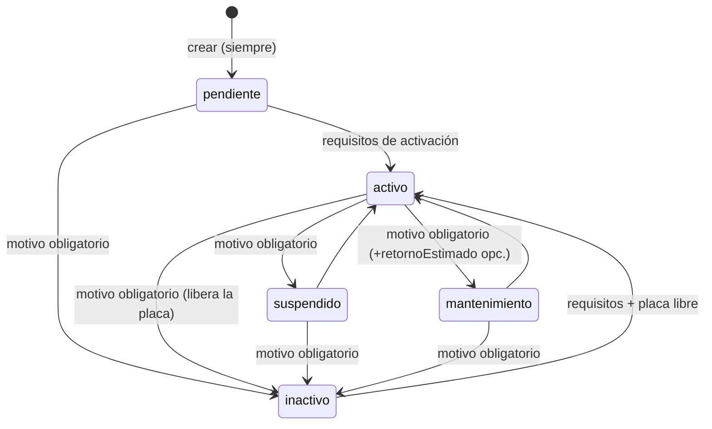
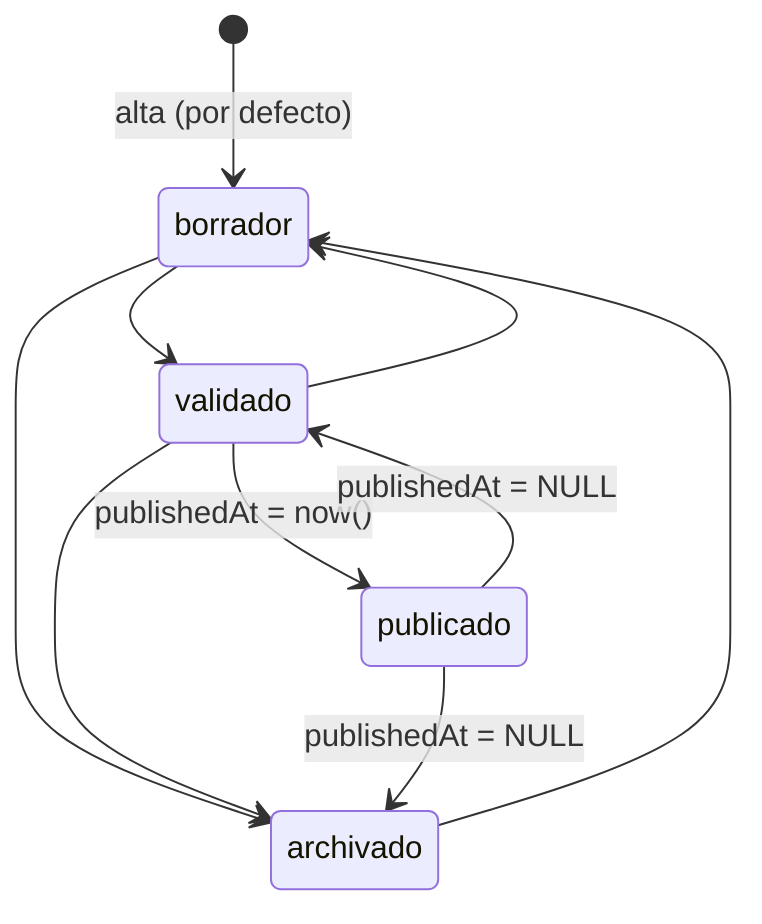
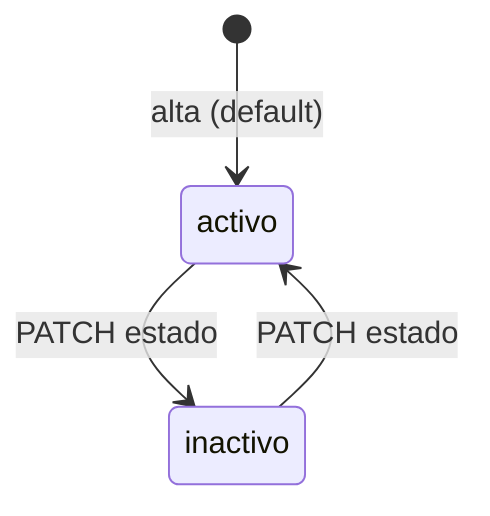

# SRS §2 — Catálogo maestro y movilidad pública

Alcance: sindicatos, socios, vehículos, conductores, líneas, rutas/variantes/paradas, puntos de control, media de líneas, publicación pública, `/v1/public/mobility`, ciudades, identidad Bolivia.
> Parte del [SRS](README.md). Reconstruido desde el código de `main@64125f7` el 2026-10-10 (sin el documento original de requisitos). Rutas relativas a la raíz del repo. "No encontrado" = buscado y ausente; "no verificado" = no comprobado en ejecución.

**Convenciones.** Rutas relativas a la raíz del repo. Abreviaturas de archivo: `SH` = `packages/shared/src`, `API` = `apps/api/src/modules`, `PRISMA` = `packages/db/prisma/schema.prisma`, `WEB` = `apps/web/app/(dashboard)`.
**Numeración.** `docs/documento-tecnico-cto.md` §3 sólo da rangos (RF-01..04 sindicatos, 05–09 socios, 10–14 vehículos, 15–19 conductores, 20–23 líneas, 24–33 rutas/variantes/paradas, 34–39 puntos de control). El documento original se perdió, así que **no se puede saber qué número individual correspondía a qué comportamiento**. Cada requisito lleva un ID provisional `RF-CAT-<área><nn>` y el rango del doc al que pertenece entre paréntesis. El mapeo fino RF-nn ↔ RF-CAT debe validarlo el CTO (pregunta P1).
**Estado.** `implementado` = hay código y (cuando se indica) test. `inferido-validar` = comportamiento que existe en código pero no hay doc que lo respalde, o es decisión de equipo marcada como "asunción" en comentarios.
**Test.** Se indica el archivo; `—` = no hay test que lo cubra directamente (verificado por lectura de los `it(` de cada archivo, no ejecutado).

---

## 1. Requisitos funcionales

### 1.1 Transversales al catálogo (tenant, roles, auditoría, borrado)

| ID | Enunciado | Fuente | Estado | Código | Test |
|---|---|---|---|---|---|
| RF-CAT-T01 (RF-01..39) | El sistema debe aislar los datos por sindicato: un actor `admin_sindicato`/`operador` sólo ve y modifica registros de su propio `sindicatoId`; `admin_quivo` (sin `sindicatoId`) ve todos. | doc técnico §4.1, RNF-16 | implementado | RLS `sindicatos/socios/vehiculos/conductores/lineas`: `packages/db/prisma/migrations/20260730152500_rls_multi_tenant/migration.sql:44-91`; contexto: `packages/db/src/tenant-context.ts` (`withTenantContext`) | `packages/db/src/rls.integration.test.ts:214-271`; `API/socios/socios.service.test.ts:55`, `conductores…:44`, `lineas…:36`, `vehiculos…:74` |
| RF-CAT-T02 | El sistema debe responder 404 (nunca 403) cuando un actor pide un recurso de otro sindicato, para no revelar su existencia. | código (comentario) | implementado | `API/../common/geo/tenant-checks.ts:11-32` (`asegurarLineaVisible`, `asegurarRutaVisible`) | `rutas.service.test.ts:83`, `paradas…:92`, `variantes…:78`, `control-points…:91`, `socios…:55` |
| RF-CAT-T03 | El sistema debe tomar el `sindicatoId` de las altas desde el token del actor si éste tiene tenant, ignorando el `sindicatoId` del body; `admin_quivo` debe enviarlo. | código | implementado | `API/socios/socios.service.ts:76-84`, `conductores/conductores.service.ts:79-87`, `vehiculos/vehiculos.service.ts:333-341`, `lineas/lineas.service.ts:79-87` | `socios…:44,87`, `conductores…:44`, `vehiculos…:74` |
| RF-CAT-T04 | El sistema debe restringir las operaciones de catálogo a los roles `admin_quivo`, `admin_sindicato` y `operador` (sindicatos: sólo `admin_quivo`). | doc técnico §5 | implementado | `API/sindicatos/sindicatos.controller.ts:23`; `socios.controller.ts:24`; `conductores.controller.ts:22`; `vehiculos.controller.ts:26`; `lineas.controller.ts:22`; `rutas/*.controller.ts` (`ROLES_*`); `control-points.controller.ts:19` | — (no hay test de guards por rol en estos módulos) |
| RF-CAT-T05 | El sistema debe registrar en `audit_log` cada alta/edición de sindicato, socio, vehículo, conductor, línea, ruta, variante, parada, punto de control y cambio de publicación. | doc técnico §9, RF-81..84 | parcial | `@Auditable(...)` en cada controller (p. ej. `vehiculos.controller.ts:51,57,67`, `mobility-publication.controller.ts:21`). **No** auditado: `POST /media/lineas/logo` (`media.controller.ts:32-34`). | `common/audit/audit.interceptor.test.ts` (interceptor genérico) |
| RF-CAT-T06 | El sistema no debe ofrecer borrado físico de ninguna entidad del catálogo; la baja es lógica vía `estado`. | código (comentarios `estados.ts:44-49`, schema) | implementado | no existe `@Delete` en los módulos del dominio (grep); `SH/enums/estados.ts:44-55`; `PRISMA:380,404,362` | — |
| RF-CAT-T07 | El sistema debe omitir de los listados de vehículos las filas que no pasen `VehiculoSchema` (datos corruptos) y dejar rastro en el log, en vez de fallar todo el listado. | QUI-366 (comentario) | implementado | `API/vehiculos/vehiculos.service.ts:53` (`mapearTolerante`) | `vehiculos…:257-342` |

### 1.2 Sindicatos (RF-01..04)

| ID | Enunciado | Fuente | Estado | Código | Test |
|---|---|---|---|---|---|
| RF-CAT-S01 (RF-01..04) | El sistema debe permitir a `admin_quivo` crear un sindicato con `nombre` (1–200 caracteres) y `estado` (`activo` por defecto). | doc técnico §4.2 | implementado | `SH/entities/sindicato.ts:5-13`; `API/sindicatos/sindicatos.service.ts:34-37`; controller `:36-43` | `sindicatos…:26` |
| RF-CAT-S02 (RF-01..04) | El sistema debe permitir listar (orden alfabético por nombre) y consultar un sindicato por id; id inexistente → 404. | doc técnico §8 | implementado | `sindicatos.service.ts:17-32` | `sindicatos…:35,54` |
| RF-CAT-S03 (RF-01..04) | El sistema debe permitir editar `nombre` y/o `estado` de un sindicato (PATCH parcial); id inexistente → 404. | doc técnico §8 | implementado | `SH/entities/sindicato.ts:17`; `sindicatos.service.ts:39-48` | `sindicatos…:46,58` |
| RF-CAT-S04 (RF-01..04) | El sistema debe permitir activar/desactivar un sindicato (`estado` `activo`/`inactivo`), sin borrarlo. | doc técnico §4.2 | parcial — el valor se guarda pero **ningún flujo lo consulta** (login móvil, rotaciones, publicación pública y alta de entidades no filtran por `sindicato.estado`; grep sin resultados). | `SH/enums/estados.ts:5` | `sindicatos…:46` (sólo persistencia) |
| RF-CAT-S05 | El sistema no debe permitir que un `admin_sindicato` cree o edite sindicatos (el sindicato es el tenant). | código (comentario) | implementado | `sindicatos.controller.ts:20-23`; RLS `WITH CHECK admin_quivo` `20260730152500…:46-50`; web: ítem de menú sólo para `admin_quivo` `apps/web/src/lib/nav-items.ts:34-37` | — |

### 1.3 Socios (RF-05..09)

| ID | Enunciado | Fuente | Estado | Código | Test |
|---|---|---|---|---|---|
| RF-CAT-SOC01 (RF-05..09) | El sistema debe crear un socio con `nombre` (NombrePersona), `documentoIdentidad` (CI boliviano normalizado), `sindicatoId` y `estado` (`activo` por defecto). | doc técnico §4.2 | implementado | `SH/entities/socio.ts:15-20`; `API/socios/socios.service.ts:41-51` | `socios…:44` |
| RF-CAT-SOC02 (RF-05..09) | El sistema debe garantizar un único socio por CI dentro de un mismo sindicato (409 «Ya existe un socio con ese CI en este sindicato»). El mismo CI puede existir en sindicatos distintos. | `20260802224500_ci_unico_por_sindicato` | implementado | `PRISMA:151`; migración `packages/db/prisma/migrations/20260802224500_ci_unico_por_sindicato/migration.sql:1-9`; `socios.service.ts:86-91` | `socios…:111` |
| RF-CAT-SOC03 (RF-05..09) | El sistema debe listar socios del tenant (orden por nombre), consultar por id (404 si no existe/ajeno) y editar `nombre`, `documentoIdentidad`, `estado` (PATCH parcial). | doc técnico §8 | implementado | `socios.service.ts:21-39,53-66`; `SH/entities/socio.ts:24` | `socios…:55,68,98` |
| RF-CAT-SOC04 (RF-05..09) | El sistema no debe permitir cambiar el `sindicatoId` de un socio por PATCH (mover socio entre sindicatos queda fuera de alcance). | código (comentario `socio.ts:22-23`) | implementado | `SH/entities/socio.ts:24` (`omit({sindicatoId})`) | `socios…:98` |
| RF-CAT-SOC05 (RF-05..09) | El sistema debe permitir activar/desactivar un socio (`activo`/`inactivo`). Efecto implementado: un socio `inactivo` no puede asignarse como propietario de un vehículo. No hay efecto en cascada sobre los vehículos que ya lo tienen. | inferido | inferido-validar | `SH/enums/estados.ts:17`; `API/vehiculos/vehiculos.service.ts:349-369` | — |

### 1.4 Vehículos (RF-10..14) — ver también `docs/plan-evolucion-vehiculo.md`, `docs/plan-unicidad-placa.md`

| ID | Enunciado | Fuente | Estado | Código | Test |
|---|---|---|---|---|---|
| RF-CAT-VEH01 (RF-10..14) | El sistema debe crear un vehículo siempre en estado `pendiente`, con `placa`, `tipo`, `marca`, `modelo`, `color`, `colorSecundario` (nullable), `capacidad` (entero 1–200) y `socioId` (nullable), y registrar la primera fila de historial (`estadoDesde=null → pendiente`). | plan-evolucion-vehiculo («estado inicial `pendiente`») | implementado | `SH/entities/vehiculo.ts:179-214`; `API/vehiculos/vehiculos.service.ts:112-154` | `vehiculos…:95,239`; `SH/entities/vehiculo.test.ts:26` |
| RF-CAT-VEH02 (RF-10..14) | El sistema debe validar la placa con formato PTA actual: 3 o 4 dígitos + 3 letras (`/^\d{3,4}[A-Z]{3}$/` sobre la placa normalizada), aceptando al capturar sólo `[A-Za-z0-9 -]`, máx. 20 caracteres, y rechazar con mensaje específico el formato anterior `ABC123`. | plan-evolucion-vehiculo («regla oficial… pendiente») | implementado (formato decidido por el equipo; plan lo marca como decisión pendiente) | `SH/entities/vehiculo.ts:40-67` | `vehiculo.test.ts:22,30,50`; `vehiculos…:251` |
| RF-CAT-VEH03 (RF-10..14) | El sistema debe guardar la placa en mayúsculas y sin espacios en los extremos (`trim().toUpperCase()`), conservando espacios/guiones internos, y derivar la `placaNormalizada` (`[^A-Z0-9]` eliminados) en la base como columna `GENERATED ALWAYS … STORED`, NOT NULL; ningún cliente puede escribirla. | plan-unicidad-placa | implementado | `API/vehiculos/vehiculos.service.ts:371-378`; `PRISMA:173`; migración `packages/db/prisma/migrations/20260908151800_unicidad_placa_generada/`; `SH/entities/vehiculo.ts:290-292` | `packages/db/src/vehiculo-placa-unicidad.test.ts:125` (escritura manual → P2039) |
| RF-CAT-VEH04 (RF-10..14) | El sistema debe garantizar que no existan dos vehículos **vigentes** (`estado <> 'inactivo'`) con la misma `placaNormalizada`, aun en sindicatos distintos (índice único parcial `vehiculos_placa_norm_vigente_key`). | plan-unicidad-placa «Decisión» | implementado | `PRISMA:173`; `API/vehiculos/vehiculos.service.ts:384-400,142-153` | `vehiculo-placa-unicidad.test.ts:54,149`; `vehiculos…:152` |
| RF-CAT-VEH05 (RF-10..14) | El sistema debe permitir que un vehículo `inactivo` libere su placa para que otro (incluso de otro sindicato) la registre, y permitir reingreso de la misma placa al mismo sindicato tras la baja. | plan-unicidad-placa «migración» | implementado | `vehiculos.service.ts:66-110` (`estado: { not: 'inactivo' }` en `verificarPlaca`); `PRISMA:197-204` (comentario: no hay `@@unique([sindicatoId,placaNormalizada])`) | `vehiculo-placa-unicidad.test.ts:70,97` |
| RF-CAT-VEH06 (RF-10..14) | El sistema debe ofrecer una verificación previa de disponibilidad de placa (`GET /vehiculos/verificar-placa?placa=`) que devuelva `disponible` y, si hay conflicto, el vehículo/sindicato que la tiene; valida el formato (400 si inválida). | plan-unicidad-placa | implementado | `vehiculos.controller.ts:35-38`; `vehiculos.service.ts:66-110` | `vehiculos…:251`; `vehiculos…:152` |
| RF-CAT-VEH07 (RF-10..14) | El sistema debe responder 409 con instrucción accionable (dar de baja el vehículo que la tiene) si la placa está vigente en otro vehículo, al crear o editar placa. | plan-unicidad-placa | implementado | `vehiculos.service.ts:143-151,189-192,396-398` | `vehiculos…:152` |
| RF-CAT-VEH08 (RF-10..14) | Al reactivar (`→ activo`) un vehículo cuya placa fue tomada mientras estaba de baja, el sistema debe responder 409 distinguiendo si el bloqueante es del mismo sindicato (instruye dar de baja ese vehículo, con su id) o de otro (instruye contactar a QUIVO). | addendum plan-unicidad (riesgo 6) | implementado | `vehiculos.service.ts:246-274` | `vehiculos…:168,206` |
| RF-CAT-VEH09 (RF-10..14) | El sistema debe validar el tipo contra el catálogo cerrado `taxi_trufi, trufi, minibus, micro, bus_urbano, omnibus, otro`; el tipo `otro` («Otro autorizado») sólo lo puede asignar `admin_quivo` (400 para otros roles, en alta y en edición). | plan-evolucion-vehiculo | implementado | `SH/entities/vehiculo.ts:5-13`; `vehiculos.service.ts:343-347,114,161` | — |
| RF-CAT-VEH10 (RF-10..14) | El sistema debe validar `marca` (2–50, `[\p{L}\p{N} .&-]`), `modelo` (1–50, `[\p{L}\p{N} .\-/]`) y colores contra el catálogo de 15 colores; `marca`/`modelo` se persisten con espacios colapsados. | plan-evolucion-vehiculo | implementado | `SH/entities/vehiculo.ts:16-32,69-81`; `vehiculos.service.ts:371-382` | `vehiculo.test.ts:56` |
| RF-CAT-VEH11 (RF-10..14) | El sistema debe validar la capacidad como entero entre 1 y 200; la advertencia por rango referencial según tipo es sólo orientativa y vive en la UI (no bloquea). | plan-evolucion-vehiculo («advertencia orientativa») | implementado | API: `SH/entities/vehiculo.ts:193-197`; rangos: `SH/entities/vehiculo.ts:86-142`; advertencia UI: `WEB/vehiculos/vehicle-form-panel.tsx:192-199,1046-1051` | — |
| RF-CAT-VEH12 (RF-10..14) | El sistema debe permitir asociar un socio propietario sólo si el socio existe, está `activo` y pertenece al mismo sindicato del vehículo (400 en otro caso). | plan-evolucion-vehiculo | implementado | `vehiculos.service.ts:349-369,119,173` | — |
| RF-CAT-VEH13 (RF-10..14) | El sistema debe aceptar los atributos opcionales `numeroInterno` (≤30), `distintivo` (≤80), `cartelSuperior` (≤120); cadena vacía se convierte en `null`. | código (el plan los ubica como «siguiente incremento» y propone `numeroInterno` en la asignación) | inferido-validar | `SH/entities/vehiculo.ts:83-84,190-192`; `PRISMA` modelo Vehiculo (`numeroInterno, distintivo, cartelSuperior`) | — |
| RF-CAT-VEH14 (RF-10..14) | El sistema debe permitir editar (PATCH) los datos del vehículo sin tocar `sindicatoId`, `placaNormalizada` ni `estado`; si el vehículo está `activo`, la edición no puede dejarlo sin socio/tipo/marca/modelo/color/capacidad válidos. | plan-evolucion-vehiculo | implementado | `SH/entities/vehiculo.ts:217-224`; `vehiculos.service.ts:156-195,177-179` | `vehiculos…:140` |
| RF-CAT-VEH15 (RF-10..14) | El sistema debe cambiar el estado del vehículo sólo por `PATCH /vehiculos/:id/estado`, aceptando como destino `activo, inactivo, suspendido, mantenimiento` (nunca `pendiente`), según la tabla de transiciones de §3.1 (400 «Transición de estado inválida» si no está permitida). | plan-evolucion-vehiculo | implementado | `SH/entities/vehiculo.ts:226-252`; `vehiculos.service.ts:29-35,197-216,297-301`; `vehiculos.controller.ts:56-64` | `vehiculos…:95,109` |
| RF-CAT-VEH16 (RF-10..14) | El sistema debe exigir `motivo` (≤200) cuando el destino es `inactivo`, `suspendido` o `mantenimiento`; `observacion` (≤500) y `retornoEstimado` (ISO datetime) son opcionales. | plan-evolucion-vehiculo | implementado | `SH/entities/vehiculo.ts:226-251` | `vehiculos…:239` (historial) |
| RF-CAT-VEH17 (RF-10..14) | El sistema debe exigir, para activar un vehículo, socio propietario, tipo, marca, modelo, color y capacidad válidos (400 «No se puede activar el vehículo. Revisa: …»). Aplica también al reactivar desde `inactivo`. | plan-evolucion-vehiculo («activación validada») | implementado | `vehiculos.service.ts:219-221,307-327` | `vehiculos…:128` |
| RF-CAT-VEH18 (RF-10..14) | El sistema debe registrar en `historial_estados_vehiculo` cada cambio de estado efectivo (estado desde/hasta, motivo, observación, retorno estimado, actor, origen, fecha) y exponerlo ordenado de más reciente a más antiguo en `GET /vehiculos/:id/historial-estados`. Un cambio al mismo estado no genera fila. | plan-evolucion-vehiculo («historial de estados») | implementado | `vehiculos.service.ts:216-218,231-242,279-294`; `PRISMA:215-233` | `vehiculos…:239` |
| RF-CAT-VEH19 (RF-10..14) | El sistema debe permitir filtrar/buscar vehículos en el panel por texto (placa, marca, modelo, número interno, distintivo, cartel, socio), sindicato, línea, estado y tipo. El filtrado es en cliente sobre la lista completa; no hay paginación servidor. | plan-evolucion-vehiculo («filtros básicos por tipo y estado») | implementado | `WEB/vehiculos/page.tsx:75-106` | — |
| RF-CAT-VEH20 | El sistema debe normalizar la placa en la UI a mayúsculas alfanuméricas de máx. 7 caracteres y verificar disponibilidad al salir del campo. | código | implementado | `WEB/vehiculos/vehicle-form-panel.tsx:313-317,320-346` | — |
| RF-CAT-VEH21 | El sistema debe exigir en la UI que el color secundario sea distinto del principal. **No se aplica en la API.** | código | parcial (sólo cliente) | `WEB/vehiculos/vehicle-form-panel.tsx:282-286`; ausente en `SH/entities/vehiculo.ts` | — |
| RF-CAT-VEH22 | El sistema debe omitir de las respuestas el `credencialHash` del vehículo (credencial de login móvil; emisión de PIN pertenece al dominio auth-móvil). | código | implementado | `vehiculos.service.ts:406-429` | — |

### 1.5 Conductores (RF-15..19)

| ID | Enunciado | Fuente | Estado | Código | Test |
|---|---|---|---|---|---|
| RF-CAT-CON01 (RF-15..19) | El sistema debe crear un conductor con `nombre`, `documentoIdentidad` (CI), `licenciaConducir`, `sindicatoId` y `estado` (`activo` por defecto). Sin FK fija a vehículo: un conductor rota entre vehículos. | doc técnico §15.3 | implementado | `SH/entities/conductor.ts:20-25`; `API/conductores/conductores.service.ts:43-53` | `conductores…:44` |
| RF-CAT-CON02 (RF-15..19) | El sistema debe garantizar un único conductor por CI dentro de un mismo sindicato (409). Una persona puede ser socio y conductor a la vez. | migración 20260802224500 | implementado | `PRISMA:253`; `conductores.service.ts:89-94` | `conductores…:91` |
| RF-CAT-CON03 (RF-15..19) | El sistema debe listar (orden por nombre), consultar (404) y editar (PATCH parcial: nombre, CI, licencia, estado) conductores del tenant. | doc técnico §8 | implementado | `conductores.service.ts:23-72`; `SH/entities/conductor.ts:28` | `conductores…:66,71,85` |
| RF-CAT-CON04 (RF-15..19) | El sistema debe validar `licenciaConducir`: 4–50 caracteres, normalizada a mayúsculas con espacios colapsados, regex `^[A-Z0-9][A-Z0-9 ./-]*$`. | código | implementado | `SH/identidad-bolivia.ts:73-85` | `SH/identidad-bolivia.test.ts:32` |
| RF-CAT-CON05 (RF-15..19) | El sistema debe permitir activar/desactivar un conductor; sólo conductores `activo` son elegibles en rotaciones y en el login móvil. | doc técnico §4.2 | implementado | `SH/enums/estados.ts:20`; consumo: `API/rotaciones/rotaciones.service.ts:45`, `API/auth-movil/auth-movil.service.ts:807` | `conductores…:71` (persistencia) |
| RF-CAT-CON06 | El sistema debe ofuscar la credencial (PIN) del conductor: sólo se guarda hash; la gestión del PIN (establecer/generar) está en `PUT/POST /mobile/credenciales/conductores/:id` (dominio auth-móvil, no en este módulo). | PRISMA comentario | implementado (fuera de dominio) | `PRISMA:240-243`; `API/auth-movil/credenciales-moviles.controller.ts:12-50` | — |

### 1.6 Líneas (RF-20..23) y media

| ID | Enunciado | Fuente | Estado | Código | Test |
|---|---|---|---|---|---|
| RF-CAT-LIN01 (RF-20..23) | El sistema debe crear una línea con `codigo` (1–20), `nombre` (1–200), `sindicatoId` y `cityId` (por defecto `cochabamba`), más branding opcional (ver LIN04). | doc técnico §4.2 | implementado | `SH/entities/linea.ts:42-47,74-121`; `API/lineas/lineas.service.ts:36-48` | `lineas…:44,65` |
| RF-CAT-LIN02 (RF-20..23) | El sistema debe garantizar un único `codigo` por sindicato (409 «Ya existe una línea con el código "X" en este sindicato»); el mismo código puede repetirse entre sindicatos. | código | implementado | `PRISMA:322`; `lineas.service.ts:91-96` | `lineas…:44,51` |
| RF-CAT-LIN03 (RF-20..23) | El sistema debe rechazar con 400 una línea cuyo `cityId` no exista en `mobility_cities`, en alta y en edición. | código | implementado | `lineas.service.ts:41,57,67-73` | `lineas…:65` (sólo caso feliz) |
| RF-CAT-LIN04 (RF-20..23) | El sistema debe validar el branding: colores hex `#RRGGBB` (`colorSecundario, colorTexto, colorTerciario, colorFondo, cartelColor*`; `''` → null), `color` principal texto libre ≤30 (no hex), `nombreCorto` ≤40, `lema` ≤160, `descripcion` ≤1000, `logoUrl` URL ≤500, `distintivoTipo` ∈ {banderita, cartel, numero, texto, simbolo}, `distintivoValor` ≤80, `cartelSuperior` ≤120, `cartelFormato` ∈ {doble_clasico, simple, tres_lineas}, `cartelTitulo` ≤60, `cartelDetalle` ≤80, posiciones de número ∈ {izquierda, derecha} y de logo ∈ {ninguno, izquierda, derecha}. | plan marca de línea | implementado | `SH/entities/linea.ts:5-71` | `lineas…:58` (sólo nombre/color) |
| RF-CAT-LIN05 (RF-20..23) | El sistema debe resolver la marca visual efectiva de una línea con valores por defecto (primario `#3226B4`, secundario `#FD9E15`, terciario `#0F766E`, fondo `#F8FAFC`, texto `#FFFFFF`; `shortName` ← nombreCorto/codigo/nombre; `markerType` ← `numero`). | código | implementado | `SH/entities/linea.ts:132-193` | — |
| RF-CAT-LIN06 (RF-20..23) | El sistema debe listar (orden por código), consultar (404) y editar (PATCH parcial; no permite cambiar `sindicatoId` ni `publicStatus`/`publishedAt`) líneas del tenant. | doc técnico §8 | implementado | `lineas.service.ts:16-64`; `SH/entities/linea.ts:124-130` | `lineas…:58` |
| RF-CAT-LIN07 (RF-20..23) | El sistema debe permitir dar de baja una línea. **No hay `estado` operativo en `Linea`**: sólo existe `publicStatus` (`archivado`), que no afecta rotaciones/asignaciones. La UI describe «Archivado» como «deja de operar», lo cual no es cierto en backend. | doc técnico §4.2 (`lineas(id, …)` sin estado) | pendiente (gap) | `PRISMA:286-330`; texto UI `WEB/lineas/linea-state-modal.tsx:27-30` | — |
| RF-CAT-MED01 | El sistema debe permitir a `admin_quivo`/`admin_sindicato`/`operador` subir el logo de una línea como data-URI base64 (`image/png`, `image/jpeg`, `image/webp`), máx. 2 MB, verificando que el prefijo coincida con el `mimeType` y la firma binaria (magic bytes); devuelve una URL pública `/v1/media/lineas/<uuid>.<ext>`. | código | implementado | `API/media/media.controller.ts:12-17,32-44`; `media.service.ts:7-38,54-64` | — (no hay test de media) |
| RF-CAT-MED02 | El sistema debe servir los logos sin autenticación con `Cache-Control: public, max-age=86400`, validando el nombre de archivo (`/^[a-z0-9][a-z0-9-]*\.(png\|jpe?g\|webp)$/i`) para evitar path traversal. | código | implementado | `media.controller.ts:22-29`; `media.service.ts:40-51` | — |
| RF-CAT-MED03 | El sistema debe almacenar los logos en el sistema de archivos local del proceso API (`apps/api/media/lineas/`). | código | implementado — **riesgo**: en Cloud Run el disco es efímero (ver §5) | `media.service.ts:18-20` | — |

### 1.7 Rutas, variantes y paradas (RF-24..33)

| ID | Enunciado | Fuente | Estado | Código | Test |
|---|---|---|---|---|---|
| RF-CAT-RUT01 (RF-24..33) | El sistema debe crear una ruta bajo una línea (`POST /lineas/:lineaId/rutas`) con `sentido` (1–50; la UI ofrece `ida`/`vuelta`), `geometria` GeoJSON `LineString` (≥2 coordenadas `[lon,lat]`, lon∈[-180,180], lat∈[-90,90]) y `estado` (`activo` por defecto). | doc técnico §4.2 | implementado | `SH/entities/ruta.ts:10-30`; `SH/geo.ts:3-16`; `API/rutas/rutas.service.ts:53-70`; UI `WEB/rutas/page.tsx:58-61` | `rutas…:56` |
| RF-CAT-RUT02 (RF-24..33) | El sistema debe rechazar con 400 una geometría que PostGIS considere inválida (`ST_IsValid`). | código | implementado | `rutas.service.ts:111-118` | `rutas…:72` |
| RF-CAT-RUT03 (RF-24..33) | El sistema debe listar las rutas de una línea (orden de creación), consultar una ruta y editar `sentido`, `geometria`, `estado`; la ruta no cambia de línea. | doc técnico §8 | implementado | `rutas.service.ts:34-96`; `SH/entities/ruta.ts:32-37` | `rutas…:93,99` |
| RF-CAT-RUT04 (RF-24..33) | Al editar la geometría de una ruta, el sistema debe rechazar con 400 si alguna **parada** queda a más de 100 m de la nueva geometría. **No revalida los puntos de control.** | código | parcial | `rutas.service.ts:77-80,120-142`; `common/geo/proximidad-ruta.ts:9` | `rutas…:113` |
| RF-CAT-RUT05 (RF-24..33) | El sistema debe permitir invertir una ruta en la UI (borrador de sentido contrario copiando paradas y/o puntos de control en orden inverso con `origen`↔`destino` intercambiados) y guardarla como una ruta nueva. | código | implementado (sólo web) | `WEB/rutas/route-utils.ts:70-90`; `use-rutas-data.ts:186-230`; `rutas/page.tsx:142-149` | `WEB/rutas/route-utils.test.ts` |
| RF-CAT-VAR01 (RF-24..33) | El sistema debe crear, listar (orden por nombre), consultar y editar variantes de una ruta: una variante es sólo una etiqueta (`nombre` 1–200, `estado` `activo`/`inactivo`), sin geometría propia. | doc técnico §4.2 («variantes(id, ruta_id, …)») | implementado | `SH/entities/variante.ts:7-21`; `API/rutas/variantes.service.ts` (todo) | `variantes…:70-95` |
| RF-CAT-PAR01 (RF-24..33) | El sistema debe crear paradas bajo una ruta con `tipo` ∈ {origen, intermedia, destino}, `orden` (entero ≥0), `coord` GeoJSON `Point`, `nombre` opcional (1–200), `referencia` opcional (≤500) y `estado` (`activo`). | doc técnico §4.2 | implementado | `SH/entities/parada.ts:15-40`; `API/rutas/paradas.service.ts:46-62` | `paradas…:70` |
| RF-CAT-PAR02 (RF-24..33) | El sistema debe rechazar con 400 una parada (alta o cambio de `coord`) a más de 100 m de la geometría de su ruta (`ST_DWithin`). | decisión de equipo marcada como asunción (`proximidad-ruta.ts:5-8`); el CTO indicó ≤100 m | implementado | `common/geo/proximidad-ruta.ts:9-29`; `paradas.service.ts:48,66-70` | `paradas…:81` |
| RF-CAT-PAR03 (RF-24..33) | El sistema debe listar paradas de una ruta ordenadas por `orden`, consultar y editar (`tipo, orden, nombre, referencia, coord, estado`). No hay unicidad de `orden` ni de `tipo=origen/destino` por ruta. | doc técnico §8 | implementado | `paradas.service.ts:28-96`; `SH/entities/parada.ts:42-47`; `PRISMA:375-395` | `paradas…:103,115` |
| RF-CAT-PAR04 (RF-24..33) | El sistema debe dar de baja paradas, variantes y puntos de control sólo por `estado=inactivo` (nunca DELETE), porque `cumplimientos_pc.puntoControlId` referencia sin FK. | `estados.ts:44-49`, PRISMA | implementado | `SH/enums/estados.ts:44-55`; UI `WEB/rutas/use-rutas-data.ts:442-488` | `route-utils.test.ts` (no cubre baja) |
| RF-CAT-PAR05 | El sistema debe exigir en la UI al menos una parada activa antes de avanzar la publicación de un recorrido. **No se aplica en la API.** | código | parcial (sólo cliente) | `WEB/rutas/use-rutas-data.ts:494-503` | — |

### 1.8 Puntos de control (RF-34..39)

| ID | Enunciado | Fuente | Estado | Código | Test |
|---|---|---|---|---|---|
| RF-CAT-PCT01 (RF-34..39) | El sistema debe crear puntos de control bajo una ruta con `orden` (entero ≥0), `coord` GeoJSON `Point`, `radioToleranciaM` (entero >0, sin tope superior), `obligatorio` (por defecto `true`) y `estado` (`activo`). | doc técnico §4.2 | implementado | `SH/entities/punto-control.ts:10-30`; `API/control-points/control-points.service.ts:52-68` | `control-points…:66` |
| RF-CAT-PCT02 (RF-34..39) | El sistema debe rechazar con 400 un punto de control (alta o cambio de `coord`) a más de 100 m de la geometría de su ruta. | decisión CTO / asunción de equipo | implementado | `proximidad-ruta.ts:9-29`; `control-points.service.ts:55,79-80` | `control-points…:79` |
| RF-CAT-PCT03 (RF-34..39) | El sistema debe listar (orden por `orden`), consultar y editar puntos de control (`orden, coord, radioToleranciaM, obligatorio, estado`). No hay unicidad de `orden` por ruta. | doc técnico §8 | implementado | `control-points.service.ts:33-107`; `SH/entities/punto-control.ts:32` | `control-points…:103,109` |
| RF-CAT-PCT04 (RF-34..39) | El sistema debe proveer a la UI un radio de tolerancia por defecto de 30 m al dibujar un punto de control; el valor operativo cargado en producción es 150 m. | código | inferido-validar | UI `WEB/rutas/use-route-drawing.ts:33`; producción `SH/entities/punto-control.ts:51-59` (`RADIO_AVISO_M=150`, menciona `scripts/data/z12-circuito/puntos-control.json`) | — |
| RF-CAT-PCT05 (RF-34..39) | El sistema debe usar el radio de tolerancia como criterio de detección de cumplimiento (RF-39); el aviso de aproximación al chofer usa `RADIO_AVISO_M = 150 m` y la confirmación de paso `RADIO_CONFIRMACION_M = 40 m` (provisional, sin validar con datos reales). | doc técnico §6, §2 | implementado (lógica en móvil/worker, fuera del dominio de este módulo) | `SH/entities/punto-control.ts:59,74` | `apps/mobile/src/gps/geofence.ts` (fuera de dominio) |

### 1.9 Publicación pública y `/v1/public/mobility` (ADR 0002)

| ID | Enunciado | Fuente | Estado | Código | Test |
|---|---|---|---|---|---|
| RF-CAT-PUB01 | El sistema debe mantener un estado editorial `publicStatus` ∈ {borrador, validado, publicado, archivado} en líneas, rutas, variantes y paradas, independiente del `estado` operativo; todo recurso nuevo (y los existentes en la migración) nace en `borrador`. | ADR 0002 | implementado | `SH/public-mobility.ts:6`; `PRISMA:316,342,364,383`; migración `20260817163000_public_mobility_publication` | `public-mobility.service.test.ts:146` (indirecto) |
| RF-CAT-PUB02 | El sistema debe cambiar el `publicStatus` únicamente por `PATCH /v1/mobility-publications/:resource/:id` (`resource` ∈ lineas, rutas, variantes, paradas) con body `{status}`, según el diagrama de §3.2; transición no permitida o al mismo estado → 400. | ADR 0002 | implementado | `API/public-mobility/mobility-publication.service.ts:8-49`; controller `mobility-publication.controller.ts:16-30` | uso en setup de `public-mobility.service.test.ts:35-45`; **sin test propio de transiciones** |
| RF-CAT-PUB03 | El sistema debe fijar `publishedAt = now()` al pasar a `publicado` y `NULL` en cualquier otro estado. | código | implementado | `mobility-publication.service.ts:91-116` | — |
| RF-CAT-PUB04 | El sistema debe restringir el cambio de publicación a `admin_quivo`, `admin_sindicato` y `operador`, resolviendo el tenant a través de la línea (recursos ajenos → 404) y auditándolo como `movilidad_publica/publicar`. | ADR 0002 («autenticada») | implementado | `mobility-publication.controller.ts:16,21`; `mobility-publication.service.ts:52-82` | — |
| RF-CAT-PUB05 | El sistema debe aplicar la jerarquía de publicación en la UI: «Avanzar publicación» de un recorrido mueve ruta, línea y paradas activas juntas, exigiendo que línea y paradas estén en el mismo estado que la ruta (o ya en el destino). El backend **no** valida coherencia padre/hijo. | código | parcial (regla sólo cliente) | `WEB/rutas/use-rutas-data.ts:28-33,494-550` | — |
| RF-CAT-PUB06 | El sistema no debe exponer la publicación de variantes en la UI (no hay llamada a `mobilityPublicationsApi.actualizar(..,'variantes',..)` en el web). | grep | pendiente (gap) | `apps/web/src/lib/api/mobility-publications.ts`; usos sólo en `lineas/*` y `rutas/use-rutas-data.ts:529-538` | — |
| RF-CAT-MOV01 | El sistema debe exponer, sin autenticación, `GET /v1/public/mobility/lines` con las líneas `publicado` y su árbol (rutas → variantes, paradas), proyectado explícitamente por `PublicLineDetailSchema`. | ADR 0002 | implementado | `API/public-mobility/public-mobility.controller.ts:34-41`; `public-mobility.service.ts:118-146`; `SH/public-mobility.ts:33-82` | `public-mobility.service.test.ts:146`; `public-mobility.controller.test.ts:6` |
| RF-CAT-MOV02 | El sistema debe filtrar por estado en los cuatro niveles: línea `publicStatus='publicado'`; ruta `publicado` y `estado='activo'`; variante `publicado` y `activo`; parada `publicado`, `activo` y `nombre IS NOT NULL`; y que línea/ruta padre también estén publicadas. | ADR 0002 | implementado | `public-mobility.service.ts:157-190,321-354` (nombre: `:351`) | `public-mobility.service.test.ts:146` |
| RF-CAT-MOV03 | El sistema debe aceptar los filtros `cityId` (formato slug `^[a-z0-9]+(-[a-z0-9]+)*$`, ≤80), `since` (fecha), `limit` (entero ≥1, por defecto 100, tope 500 sin rechazar) y `afterId` (uuid) para sincronización incremental paginada por cursor `(effectiveUpdatedAt, id)`. | ADR 0002 | implementado | `public-mobility.controller.ts:12-17`; `public-mobility.service.ts:11-12,217-225,416-428` | `public-mobility.service.test.ts:159,233,435,446-477` |
| RF-CAT-MOV04 | El sistema debe calcular `updatedAt` público de una línea como el máximo entre su `updatedAt` y el de sus rutas/variantes/paradas publicadas y activas, de modo que un cambio sólo en una parada mueva el cursor. | código | implementado | `public-mobility.service.ts:157-190` | `public-mobility.service.test.ts:159` |
| RF-CAT-MOV05 | El sistema debe rechazar con 400 un `afterId` que no corresponda a una línea pública visible. | código | implementado | `public-mobility.service.ts:123-128` | `public-mobility.service.test.ts:435` |
| RF-CAT-MOV06 | El sistema debe limitar el endpoint a 120 req/min por cliente y servirlo con `Cache-Control: public, max-age=300, stale-while-revalidate=3600`. | código | implementado | `public-mobility.controller.ts:39-40` | — |
| RF-CAT-MOV07 | El sistema no debe informar bajas (sin tombstones): una línea despublicada simplemente deja de aparecer; el consumidor debe reconciliar con descarga completa periódica. | docstring del servicio | implementado (limitación documentada) | `public-mobility.service.ts:85-89` | — |
| RF-CAT-MOV08 | El sistema debe exponer en la línea pública: ciudad (`cityId`, `cityName`, `departmentCode/Name`), operador (`{id, name}` del sindicato), código, nombre, descripción y branding reducido (`primaryColor, secondaryColor, textColor, logoUrl, shortName, tagline, markerType, markerValue, roofSign`). No expone `colorTerciario`, `colorFondo`, `cartel*` salvo `roofSign`. | ADR 0002 | implementado | `public-mobility.service.ts:304-319`; `SH/public-mobility.ts:20-46` | `public-mobility.service.test.ts:146` |

### 1.10 Ciudades e identidad

| ID | Enunciado | Fuente | Estado | Código | Test |
|---|---|---|---|---|---|
| RF-CAT-CIU01 | El sistema debe mantener un catálogo de ciudades de cobertura en base (`mobility_cities`: id slug, nombre, departamento, `estadoCobertura` por defecto `coming_soon`, zona horaria `America/La_Paz`, fuentes, modos) con 9 filas sembradas por migración, y asociar cada línea a una ciudad (`FK ON DELETE RESTRICT`). | migración | implementado | `PRISMA:263-284`; migración `20260819100000_mobility_city_scope/migration.sql:1-37` | `lineas…:65` |
| RF-CAT-CIU02 | El sistema debe ofrecer en el panel un catálogo estático de 9 ciudades con coordenadas y zoom (`CIUDADES_BOLIVIA`), resolución por id con fallback a Cochabamba y detección de la ciudad más cercana por geolocalización del navegador. | código | implementado | `SH/ciudades-bolivia.ts:13-125`; `apps/web/src/lib/geo/use-admin-city.ts:14-60` | — |
| RF-CAT-CIU03 | El sistema debe permitir elegir la ciudad de una línea desde el panel. **No existe selector de `cityId` en el formulario de líneas**: toda línea creada desde el web queda en `cochabamba` (default de API). | grep `cityId` en `WEB/lineas` | pendiente (gap) | `WEB/lineas/` sin referencias a `cityId`; `lineas.service.ts:38` | — |
| RF-CAT-CIU04 | El sistema debe exponer `/v1/public/mobility/cities` filtrando líneas, rutas, paradas y planner por ciudad. | `docs/plan-backend-quivo-rutas.md:165-172` | descartado/no implementado — el controller sólo tiene `lines`; el comentario del controller dice que los 7 endpoints previos no vuelven | `public-mobility.controller.ts:25-33` | — |
| RF-CAT-IDB01 | El sistema debe validar el CI boliviano: `^\d{4,15}(?:-[A-Z0-9]{1,10})?(?: (LP\|CB\|SC\|OR\|PT\|TJ\|CH\|BE\|PD))?$`, 4–29 caracteres, tras normalizar (NFKC, mayúsculas, trim, `\s*-\s*`→`-`, espacios colapsados). | `identidad-bolivia.ts:50-58` | implementado | `SH/identidad-bolivia.ts:5-28,59-71` | `SH/identidad-bolivia.test.ts:8-23` |
| RF-CAT-IDB02 | El sistema debe validar nombres de persona: normalizar NFC + trim + espacios colapsados, 3–200 caracteres, regex `^[\p{L}\p{M}][\p{L}\p{M} .'-]*[\p{L}\p{M}]$`. | código | implementado | `SH/identidad-bolivia.ts:17-19,36-48` | `identidad-bolivia.test.ts:25` |

---

## 2. Reglas de validación de datos por entidad

| Entidad.campo | Regla exacta | Schema de origen | ¿Se aplica en API? |
|---|---|---|---|
| Sindicato.nombre | string 1–200 | `SH/entities/sindicato.ts:7` | sí |
| Sindicato.estado | enum `activo`\|`inactivo` | `SH/enums/estados.ts:5` | sí |
| Socio.nombre (alta/edición) | `NombrePersonaSchema` (ver abajo); el schema base `SocioSchema` sólo exige 1–200 (se usa para respuesta) | `SH/entities/socio.ts:9,16` | sí |
| Socio.documentoIdentidad | `DocumentoIdentidadBoliviaSchema`; base 1–50 | `SH/entities/socio.ts:10,17` | sí; unicidad `(sindicatoId, documentoIdentidad)` |
| Socio.estado | `activo`\|`inactivo`, default `activo` | `SH/entities/socio.ts:18` | sí |
| **Socio.sindicatoId en body** | uuid **obligatorio** aun para `admin_sindicato` (se ignora). El chequeo `!sindicatoIdDelBody` del servicio es código muerto salvo cadena vacía | `SH/entities/socio.ts:7,15` / `socios.service.ts:80` | — (contrato incómodo, ver §5) |
| NombrePersona | NFC + trim + `\s+`→' ' ; min 3, max 200; `^[\p{L}\p{M}][\p{L}\p{M} .'-]*[\p{L}\p{M}]$` | `SH/identidad-bolivia.ts:36-48` | sí |
| CI (DocumentoIdentidadBolivia) | normaliza NFKC/mayúsculas/trim; min 4, max 29; `^\d{4,15}(?:-[A-Z0-9]{1,10})?(?: (?:LP\|CB\|SC\|OR\|PT\|TJ\|CH\|BE\|PD))?$` | `SH/identidad-bolivia.ts:59-71` | sí |
| Licencia de conducir | normaliza NFKC/mayúsculas/trim/espacios; min 4, max 50; `^[A-Z0-9][A-Z0-9 ./-]*$` | `SH/identidad-bolivia.ts:73-85` | sí |
| Conductor.estado | `activo`\|`inactivo`, default `activo` | `SH/entities/conductor.ts:24` | sí |
| Vehiculo.placa | trim, 1–20, `^[A-Za-z0-9 -]+$` (ASCII estricto por seguridad anti-homóglifos), normalizada debe cumplir `^\d{3,4}[A-Z]{3}$`; se persiste `trim().toUpperCase()` | `SH/entities/vehiculo.ts:40-67`; `vehiculos.service.ts:374` | sí |
| Vehiculo.placaNormalizada | `regexp_replace(upper(btrim(placa)),'[^A-Z0-9]','','g')`, generada por la base; schema de lectura 3–20 | `PRISMA:173`; `SH/entities/vehiculo.ts:184` | base (rechaza escritura: P2039) |
| Vehiculo.tipo | enum de 7 valores | `SH/entities/vehiculo.ts:5-13` | sí; `otro` sólo `admin_quivo` (`vehiculos.service.ts:343`) |
| Vehiculo.marca | trim, 2–50, `^[\p{L}\p{N} .&-]+$` | `SH/entities/vehiculo.ts:69-74` | sí; catálogo `MARCAS_VEHICULO_INICIALES` (10 marcas) es sólo sugerencia UI |
| Vehiculo.modelo | trim, 1–50, `^[\p{L}\p{N} .\-/]+$` | `SH/entities/vehiculo.ts:76-81` | sí (la UI exige ≥2, la API ≥1: `vehicle-form-panel.tsx:259`) |
| Vehiculo.color / colorSecundario | enum de 15 colores; secundario nullable | `SH/entities/vehiculo.ts:16-32,189` | color≠secundario **sólo en UI** |
| Vehiculo.capacidad | entero, >0, ≤200 | `SH/entities/vehiculo.ts:193-197` | sí |
| Vehiculo.numeroInterno / distintivo / cartelSuperior | `''`→null; string trim ≤30 / ≤80 / ≤120; opcionales | `SH/entities/vehiculo.ts:83-84,190-192` | sí |
| Vehiculo.estado (cambio) | enum sin `pendiente`; `motivo` obligatorio para inactivo/suspendido/mantenimiento (≤200); `observacion` ≤500; `retornoEstimado` ISO datetime | `SH/entities/vehiculo.ts:226-252` | sí |
| Línea.codigo / nombre | 1–20 / 1–200; `(sindicatoId, codigo)` único | `SH/entities/linea.ts:46-47`; `PRISMA:322` | sí |
| Línea.cityId | slug `^[a-z0-9]+(?:-[a-z0-9]+)*$`, 1–80; debe existir en `mobility_cities` | `SH/public-mobility.ts:11`; `lineas.service.ts:67` | sí |
| Línea.color (principal) | string ≤30 nullable, **sin formato hex** (inconsistente con los demás colores) | `SH/entities/linea.ts:48,100` | sí |
| Línea.colores restantes | `^#[0-9a-f]{6}$` (i), `''`→null | `SH/entities/linea.ts:5-9` | sí |
| Línea textos de marca | nombreCorto ≤40, lema ≤160, descripcion ≤1000, logoUrl URL ≤500, distintivoValor ≤80, cartelSuperior ≤120, cartelTitulo ≤60, cartelDetalle ≤80 | `SH/entities/linea.ts:53-68` | sí |
| Ruta.sentido | string 1–50 (UI: `ida`\|`vuelta`) | `SH/entities/ruta.ts:13` | sí (sin enum en API) |
| Ruta.geometria | `LineString`, ≥2 coordenadas, lon[-180,180], lat[-90,90], `ST_IsValid` | `SH/geo.ts:3-16`; `rutas.service.ts:111` | sí |
| Parada | tipo enum 3; orden int ≥0; coord Point; nombre 1–200 opcional; referencia ≤500; a ≤100 m de la ruta | `SH/entities/parada.ts:10-40`; `proximidad-ruta.ts:9` | sí |
| PuntoControl | orden int ≥0; coord Point; `radioToleranciaM` int >0 (sin máximo); obligatorio bool; a ≤100 m de la ruta | `SH/entities/punto-control.ts:10-30` | sí |
| Variante.nombre | 1–200 | `SH/entities/variante.ts:10` | sí |
| Logo de línea | mime ∈ png/jpeg/webp, contenido ≤2 800 000 chars, binario ≤2 MB, firma coherente | `media.controller.ts:12-17`; `media.service.ts:7,27-33` | sí |
| Teléfono | **no encontrado**: ninguna entidad del dominio tiene teléfono | grep `telefono\|celular\|phone` sin resultados en `SH`, `API`, `PRISMA` | — |
| PIN (credencial móvil, dominio auth-móvil) | `^\d{6,12}$` | `SH/auth/mobile.ts:20-22` | sí (módulo auth-movil) |

---

## 3. Máquinas de estado

### 3.1 Vehículo (`estado`)

Fuente: `vehiculos.service.ts:29-35` (API) y `WEB/vehiculos/vehicle-state-modal.tsx:20-26` (UI, idéntica salvo auto-transiciones). Las auto-transiciones (`X → X`) son aceptadas por la API como no-op sin historial (`:216-218`); `pendiente` no es destino válido (`CambiarEstadoVehiculoSchema`, `vehiculo.ts:228`). Cada flecha efectiva escribe una fila de historial. `→ activo` exige requisitos de activación (VEH17) y puede chocar con la unicidad de placa (VEH08).

No existen: `suspendido ↔ mantenimiento`, `inactivo → suspendido/mantenimiento`, `* → pendiente`. Sólo `inactivo` libera la placa (índice parcial).

### 3.2 Publicación pública (`publicStatus`, aplica a línea, ruta, variante, parada)

Fuente: `mobility-publication.service.ts:11-16` (misma tabla en web: `use-rutas-data.ts:28-33`, `linea-publication-action.tsx:7-12`, aunque el modal de línea permite elegir cualquier destino válido). Mismo estado → 400. `publishedAt` = now() sólo al entrar en `publicado`.

No existe `borrador → publicado` directo ni `publicado → borrador`: para despublicar hay que pasar por `validado`. Editar un recurso `publicado` **no** lo devuelve a `validado` (no hay re-validación).

### 3.3 Estados simples activo/inactivo

Sindicato, socio, conductor, ruta, variante, parada, punto de control: `activo ⇄ inactivo` sin restricciones de transición ni motivo (PATCH libre de `estado`). Para ruta/variante/parada el estado `inactivo` los saca de la publicación pública (`public-mobility.service.ts:171,178,185,327,336,348`).

---

## 4. Requisitos no funcionales del dominio

| ID | Enunciado | Estado | Código |
|---|---|---|---|
| RNF-CAT-01 (RNF-16) | Aislamiento multi-tenant en dos barreras (claims + RLS `FORCE`) para sindicatos, socios, vehículos, conductores y líneas. | implementado | `20260730152500_rls_multi_tenant/migration.sql`; `rls.integration.test.ts` |
| RNF-CAT-02 | Aislamiento de rutas/variantes/paradas/puntos de control **sólo por capa de aplicación** (`asegurarLineaVisible`/`asegurarRutaVisible`); estas tablas **no tienen RLS** (migración de RLS las deja explícitamente «para QUI-225/226» y no hay migración posterior). | gap respecto a doc §4.1 («RLS en todas las tablas») | `20260730152500…migration.sql:40-42`; grep de políticas sobre `rutas/paradas/puntos_control/variantes` sin resultados |
| RNF-CAT-03 | Integridad de placa garantizada por la base (columna generada + índice único parcial + CHECK estructural), no por la app. | implementado | `20260908151800_unicidad_placa_generada` |
| RNF-CAT-04 | El endpoint público de movilidad corre con rol `admin_quivo` (bypass RLS); su única defensa es la proyección explícita columna por columna + filtros de estado en 4 niveles. | implementado, riesgo documentado | `public-mobility.service.ts:99-105` |
| RNF-CAT-05 | Rendimiento del catálogo público: 5 queries fijas por página (sin N+1), `limit` por defecto 100, tope 500, caché 5 min + SWR 1 h, throttling 120/min. | implementado | `public-mobility.service.ts:91-97`; `controller:39-40` |
| RNF-CAT-06 | Listados de socios/vehículos/conductores/líneas sin paginación ni búsqueda en servidor (`findMany` completo; filtrado en cliente). Escala a 2000–3000 vehículos (doc §15.2) no verificada. | inferido-validar | `socios.service.ts:21-29`, `vehiculos.service.ts:43-54`, `WEB/vehiculos/page.tsx:75` |
| RNF-CAT-07 | Seguridad de entrada: placa restringida a ASCII (anti-homóglifos); logos validados por firma binaria y tamaño; nombre de archivo de logo validado contra path traversal; PostGIS vía SQL parametrizado. | implementado | `SH/entities/vehiculo.ts:48-56`; `media.service.ts:27-64` |
| RNF-CAT-08 | Auditabilidad: los cambios de estado de vehículo quedan en tabla de historial con actor y origen, además del `audit_log`. | implementado | `vehiculos.service.ts:231-242` |
| RNF-CAT-09 | Tolerancia a datos legados corruptos en listados de vehículos (omitir y loguear). | implementado | `vehiculos.service.ts:53` |

---

## 5. Contradicciones doc ↔ código y huecos

### 5.1 Contradicciones

1. **IDs de ciudad: catálogo compartido vs. base.** `SH/ciudades-bolivia.ts:24,32` define `la-paz` y `el-alto` por separado; la migración `20260819100000_mobility_city_scope/migration.sql` siembra `la-paz-el-alto` (sin `la-paz` ni `el-alto`). Consecuencias: (a) una línea con `cityId='la-paz-el-alto'` (los tests la usan) hace que `resolverCiudadBolivia` devuelva Cochabamba como fallback y el mapa del panel enfoque la ciudad equivocada (`WEB/rutas/page.tsx:112`, `SH/ciudades-bolivia.ts:101-105`); (b) `la-paz` o `el-alto` enviados a la API fallan con 400 «cityId no registrado» (`lineas.service.ts:72`). Además el nombre difiere («Cochabamba metropolitana» en base vs «Cochabamba» en shared).
2. **`/v1/public/mobility/cities`** documentado como existente (`docs/plan-backend-quivo-rutas.md:165-172`); el código sólo expone `lines` (`public-mobility.controller.ts:25-41`).
3. **`plan-unicidad-placa.md` vs. schema.** El plan dice «Entra `@@unique([sindicatoId, placaNormalizada])`» y «Se va `@@unique([sindicatoId, placa])`»; el schema actual **no** tiene ninguno de los dos y justifica por qué (`PRISMA:197-204`). El test `vehiculo-placa-unicidad.test.ts:97` confirma el diseño final (F1). El plan quedó desactualizado. También el plan afirma «Sin implementar», pero está implementado (#56).
4. **`plan-evolucion-vehiculo.md`** lista `numeroInterno` como campo a definir y como dato de la asignación, pero ya existe en `Vehiculo` (con `distintivo`, `cartelSuperior`) y se usa en el filtro por línea de la UI.
5. **Plan: «excepción para activar sin socio propietario» pendiente** → el código la prohíbe sin excepción (`vehiculos.service.ts:316`); la UI marca socio «Obligatorio» desde el alta (`vehicle-form-panel.tsx:763`), pero la API acepta crear sin socio (sólo bloquea al activar).
6. **UI de línea: «Archivado = deja de operar»** (`linea-state-modal.tsx:27-30`) vs. backend: `archivado` sólo oculta de la app pública; no hay efecto operativo (`Linea` no tiene `estado`).
7. **ADR 0002** dice que los recursos «dependientes estén activos» para exponerse: se cumple para ruta/variante/parada (`estado='activo'`) pero **no existe `estado` de línea ni se filtra `sindicato.estado`**: un sindicato `inactivo` con líneas `publicado` sigue en el catálogo público.
8. **Documento técnico §4.2** lista `rutas(…, sentido, …)`, `paradas(… tipo, orden …)`; el código añadió `publicStatus/publishedAt` (no estaba en §4.2; sí en ADR 0002) — consistente, sólo falta actualizar §4.2.
9. **Doc §5 roles** incluye `supervisor`/`socio`; las rutas de catálogo no los admiten (sólo `admin_quivo, admin_sindicato, operador`) y el menú web oculta todo el catálogo a `operador` (`nav-items.ts:42-77` sólo `admin_*`) aunque la API sí lo permite.

### 5.2 Huecos (no implementado / no encontrado)

- **Sin RLS** en `rutas`, `variantes`, `paradas`, `puntos_control` (RNF-CAT-02). Un bug en un servicio nuevo que olvide `asegurarRutaVisible` filtraría entre tenants.
- **`sindicato.estado` sin efecto** (S04): no corta login móvil, rotaciones, altas ni publicación.
- **Socio `inactivo` sin cascada** (SOC05): vehículos con ese propietario siguen operando.
- **Cambio de geometría de ruta no revalida puntos de control** (RUT04) → pueden quedar >100 m de la ruta, o paradas/PC incoherentes tras edición.
- **Sin unicidad de `orden`** en paradas ni puntos de control, ni de un único `origen`/`destino` por ruta (PAR03/PCT03). Sin validación de coherencia orden↔trazado.
- **`radioToleranciaM` sin máximo**, y sin mínimo útil (>0). UI default 30 m vs. producción 150 m (PCT04).
- **Edición de recurso publicado no revierte a `validado`** y el backend no valida coherencia padre/hijo ni requisitos mínimos para publicar (p. ej. ruta sin paradas, parada sin nombre se publica pero se omite del catálogo `public-mobility.service.ts:351`).
- **Variantes sin UI de publicación** (PUB06) → `variants` siempre vacío en el catálogo público desde el panel.
- **Selector de ciudad de línea ausente en el panel** (CIU03); sólo hay selector de foco de mapa.
- **Media local no persistente**: `apps/api/media/lineas/` en disco local; en Cloud Run (ADR 0002-gcp) el sistema de archivos es efímero y cada instancia ve su propio disco → logos se pierden/ no son visibles entre instancias. No encontrado almacenamiento de objetos para logos.
- **`logoUrl` es URL libre** (cualquier host), no restringida a los medios subidos; se publica tal cual en el catálogo.
- **Sin endpoints de borrado** ni de fusión/transferencia de vehículo o socio entre sindicatos; liberar/transferir una placa ajena no tiene vía de producto (riesgo 1 y 6 de `plan-unicidad-placa.md`, «admin_quivo» pendiente).
- **`verificarPlaca` filtra `sindicatoNombre` de otros tenants** a cualquier rol de catálogo (corre con `CONTEXTO_ADMIN`, `vehiculos.service.ts:83`), aceptado en el plan (riesgo 2).
- **Sin datos de contacto**: ninguna entidad tiene teléfono/correo/dirección (socio, conductor, sindicato). Sin NIT/personería para sindicato. Sin unicidad de `Sindicato.nombre`.
- **Documentos del vehículo** (RUAT, revisión técnica, SOAT), año, chasis, motor, foto, kilometraje: planificados en `plan-evolucion-vehiculo.md`, no implementados.
- **Emisión de PIN/credencial** no tiene UI en las páginas de vehículos/conductores del dominio (existen endpoints `mobile/credenciales/*` y scripts `scripts/crear-credenciales-piloto.ts`); no verificado si otra pantalla del web lo usa (fuera de mi dominio).
- **Tests faltantes**: transiciones de publicación (sin test propio), guards de rol, módulo `media` completo, branding de línea, caso 400 de `cityId` inexistente, tipo `otro` sólo admin_quivo, validación de socio activo/mismo sindicato en vehículo, RLS de rutas/paradas/PC, baja lógica de paradas/PC/variantes.
- **Contrato incómodo**: `CrearSocio/CrearConductor/CrearLinea/CrearVehiculo` exigen `sindicatoId` (uuid) en el body aun para roles con tenant, donde se ignora.

---

## 6. Preguntas para el CTO

1. **P1 (numeración).** Sin `QUIVOcontrol.md`, ¿puedo asignar los RF-01..39 individuales por orden natural dentro de cada rango (crear/consultar/editar/activar…) o prefiere que quede con IDs `RF-CAT-*` hasta recuperar el original (¿existe copia en el correo del CPO, Drive o commits viejos)?
2. **P2.** ¿Qué debe pasar cuando un sindicato queda `inactivo`: bloquear login móvil de sus vehículos/conductores, ocultar sus líneas del catálogo público, impedir altas? Hoy no pasa nada.
3. **P3.** ¿Un socio `inactivo` debe suspender automáticamente sus vehículos, o sólo bloquear nuevas asignaciones?
4. **P4.** Líneas: ¿hace falta un estado operativo (`activo/inactivo`) separado de `publicStatus`? ¿«Archivado» debe impedir rotaciones/asignaciones?
5. **P5.** Ciudades: ¿el id canónico es `la-paz-el-alto` (base) o `la-paz`/`el-alto` (shared)? ¿Se agrega el selector de ciudad en el panel y el endpoint `/public/mobility/cities`, o se descarta formalmente?
6. **P6.** Punto de control: ¿rango permitido de `radioToleranciaM` (mín/máx) y valor por defecto oficial (30 en UI vs 150 en producción)? ¿Debe revalidarse contra la ruta al editar la geometría (como las paradas)?
7. **P7.** Tolerancia ≤100 m a la ruta: ¿es decisión confirmada de Producto (el código la llama «asunción razonable») y aplica igual a paradas y PC?
8. **P8.** Paradas/PC: ¿`orden` debe ser único por ruta y contiguo? ¿Debe haber exactamente un `origen` y un `destino`?
9. **P9.** Publicación: ¿quién puede publicar (hoy `operador` también)? ¿Debe el backend imponer coherencia línea→ruta→paradas y requisitos mínimos (ruta con ≥1 parada, paradas con nombre), y revertir a `validado` al editar un recurso publicado? ¿Se publica `variantes` desde el panel?
10. **P10.** Vehículos: ¿se confirma el formato de placa PTA `3–4 dígitos + 3 letras` como regla definitiva (el plan la marca pendiente)? ¿Se permite activar sin socio propietario en algún caso (flotas propias)? ¿Qué hacer con `omnibus`/`otro`?
11. **P11.** Placas: ¿se construye la vía `admin_quivo` para transferir/liberar una placa entre sindicatos (riesgos 1 y 6 aceptados en el plan)?
12. **P12.** Logos de línea: ¿se migra a almacenamiento de objetos (GCS) antes del despliegue en Cloud Run? ¿Se restringe `logoUrl` a nuestros medios?
13. **P13.** Datos faltantes: ¿se requieren teléfono/contacto en socios y conductores, NIT/personería en sindicatos, unicidad de nombre de sindicato?
14. **P14.** RLS en `rutas/variantes/paradas/puntos_control`: ¿se prioriza antes del piloto con 2 sindicatos?
15. **P15.** Roles: ¿`operador` debe ver el catálogo en el panel (API ya lo permite) y qué pueden hacer `supervisor`/`socio` sobre el catálogo?
