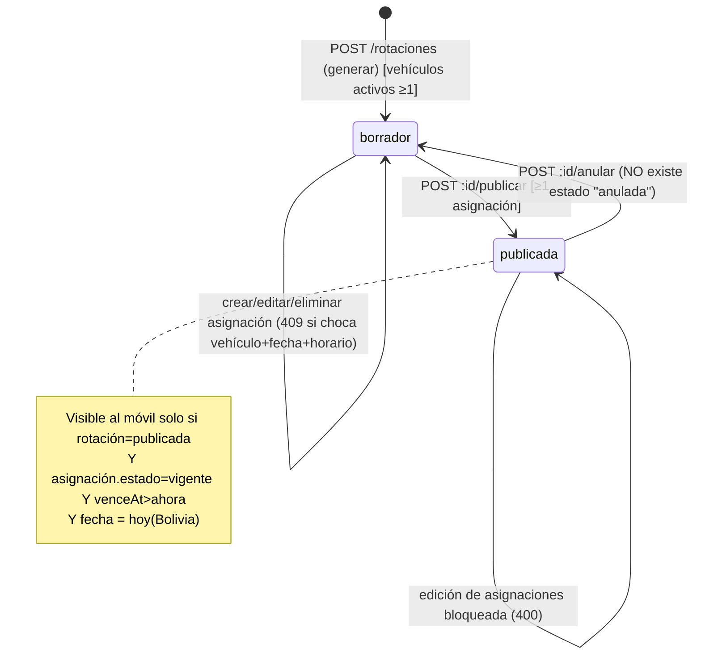
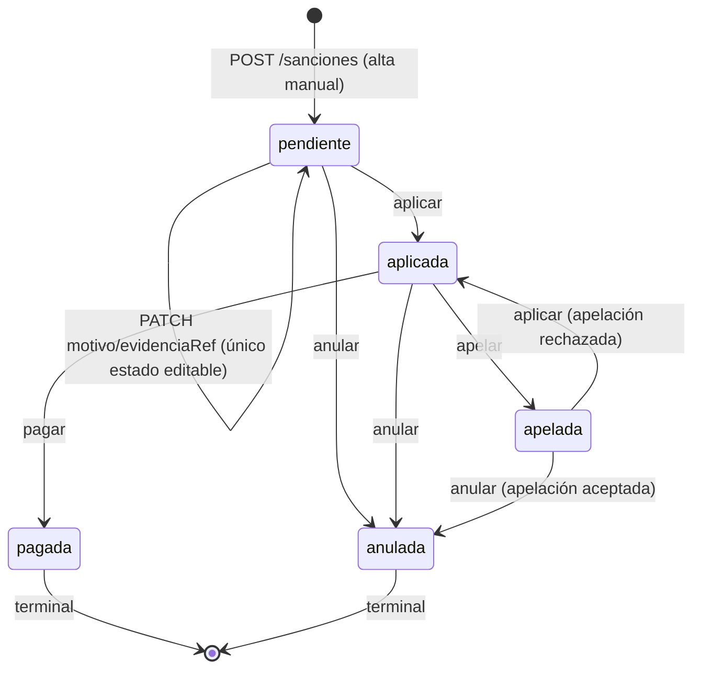
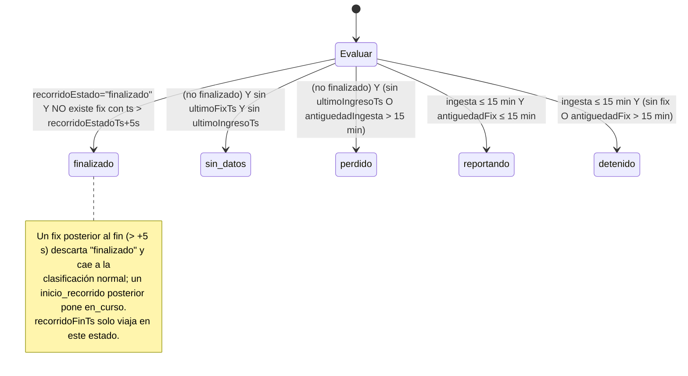
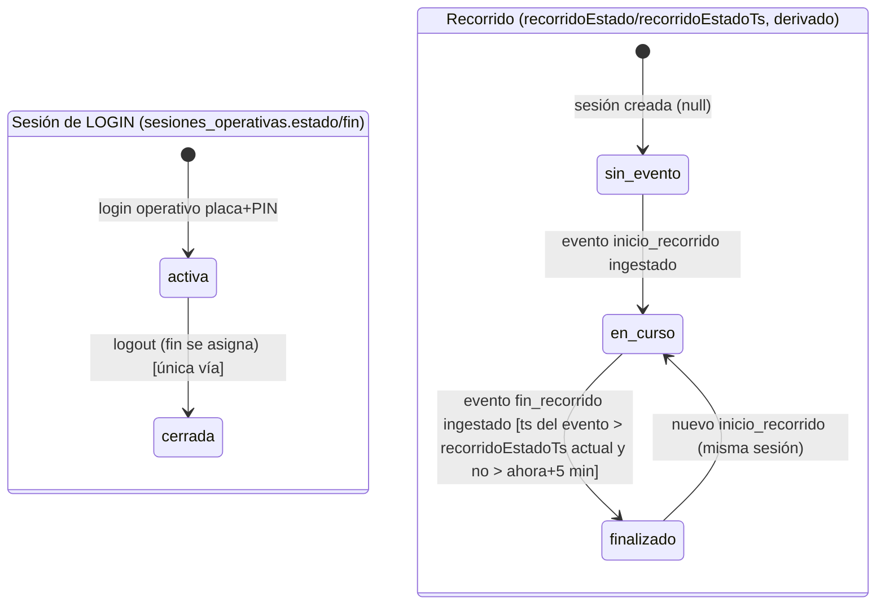

# SRS §3 — Rotaciones y asignaciones, reglas y sanciones, reportes

> Parte del [SRS](README.md). Reconstruido desde el código de `main@64125f7` el 2026-10-10 (sin el documento original de requisitos). Rutas relativas a la raíz del repo. "No encontrado" = buscado y ausente; "no verificado" = no comprobado en ejecución.

Convención de IDs: el doc técnico (`docs/documento-tecnico-cto.md` §3 líneas 88-93 y §11 línea 235-237) solo da **rangos** por módulo (RF-40..50 reglas/sanciones, RF-51..57 rotaciones, RF-74..80 reportes), sin enunciar cada RF. Los comentarios del código pinean sub-rangos puntuales (RF-51..53 generar, RF-54..55 edición manual, RF-57 vencimiento, RF-74..77 cumplimiento, RF-78..80 exportes, RNF-24 reconstrucción de recorrido, RNF-35 sync errors, RF-39 validación worker, RF-72 idempotencia). Donde el código no pinea un número exacto uso `RF-OPS-Xnn` provisional. Los `RF-ROT-004`/`RF-ROT-007` que aparecen en `A/rotaciones` y `S/entities/rotacion.ts` pertenecen al "modelo operativo Línea 120" (otro documento, no en el repo) y los conservo como referencia cruzada.

---

## 1. Requisitos funcionales

Estados: implementado / parcial / pendiente / descartado / inferido-validar ("inferido-validar" = el código lo hace pero el propio código declara que es asunción del equipo, no decisión de Producto).

### 1.1 Rotaciones y asignaciones (RF-51..57)

| ID | Enunciado | Fuente | Estado | Código | Test |
|---|---|---|---|---|---|
| RF-51 | El sistema debe permitir a `admin_quivo` y `admin_sindicato` generar una rotación en estado `borrador` indicando `periodo` (1..20 caracteres), ≥1 `rutaIds`, ≥1 `fechas` y ≥1 `horarios`. Cualquier otro rol (incl. `operador`) recibe 403. | código (comentario "asunción de este equipo") | implementado / inferido-validar (roles) | `A/rotaciones/rotaciones.controller.ts:24,44-48`; `S/entities/rotacion.ts:53-60` | `rotaciones.service.test.ts:98`; roles en `apps/api/src/common/auth/roles-matrix.test.ts:34` |
| RF-52 | `horarios` debe pertenecer al enum fijo `manana`/`tarde`/`noche`. | `S/enums/turno.ts:7` (comentario: "asunción razonable, no decisión de Producto") | implementado / inferido-validar | `S/enums/turno.ts:7` | indirecto en `rotaciones.service.test.ts:98` |
| RF-53 | Al generar, el sistema debe repartir los vehículos `activo` del sindicato (orden por placa asc) round-robin entre los sub-slots (fecha × horario × ruta), con un único vehículo por sub-slot, y debe repartir conductores `activo` (orden por nombre asc) en round-robin; si no hay conductores activos, `conductorId = null`. | comentario `GenerarRotacionSchema` ("asunción de este equipo") | implementado / inferido-validar | `A/rotaciones/rotaciones.service.ts:43-46,77-103,125-156` | `rotaciones.service.test.ts:98` |
| RF-53b | Si el sindicato no tiene vehículos activos, la generación debe fallar con 400 `El sindicato no tiene vehículos activos para repartir`. | código | implementado | `rotaciones.service.ts:47-49` | — (no encontrado test dedicado) |
| RF-53c | Para cada sub-slot, el sistema debe preferir el primer vehículo libre que todavía no cubrió esa ruta en el período (modelo Línea 120); si todos los libres ya la cubrieron, cae al primero libre. | código (QUI/Línea 120) | implementado | `rotaciones.service.ts:129-143` | `rotaciones.service.test.ts:202` |
| RF-53d | Un sub-slot sin vehículo libre debe quedar sin cubrir sin abortar la generación; y la respuesta debe incluir `sinCobertura` = pares vehículo×ruta que no quedaron cubiertos. | código | implementado | `rotaciones.service.ts:143,158-163` | `rotaciones.service.test.ts:115,286` |
| RF-53e | La generación debe chequear en memoria la ocupación ya existente (de **cualquier** rotación) para `(vehiculoId, fecha, horario)` antes de insertar, para no abortar la transacción por el constraint. | código (comentario 55-60) | implementado | `rotaciones.service.ts:62-70,135` | `rotaciones.service.test.ts:177` |
| RF-ROT-004/007 (ref. Línea 120) | Si se envía `configHorarios[horario]` {`horaInicio`,`horaFin`,`headwayMinutos`>0 entero,`bufferPresentacionMinutos`≥0 entero}, el sistema debe generar una salida cada `headwayMinutos` entre `horaInicio` y `horaFin` **inclusive**, ciclando `rutaIds`; `horaPresentacion = horaSalida − buffer`; horas interpretadas en UTC−4 fijo. Sin `configHorarios` para ese horario, `horaSalida`/`horaPresentacion` = `null` y hay 1 sub-slot por ruta. Validación: `HH:mm` 00:00..23:59 y `horaInicio < horaFin` (comparación de strings). | comentario `ConfigHorarioSchema`; números de hora pico "NO CONFIRMADO" | implementado (valores a criterio de quien genera) | `rotaciones.service.ts:337-361`; `S/entities/rotacion.ts:34-51`; `A/common/tiempo/jornada.ts:62-73` | `rotaciones.service.test.ts:347,428` |
| RF-54 | El sistema debe permitir crear a mano una asignación (`vehiculoId`, `conductorId?`, `rutaId`, `fecha`, `horario`, `orden`>0) en una rotación **solo si** está en `borrador`; si no, 400 `Solo se pueden editar asignaciones de una rotación en borrador`. | `S/entities/asignacion.ts:27-28` ("RF-54..55") | implementado | `rotaciones.service.ts:219-240,313-318` | `rotaciones.service.test.ts:491,516` |
| RF-55 | El sistema debe permitir editar (`vehiculoId`,`conductorId`,`rutaId`,`horario`,`orden`) y eliminar una asignación solo en rotación `borrador`; `fecha`/`venceAt`/`rotacionId` no son editables. | idem (`asignacion.ts:42-49`) | implementado | `rotaciones.service.ts:242-274`; `S/entities/asignacion.ts:42-48` | `rotaciones.service.test.ts:491,516` |
| RF-56a | El sistema debe garantizar unicidad `(vehiculoId, fecha, horario)` **entre todas las rotaciones** (un vehículo no puede tener dos asignaciones el mismo día y turno) mediante el constraint de DB, y debe traducir la violación (Prisma `P2002`) a 409 `Ese vehículo ya tiene una asignación en esa fecha y horario`. | doc técnico §12 (riesgo "conflicto operativo real"), `schema.prisma:486` | implementado | `packages/db/prisma/schema.prisma:486`; `rotaciones.service.ts:363-374` | `rotaciones.service.test.ts:536` |
| RF-56b | El sistema debe permitir publicar una rotación solo si está en `borrador` y tiene ≥1 asignación; la publicación es atómica (misma transacción tenant). Errores: 400 `Solo se puede publicar una rotación en borrador` / `La rotación no tiene asignaciones para publicar`. | doc técnico §3 (RF-51..57, "publicar"); código | implementado | `rotaciones.service.ts:187-203` | `rotaciones.service.test.ts:450,463` |
| RF-56c | El sistema debe permitir "anular" una rotación `publicada`, lo cual la devuelve a `borrador` (no existe estado `anulada` para rotaciones); en borrador, 400 `Solo se puede anular una rotación publicada`. | código (comentario 205-207: "asunción de este equipo, el doc técnico no detalla qué significa anular") | implementado / inferido-validar | `rotaciones.service.ts:208-217`; `S/enums/estados.ts:35` | `rotaciones.service.test.ts:477` |
| RF-56d | Publicar/anular/crear/editar/eliminar deben quedar registrados en `audit_log` (`@Auditable`). Los GET no. | doc técnico §9 (RF-81..84) | implementado | `rotaciones.controller.ts:45,51,57,63,73,84` | — |
| RF-57a | Toda asignación debe tener `venceAt = fin de la jornada boliviana de su `fecha` = 23:59:59 UTC−4 = `fecha`+1 día 03:59:59 UTC` (UTC−4 fijo, sin horario de verano). Se calcula server-side al crear (generar y alta manual); no es editable. | doc técnico §4.2 línea 130 | implementado | `A/common/tiempo/jornada.ts:45-55`; `rotaciones.service.ts:97,232` | `A/common/tiempo/jornada.test.ts:23-44` |
| RF-57b | Un job repetible (BullMQ, cada **5 min**) debe marcar `estado='vencida'` toda asignación `vigente` con `venceAt < ahora`, cross-tenant (rol `admin_quivo`); idempotente. | comentario `vencimiento.processor.ts:9-12` ("5 min es asunción de este equipo; RF-57 no fija cadencia") | implementado / inferido-validar (cadencia); con problema operativo conocido (ver §4 C-11) | `A/rotaciones/vencimiento.processor.ts:12,53-56`; `rotaciones.service.ts:280-288` | `rotaciones.service.test.ts:564,587` |
| RF-57c | El vencimiento **no** debe depender del job para ser efectivo hacia el móvil: el login operativo y el paquete del día exigen además `venceAt > ahora` en el momento de la consulta. | código | implementado | `A/auth-movil/auth-movil.service.ts:745-746,803-804`; `A/tracking/paquete-dia.service.ts:43` | `auth-movil.service.test.ts` (no verificado caso por caso) |
| RF-OPS-R01 | El sistema debe exponer al móvil como "asignaciones del día" las del `vehiculoId` de la sesión + `conductorId` autenticado + `fecha = fechaActualBolivia(ahora)` + `estado='vigente'` + `venceAt > ahora` + rotación del mismo sindicato en `publicada`, ordenadas por `orden asc, horario asc`. 0 resultados ⇒ 404 `No existe una asignación publicada vigente…`; >1 sin `asignacionId` ⇒ respuesta `seleccion_requerida`. | código (dominio B/auth-movil; incluido por tocar RF-57) | implementado | `A/auth-movil/auth-movil.service.ts:734-751,202-218` | `auth-movil.service.test.ts` |
| RF-OPS-R02 | La "fecha de hoy" del sistema para asignaciones, jornadas y reportes debe ser la fecha calendario de Bolivia (`ahora − 4 h`, truncada a medianoche UTC). Los filtros diarios usan intervalos `[00:00 BOT, 00:00 BOT del día siguiente)` = `[04:00Z, 04:00Z+1d)`. | código | implementado | `jornada.ts:13-40` | `jornada.test.ts:9-67` |
| RF-OPS-R03 | Las rotaciones se deben listar por `periodo desc` (sin paginación); `admin_sindicato` solo ve su tenant (RLS + `where`). | código | implementado | `rotaciones.service.ts:169-177`; migración `20260731060000_rotaciones_asignaciones` línea 65-77 (RLS en `rotaciones`) | — |
| RF-OPS-R04 | La UI debe pedir confirmación antes de publicar ("queda activa y disponible inmediatamente en las apps móviles") y antes de anular ("vuelve a borrador y deja de alimentar las apps móviles"). | UI | implementado | `W/app/(dashboard)/rotaciones/page.tsx:70,138-143,760-769` | — |
| RF-OPS-R05 | Al anular una rotación, el sistema **debe** dejar sin efecto las sesiones/paquetes ya iniciados con esas asignaciones. | texto de UI (page.tsx:765 promete "deja de alimentar las apps móviles") | **pendiente / parcial**: el login nuevo sí la filtra (`rotacion.estado='publicada'`), pero `paquete-dia.service.ts:43` solo revisa `asignacion.estado==='vigente'` y `venceAt`, no el estado de la rotación; ninguna sesión abierta se cierra | `auth-movil.service.ts:747` vs `paquete-dia.service.ts:43` | — |

### 1.2 Reglas y sanciones (RF-40..50)

| ID | Enunciado | Fuente | Estado | Código | Test |
|---|---|---|---|---|---|
| RF-40 | El sistema debe permitir CRUD (sin DELETE) de reglas por sindicato con `nombre` (1..200), `tipo` (1..100, texto libre), `gravedad` ∈ {`leve`,`grave`,`gravisima`}, `aplicaA` ∈ {`vehiculo`,`conductor`,`socio`}, `descripcion` (≤2000, opcional), `estado` ∈ {`activo`,`inactivo`} (default `activo`). Baja lógica = `estado:'inactivo'`. | doc técnico §4.2 (`estatutos / reglas(id, sindicato_id, tipo, gravedad, aplica_a, relacion)`) | implementado; `gravedad` y `sujeto` son asunciones del equipo | `A/reglas/reglas.service.ts:8-43`; `S/entities/regla.ts:5-23`; `S/enums/estados.ts` (GravedadRegla/SujetoTipo, comentario "asunción de este equipo, QUI-244") | `A/reglas/reglas.service.test.ts:43,51,57` |
| RF-40b | Solo `admin_quivo` y `admin_sindicato` pueden gestionar reglas y sanciones (no `operador`/`supervisor`). `admin_quivo` debe indicar `sindicatoId` en el body (400 si falta); `admin_sindicato` queda forzado a su tenant. | código (comentario "función de política") | implementado / inferido-validar | `reglas.controller.ts:28-31`; `reglas.service.ts:50-58`; `sanciones.controller.ts:254` | `reglas.service.test.ts:43` |
| RF-41 | El campo `relacion` del doc técnico (§4.2 línea 119, "relacion") y el concepto "estatuto" separado de "regla" **no** existen en el modelo: solo hay `reglas`. | doc técnico §4.2 | pendiente / descartado-de-facto (validar) | `schema.prisma:591-609` | — |
| RF-42 | El sistema debe permitir registrar manualmente una sanción en estado inicial `pendiente` con `reglaId`, `sujetoTipo`, `sujetoId` (string, sin FK), `motivo` (1..2000), `fechaHecho` (fecha), `evidenciaRef` (≤2000, opcional). Si la regla no existe o es de otro sindicato ⇒ 404 `Regla no encontrada`. | doc técnico §4.2, §15.5 | implementado | `A/reglas/sanciones.service.ts:61-82`; `S/entities/sancion.ts:23-31` | `sanciones.service.test.ts:75,81` |
| RF-42b | El sistema **no** valida: (i) que `regla.estado='activo'`; (ii) que `sujetoTipo` coincida con `regla.aplicaA`; (iii) que `sujetoId` exista ni pertenezca al tenant. | revisión de código (ausencia) | **hueco** (ver §4 C-6) | `sanciones.service.ts:63-81` | — |
| RF-43 | Las sanciones deben seguir la máquina de estados `pendiente→{aplicada,anulada}`, `aplicada→{apelada,pagada,anulada}`, `apelada→{aplicada,anulada}`; `pagada` y `anulada` son terminales. Una transición inválida ⇒ 400 `Transición de estado inválida: "x" → "y"`. | doc técnico solo lista los 5 estados; transiciones = asunción (comentario `sanciones.service.ts:17-22`) | implementado / inferido-validar | `sanciones.service.ts:23-29,111-135` | `sanciones.service.test.ts:94,102,111,116` |
| RF-44 | El sistema debe exponer una acción por transición (`POST /sanciones/:id/{aplicar,anular,apelar,pagar}`), todas auditadas; no hay PATCH genérico de estado. | código | implementado | `sanciones.controller.ts:286-308` | — |
| RF-45 | Solo se puede editar `motivo` y `evidenciaRef` de una sanción mientras está `pendiente`; después, 400 `Solo se puede editar una sanción pendiente`. | código | implementado / inferido-validar | `sanciones.service.ts:84-93`; `S/entities/sancion.ts:40-45` | `sanciones.service.test.ts:123` |
| RF-46 | El listado de sanciones debe ordenar por `fechaHecho desc`, filtrar por `estado`, `reglaId` y (solo `admin_quivo`) `sindicatoId`, y paginar por `skip` con **200** filas por página. | código | implementado | `sanciones.service.ts:15,33-51`; `S/entities/sancion.ts:47-52` | — (no encontrado test de paginación) |
| RF-47 | Las altas/ediciones/transiciones deben registrarse en `audit_log`. | doc técnico §9 | implementado | `sanciones.controller.ts:275,281,287,293,299,305`; `reglas.controller.ts:350,356` | — |
| RF-48 | La UI debe mostrar solo las transiciones válidas por estado (iconos Aplicar/Anular/Apelar/Marcar pagada) con modal de confirmación; paginar con "cargar más" de 200. | UI | implementado | `W/app/(dashboard)/reglas/page.tsx:140-146,1050,1231-1241`; `reglas/use-sanciones.ts:11` | — |
| RF-49 | La evidencia de una sanción debe vincularse **automáticamente** a datos de recorrido (GPS, `cumplimientos_pc`, desvíos de ruta). | doc técnico §15.5 (decisión de Producto 2026-07-19) | **pendiente**: `evidenciaRef` es texto libre cargado a mano | `S/entities/sancion.ts:14-17` (comentario "necesita tracking real (M3), que todavía no existe") | — |
| RF-50 | Las sanciones deben generarse automáticamente por incumplimiento detectado (p. ej. punto de control omitido, desvío). | no encontrado en doc técnico ni en código | **no encontrado** (no hay disparador automático; solo alta manual). Validar si era requisito original | — | — |

### 1.3 Reportes, en vivo, recorridos, cumplimiento, exportes (RF-74..80)

| ID | Enunciado | Fuente | Estado | Código | Test |
|---|---|---|---|---|---|
| RF-OPS-V01 | Los endpoints de `/reportes/**` y `/sync-errores` deben restringirse a `admin_quivo` y `admin_sindicato`. | código | implementado | `en-vivo.controller.ts:30`; `recorridos.controller.ts:196`; `cumplimiento.controller.ts:224`; `exportes.controller.ts:267`; `A/sync/sync-errores.controller.ts` | `roles-matrix.test.ts` |
| RF-OPS-V02 | `GET /reportes/en-vivo/posiciones` debe devolver **una fila por sesión** con la última posición conocida (lat, lng, accuracy, speed), línea, sentido de ruta, placa, conductor y bloque de frescura, en una sola query. | plan `docs/plan-v2-app-y-mapa-en-vivo.md` (ENTREGA 10) | implementado | `A/reportes/en-vivo.service.ts:437-518` | `en-vivo.service.test.ts:751-833` |
| RF-OPS-V03 | Una sesión entra a `posiciones` si `inicio ≥ ahora − 24 h` **o** (`fin IS NULL` y `estado='activa'`) — esto último incluye sesiones colgadas de días previos. Orden: abiertas primero, luego `ultimoFixTs desc nulls last`, luego `inicio desc`; tope **500** sesiones. | código | implementado | `en-vivo.service.ts:171-172,486-494` | `en-vivo.service.test.ts:785`, `:978,999` (cruce de medianoche) |
| RF-OPS-V04 | `posiciones` debe leer la última posición del resumen `gps_sesion_resumen` (jornadas hoy+ayer, `ultimo_fix_ts ≥ min(inicio de jornada de hoy, ahora−24 h)`), con tope de 1 fila por sesión y `ultimoIngresoTs = max` entre hoy y ayer; nunca debe escanear `gps_points`. | `docs/plan-en-vivo-resumen-sesion.md` §2 | implementado | `en-vivo.service.ts:437-490` | `en-vivo.resumen-equivalencia.test.ts:195,240,296-319,447`; `en-vivo.service.test.ts:1018` |
| RF-OPS-V05 | `GET /reportes/en-vivo` (listado de la jornada) debe devolver las sesiones con `inicio` en la jornada boliviana de hoy **o** abiertas (`fin IS NULL AND estado='activa'`), tope **100**, mismo orden que V03. | código | implementado, **sin consumidor en el panel actual** (`useSesionesEnVivo` definido pero no importado por ninguna página) | `en-vivo.service.ts:311-387`; `W/src/lib/en-vivo/use-en-vivo.ts:34` | `en-vivo.service.test.ts:527-583` |
| RF-OPS-V06 | `GET /reportes/en-vivo/:sesionId/contexto` debe devolver, una sola vez por sesión, vehículo, conductor, línea (color por defecto `#3226B4`), geometría de la ruta y **solo puntos de control `activo`** con su radio de tolerancia; sesión de otro tenant ⇒ 404 (no 403). | plan v2 §3.4-3.5 | implementado | `en-vivo.service.ts:526-576` | `en-vivo.service.test.ts:586-608` |
| RF-OPS-V07 | `GET /reportes/en-vivo/:sesionId/posiciones` debe devolver el delta de traza ordenado por `ts asc`, con `limite` ∈ [1, **50 000**] (default **8 000**), `cursor` = ts del último punto, `hayMas`, `totalPuntos` (count de la ventana de sesión), cumplimientos de la sesión y estado de sesión (`sesionFin`, `sesionEstado`) + frescura. | `S/entities/en-vivo.ts:140-170,209-246` | implementado | `en-vivo.service.ts:593-663`; `S/entities/en-vivo.ts:169-170,209-220` | `en-vivo.service.test.ts:611-735` |
| RF-OPS-V08 | La ventana de traza debe ser `[inicio − 60 s, min((fin ?? ahora) + 2 h, inicio + 36 h))`; el `desde` del cliente solo puede **recortar** (se clampa a `[piso, techo]`). Una sesión colgada >36 h se reporta `sin_datos`. | código | implementado | `en-vivo.service.ts:145-147,604-606` | `en-vivo.service.test.ts:675,691,707` |
| RF-OPS-V09 | Los GET de en vivo no deben escribir en `audit_log` y tienen throttle propio de **300 req/min/IP** (el global es 100 req/min). | código | implementado | `en-vivo.controller.ts:31`; `A/app.module.ts:37` | — |
| RF-OPS-F01 | El sistema debe calcular en el servidor, contra su propio reloj, `antiguedadFixMs = ahora − max(gps_points.ts)` y `antiguedadIngestaMs = ahora − max(gps_points.received_at)`, clampeadas a ≥0; `inactivaDesdeMs = antiguedadIngestaMs` o, si nunca hubo punto, `ahora − sesion.inicio`. | código | implementado | `en-vivo.service.ts:174-179,228-258` | `en-vivo.service.test.ts:429` |
| RF-OPS-F02 | El estado de frescura debe clasificarse en este orden: (1) `finalizado` si `recorridoEstado='finalizado'` y no hay fix posterior a `recorridoEstadoTs + 5 s`; (2) `sin_datos` si no hay fix ni ingesta; (3) `perdido` si no hay ingesta o `antiguedadIngesta > 15 min`; (4) `reportando` si `antiguedadFix ≤ 15 min`; (5) `detenido` en otro caso. Umbrales: ingesta viva = **15 min** (900 000 ms), fix en movimiento = **15 min**, tolerancia de fin = **5 s**. | `S/entities/en-vivo.ts:19-60`, calibración 2026-08-18 (lag p95 684-814 s, máx 4275 s; huecos detenido hasta 56 min) | implementado | `en-vivo.service.ts:117-118,129,194-216` | `en-vivo.service.test.ts:372-444 (reportando/detenido/p95/perdido/sin_datos)`, `:450-518 (finalizado, borde 5 s)` |
| RF-OPS-F03 | `recorridoFinTs` debe ser no-nulo solo si el estado resultante es `finalizado`. | Fase A | implementado | `en-vivo.service.ts:256` | `en-vivo.service.test.ts:450-457` |
| RF-OPS-F04 | El servidor **no** debe aplicar umbrales de color; el panel pinta según `estadoFrescura` (Reportando=verde, Detenido=info, Sin señal=rojo `esFalla`, Sin datos=gris, Recorrido finalizado=gris tenue). Solo `perdido` es falla. | `W/src/lib/en-vivo/traza.ts:287-330` | implementado | `traza.ts:287-336` | `traza.test.ts:438-480` |
| RF-OPS-F05 | Un estado de frescura desconocido (versión web vieja contra API nueva) debe degradar a `sin_datos` en vez de romper el panel. | Fase A, trampa de deploy | implementado | `traza.ts:336-338` | `traza.test.ts:467-480` |
| RF-OPS-F06 | El panel debe mostrar antigüedad contra el reloj del **servidor** (`offset = servidorTs − recibidoEn`) re-calculada cada 1 s, nunca contra `Date.now()` crudo; mostrar "Última posición capturada hace…", "Última sincronización hace…" y "Finalizó hace…". | plan v2 §3.4 | implementado | `traza.ts:211-232`; `W/app/(dashboard)/en-vivo/panel-frescura.tsx:8-14,96-109`; (`PanelFrescura` es código muerto, ver C-9; verificar la lógica equivalente en `page.tsx` HUD ~L629-667) | `traza.test.ts:325-362` |
| RF-OPS-P01 | El panel `/en-vivo` debe pollear `posiciones` (todas) cada **5 s**, pausar con pestaña oculta y refrescar al volver el foco; reintentos 4 con backoff `min(1000·2^n, 30 s)`. | `use-en-vivo.ts:61-71,30-31` | implementado | `W/src/lib/en-vivo/use-en-vivo.ts:61-71,30-31` | — |
| RF-OPS-P02 | La traza de la sesión seleccionada debe pollearse cada **10 s**; `hayMas` ⇒ **1 s** (catch-up); inactividad (`inactivaDesdeMs`) > **30 min** ⇒ poll cortado con banner "Seguimiento pausado por inactividad" y botón "Reanudar"; `finalizado` ⇒ **60 s** (salvo `hayMas`, que sigue a 1 s). El corte por inactividad gana sobre `hayMas`. | `traza.ts:244-262` | implementado | `traza.ts:27,30,56,241,244-262`; `W/app/(dashboard)/en-vivo/page.tsx:504-519` | `traza.test.ts:364-436` |
| RF-OPS-P03 | El cliente debe pedir el delta con solape: `desde = cursor − 15 min` (900 000 ms) y deduplicar por `ts|lat|lng`; reordenar ráfagas post-Doze. | `traza.ts:15-24` | implementado | `traza.ts:24,99-148` | `traza.test.ts:56-163` (el `describe` dice "2 min de solape", ver C-3) |
| RF-OPS-P04 | Auto-heal: si lo acumulado < `totalPuntos` y no hay `hayMas`, recargar una vez la ventana con `limite=50 000`; no repetir mientras el déficit no crezca y nunca más de una vez cada **60 s**. | `traza.ts:57-72,152-210`; `use-en-vivo.ts:139-168` | implementado | `traza.ts:72,152-210`; `use-en-vivo.ts:115-169` | `traza.test.ts:165-322` |
| RF-OPS-P05 | El contexto de sesión debe cachearse sin refetch (`staleTime: Infinity`, `gcTime` 1 h); la traza `gcTime` 5 min. | `use-en-vivo.ts:75-90,109` | implementado | `use-en-vivo.ts:84-85,109` | — |
| RF-OPS-P06 | El dibujo de la polilínea debe simplificarse (Douglas-Peucker, ε = 3 m) solo si hay >1 500 puntos; los datos crudos nunca se simplifican. | `simplificar-traza.ts` | implementado | `W/src/lib/en-vivo/simplificar-traza.ts:105-118` | `simplificar-traza.test.ts` |
| RF-OPS-P07 | El mapa debe dibujar todos los vehículos con fix (filtrables por línea), no dibujar los que no tienen fix y contarlos aparte ("N en el mapa · M sin GPS aún"); filtro por línea cierra la selección si el vehículo seleccionado queda fuera. | UI | implementado | `W/app/(dashboard)/en-vivo/map-builders.ts:93-151`; `en-vivo/page.tsx:79-101,350-351` | `map-builders.test.ts` |
| RF-OPS-F07 | Un recorrido finalizado en la app debe aparecer como "Recorrido finalizado" en el panel dentro de ~30 s. | `docs/plan-ubicacion-fluida.md:191` (criterio de verificación) | **parcial / no garantizado**: el panel pollea cada 5 s y el estado se actualiza al ingestar `fin_recorrido`, pero la latencia móvil→servidor es mediana 153-166 s / p95 684-814 s (`S/entities/en-vivo.ts:27-28`) | `A/ingesta-worker/ingesta-worker.service.ts:563-666` (UPDATE `recorridoEstado`); `en-vivo.service.ts:201-205` | `en-vivo.service.test.ts:450` (solo la derivación, no la latencia) |
| RF-OPS-F08 | Un vehículo cuyo último fix tenga >45 min debe dibujarse como "última posición conocida" en estilo fantasma, no como posición actual. | `docs/plan-correccion-post-piloto-2026-09-09.md:564` (regla dura) y `:1122` | **pendiente (no implementado)**: no existe ningún umbral de 45 min en `apps/api`, `apps/web` ni `packages/shared` (grep `45 ?min`/`fantasma` sin resultados fuera de mobile/auth); `construirMarcadoresVehiculos` dibuja cualquier fix no-nulo con el sprite de su estado | `W/app/(dashboard)/en-vivo/map-builders.ts:125-151` | — |
| RF-OPS-F09 | Cuando el servidor devuelve `perdido`, el panel debe mostrar al operador la hora exacta del último fix/ingesta (no solo color). | plan-correccion Entrega 16 (watermark "Datos completos hasta las 17:34") | parcial: se muestra "hace X" relativo, no la hora absoluta del watermark; solo se muestra hora absoluta del último punto en el HUD (`page.tsx:639`) | `panel-frescura.tsx:96-109`; `page.tsx:639` | — |
| RF-OPS-G01 | `GET /reportes/recorridos?desde&hasta` debe listar sesiones con `inicio` en `[inicio de jornada(desde), inicio de jornada siguiente(hasta))` (sin `desde` ⇒ epoch; sin `hasta` ⇒ año 9999), orden `inicio desc`, tope fijo **100**, sin paginación. | RNF-24 | implementado | `A/reportes/recorridos.service.ts:60-95` | `recorridos.service.test.ts:207,216` |
| RF-OPS-G02 | `GET /reportes/recorridos/:id` debe reconstruir: sesión, vehículo, conductor, línea, geometría de ruta, **todos** los puntos de control (activos e inactivos) con tolerancia, **toda** la traza GPS `ts asc` (sin límite), cumplimientos (app y worker) y la línea de tiempo de `eventos_operativos`; cross-tenant ⇒ 404. | RNF-24 | implementado | `recorridos.service.ts:97-180` | `recorridos.service.test.ts:175,190,195,201` |
| RF-74 | `GET /reportes/cumplimiento?por={linea|vehiculo|ruta}&desde&hasta` debe devolver por grupo `puntosCumplidos`, `puntosTotales`, `porcentajeCumplimiento = cumplidos/totales·100` (0 si totales=0), `recorridosAsignados`, `recorridosCompletados`. El universo de grupos son las asignaciones con `fecha` en el rango (un grupo con asignaciones pero sin cumplimientos aparece con 0). | `cumplimiento.controller.ts:221` (RF-74..77) | implementado | `A/reportes/cumplimiento.service.ts:41-59`; `cumplimiento-query.util.ts:304-415` | `cumplimiento.service.test.ts:176,214,221,228,235,245` |
| RF-75 | Un punto de control cuenta como cumplido **solo** si `validadoPor='worker'` (RF-39); los cumplimientos reportados solo por el app no entran en puntos totales ni cumplidos. | `cumplimiento.service.ts:254-255` | implementado | `cumplimiento-query.util.ts:399` | `cumplimiento.service.test.ts:176,257` |
| RF-76 | `recorridosAsignados` = asignaciones distintas del grupo con `fecha` en rango; `recorridosCompletados` = asignaciones distintas con ≥1 sesión con `fin IS NOT NULL`, de modo que nunca supere los asignados. | auditoría 2026-08-11 ("3/2") | implementado, con salvedad de semántica (ver C-7) | `cumplimiento-query.util.ts:377-388` | `cumplimiento.service.test.ts:185,221` |
| RF-77 | El filtro de rango debe usar días calendario boliviano: `asignaciones.fecha` (date) con `>= desde AND <= hasta`; `cumplimientos_pc.ts` (instante) con `>= inicio jornada(desde) AND < inicio jornada siguiente(hasta)`. | código | implementado | `cumplimiento-query.util.ts:331-340,375,400` | `cumplimiento.service.test.ts:245` |
| RF-78 | El sistema debe exportar a CSV, por streaming server-side, 4 reportes: `recorridos` (inicio, fin, linea, vehiculo, conductor, estado, puntosCumplidos, puntosTotales), `cumplimiento` (id, nombre, puntosCumplidos, puntosTotales, porcentajeCumplimiento 2 decimales, recorridosAsignados, recorridosCompletados), `sanciones` (fechaHecho, regla, sujetoTipo, sujetoId, motivo, estado) y `actividad` (id, nombre, recorridos, horasOperadas 2 decimales, puntosCumplidos, puntosTotales; `por` ∈ vehiculo/conductor). | doc: RF-78..80 | implementado (el doc técnico habla de "3 reportes", el código tiene 4 — el de cumplimiento se sumó después) | `A/reportes/exportes.controller.ts:265-317`; `exportes.service.ts:64-231` | `exportes.service.test.ts:192-279` |
| RF-79 | Cada export debe paginar de a **500** filas en transacciones tenant independientes (cada una bajo el timeout de 5 s de Prisma) y terminar al recibir una página <500; la salida es `text/csv; charset=utf-8`, CRLF (RFC 4180), adjunto `recorridos.csv`/`cumplimiento.csv`/`sanciones.csv`/`actividad.csv`. | `csv.util.ts:16-22`; `exportes.service.ts:52-61` | implementado | `exportes.service.ts:21,71,105,154,196`; `csv.util.ts:3-34`; `exportes.controller.ts:272-273` | `csv.util.test.ts`; `exportes.service.test.ts` |
| RF-80 | Los filtros del export deben ser: fechas para los 4; `estado` y `sujetoTipo` para sanciones; `por` para cumplimiento/actividad. Las sesiones del último día calendario boliviano deben incluirse completas. | RF-78..80 | implementado | `S/entities/reportes.ts` (Exportar*QuerySchema); `exportes.service.ts:98-103,190-193` | `exportes.service.test.ts:247,279` |
| RF-OPS-X01 | El export CSV debe neutralizar celdas que empiecen con `=`, `+`, `-`, `@` (también tab/CR) para evitar inyección de fórmulas en Excel/Sheets. | `docs/deuda-abierta.md:51` (S5) | **pendiente (confirmado abierto)**: `escaparCampoCsv` solo escapa `, " \n \r`; campos controlados por usuario que viajan sin neutralizar: `motivo`, `sujetoId`, `reglaNombre` (sanciones), `lineaNombre`, `vehiculoPlaca`, `conductorNombre`, `nombre` | `A/reportes/csv.util.ts:5-10,12-14` | — (no hay test de fórmulas) |
| RF-OPS-X02 | El CSV debe abrirse correctamente en Excel con acentos/ñ. | no encontrado | **hueco**: no se emite BOM UTF-8 (`csv.util.ts:27-33` arranca con la cabecera); Excel suele interpretar CSV UTF-8 sin BOM como ANSI | `csv.util.ts:27-33` | — |
| RF-OPS-D01 | La pantalla `/reportes` debe permitir elegir agrupación (linea/vehiculo/ruta), rango desde/hasta (con validación `desde ≤ hasta`) persistidos en la URL, y botones de descarga de los 4 CSV. | UI | implementado | `W/app/(dashboard)/reportes/page.tsx:81-143,152-170,528-612`; `W/src/lib/api/exportes.ts:17-60` | — |
| RF-OPS-D02 | El "dashboard" (home `/`) debe mostrar KPIs de flota, borradores de rotación, sanciones pendientes, vehículos a regularizar y errores de sync (7 días). **No existe endpoint de dashboard**: el home compone 7 `GET` de listados en el cliente (`sindicatos`, `socios`, `vehiculos`, `conductores`, `rotaciones`, `sanciones?estado=pendiente`, `sync-errores?desde=hace 7 días`). | doc técnico §3 ("reportes: dashboard") | parcial | `W/app/(dashboard)/page.tsx:64-113` | — |
| RF-OPS-D03 | El gráfico "Tendencia de 7 días" debe representar datos reales. | UI/código | **incumplido**: la serie "sanciones" de los 6 días previos es sintética: `Math.max(0, (i*2)%3)`; solo "hoy" usa `sancionesPendientes.length`, y representa **pendientes totales**, no sanciones del día | `W/app/(dashboard)/page.tsx:139-165` (línea 157) | — |
| RF-OPS-D04 | Los listados que usa el home (`sanciones` 200, `sync-errores` 200, `vehiculos`, etc.) son truncados; los contadores del home subestiman cuando se supera el tope (p. ej. "Sanciones Pendientes" máx. 200, "Errores Sync" máx. 200). | código | **hueco** | `sanciones.service.ts:15,47`; `A/sync/sync-errores.service.ts:11,31`; `W/app/(dashboard)/page.tsx:87-88,600-650` | — |
| RF-OPS-E01 | `GET /sync-errores?deviceId&sesionId&desde&hasta&skip` debe devolver errores de sync por `ts desc`, **200** filas/página, con rango por jornada boliviana. | RNF-35 | implementado | `A/sync/sync-errores.service.ts:11-38`; `S/sync/sync-error.ts:21-27` | `sync-errores.service.test.ts` |

---

## 2. Máquinas de estado

### 2.1 Rotación (`rotaciones.estado`: `borrador | publicada`) y Asignación (`asignaciones.estado`: `vigente | vencida`)

```mermaid
stateDiagram-v2
    [*] --> vigente: alta (venceAt = fecha 23:59:59 UTC-4)
    vigente --> vencida: job cada 5 min [venceAt < ahora]
    vencida --> [*]: terminal (sin reactivación; fecha no editable)
```

Notas: `vencida` no depende de `rotacion.estado`; una asignación de rotación en `borrador` también vence. No hay transición `vencida → vigente`.

### 2.2 Sanción (`sanciones.estado`)

Fuente: `sanciones.service.ts:23-29`. Las transiciones son asunción del equipo (no hay doc de Producto). No hay regla de plazo ni de monto (no existen campos `monto`/`plazo` en `Sancion`).

### 2.3 Frescura en vivo (`estadoFrescura`) — orden de evaluación real

La clasificación se recalcula en cada request (no es estado persistido); lo único persistido es `sesiones_operativas.recorridoEstado` (`en_curso|finalizado`, `null` si la sesión nunca registró inicio/fin) y `recorridoEstadoTs`. Color/etiqueta: ver RF-OPS-F04. Aplicable también al detalle de traza (`obtenerTraza`, usa `max(ts)`/`max(received_at)` de `gps_points` de la ventana, no el resumen).

### 2.4 Recorrido / sesión

Hay **dos** ciclos de vida que no deben confundirse:

Condiciones reales: el UPDATE exige `recorridoEstadoTs IS NULL OR recorridoEstadoTs < ts` (idempotente/orden), solo si el INSERT del evento fue nuevo (`insertado.count === 1`), atado a `sindicatoId` + `deviceId` autenticados, y se omite si `ts` viene >5 min en el futuro (`DRIFT_ALERTA_MS`) — `ingesta-worker.service.ts:29,624-666`. "Finalizar" en la app **no** cierra la sesión de login (`fin` queda NULL hasta logout): por eso el panel necesita `inactivaDesdeMs` para cortar el poll y por eso `activa=true` no implica reportando.

---

## 3. Requisitos no funcionales

| ID | Requisito | Valor exacto | Fuente (file:line) | Test |
|---|---|---|---|---|
| RNF-OPS-01 | Zona horaria operativa fija UTC−4, sin horario de verano. | 4 h | `jornada.ts:9` | `jornada.test.ts:44` |
| RNF-OPS-02 | Cadencia del job de vencimiento. | 5 min (BullMQ `upsertJobScheduler`, idempotente al reiniciar) | `vencimiento.processor.ts:12,53-56` | — |
| RNF-OPS-03 | Poll de posiciones del mapa. | 5 s (≈12 req/min/pestaña); background pausado | `use-en-vivo.ts:66-67` | — |
| RNF-OPS-04 | Poll de traza. | 10 s normal; 1 s con `hayMas`; 60 s con `finalizado`; corte tras 30 min de `inactivaDesdeMs` | `traza.ts:27,30,56,241,244-262` | `traza.test.ts:364-436` |
| RNF-OPS-05 | Throttle API en vivo. | 300 req/min/IP en `/reportes/en-vivo/*`; 100 req/min/IP global | `en-vivo.controller.ts:31`; `app.module.ts:37` | — |
| RNF-OPS-06 | Tope de sesiones por respuesta. | `posiciones` 500; `listarHoy` 100; `recorridos` 100 | `en-vivo.service.ts:172,361,494`; `recorridos.service.ts:80` | — |
| RNF-OPS-07 | Tope de puntos de traza por request. | default 8 000; máximo 50 000 (≈4-5 MB JSON la recarga completa) | `S/entities/en-vivo.ts:169-170` | `en-vivo.service.test.ts:648` |
| RNF-OPS-08 | Ventana de traza. | `[inicio−60 s, min(fin+2 h, inicio+36 h))` | `en-vivo.service.ts:145-147` | `:707` |
| RNF-OPS-09 | Ventana de sesiones de `posiciones`. | 24 h rodantes + abiertas | `en-vivo.service.ts:171` | `:785` |
| RNF-OPS-10 | Latencia objetivo de `listarHoy`/`posiciones` tras `gps_sesion_resumen`. | objetivo plan: <50 ms por endpoint (medido en plan: ~62 ms con 1 000 sesiones, antes 10,5-10,65 s). La verificación contra producción: no encontrado. | `docs/plan-en-vivo-resumen-sesion.md` §1,§4; `en-vivo.service.ts` docstring 288-310 | `en-vivo.resumen-equivalencia.test.ts` (equivalencia, no latencia) |
| RNF-OPS-11 | Lag móvil→servidor usado para calibrar umbrales. | mediana 153-166 s, p95 684-814 s, máx 4 275 s | `S/entities/en-vivo.ts:27-28` | `en-vivo.service.test.ts:399` |
| RNF-OPS-12 | Tolerancia de reloj del dispositivo para `finalizado`. | 5 s | `en-vivo.service.ts:129` | `:504,511` |
| RNF-OPS-13 | Paginación de listados administrativos. | sanciones 200 (`skip`); sync-errores 200 (`skip`); rotaciones/reglas sin paginación | `sanciones.service.ts:15`; `sync-errores.service.ts:11` | — |
| RNF-OPS-14 | Exportes CSV. | páginas de 500 filas, una transacción tenant por página; stream `Readable.from`; sin tope total de filas ni de tiempo; el navegador igual materializa el archivo completo en un `Blob` (`apiDownload`) | `exportes.service.ts:21`; `csv.util.ts:23-34`; `W/src/lib/api/client.ts:67-89` | `csv.util.test.ts` |
| RNF-OPS-15 | Aislamiento multi-tenant. | RLS en `rotaciones`, `sanciones`, `reglas`, `sesiones_operativas`, `cumplimientos_pc`, `gps_points` (padre y particiones), `gps_sesion_resumen`, `sync_errors`; `asignaciones`/`rutas`/`puntos_control` **sin RLS** (barrera = código); cross-tenant ⇒ 404 | `migrations/20260731060000_rotaciones_asignaciones` L51-77; `en-vivo.service.ts:265-270` | `en-vivo.service.test.ts:579,597,737,810` |
| RNF-OPS-16 | Auditoría de acciones críticas. | `@Auditable` en generar/publicar/anular/asignaciones, reglas, sanciones; GET de poll nunca | controllers citados | — |
| RNF-OPS-17 | Rendimiento de dibujo de la traza. | simplificación Douglas-Peucker ε=3 m sobre >1 500 puntos | `simplificar-traza.ts:105-118` | `simplificar-traza.test.ts` |
| RNF-OPS-18 | Tolerancia a despliegue API/web desfasados. | estado desconocido ⇒ `sin_datos`; orden obligatorio web→api para Fase A | `traza.ts:336`; `docs/plan-ubicacion-fluida.md:103` | `traza.test.ts:473` |

---

## 4. Contradicciones doc↔código y huecos

### Contradicciones

| # | Doc dice | Código hace | Impacto |
|---|---|---|---|
| C-1 | `docs/plan-v2-app-y-mapa-en-vivo.md:466` — frescura **<90 s verde · 90 s–5 min ámbar · >5 min rojo**. | No existe tal escala. Cinco estados categóricos con umbral único de 15 min (ingesta y fix) calculados en el servidor (`en-vivo.service.ts:117-118,194-216`). `traza.ts:272` dice textualmente que no se usan los umbrales de la spec original. | El doc v2 está **superado**: no usar sus umbrales en el SRS. |
| C-2 | Plan v2 `:461` — "sesión con `fin` +5 min ⇒ `false` (se corta solo)". | Corte por `inactivaDesdeMs > 30 min` (`traza.ts:56`); `fin` nunca se asigna al finalizar; con `finalizado` el poll baja a 60 s (no se corta). | Doc obsoleto. |
| C-3 | Plan v2 `:456` y el `describe` de `traza.test.ts:151` — solape del cursor **2 min**. | `SOLAPE_CURSOR_MS = 900_000` (**15 min**) (`traza.ts:24`). | Nombre del test engañoso; doc obsoleto. |
| C-4 | Plan v2 `:485` — "Día completo ≈ 4.300 puntos ≈ 250 KB"; "ventana por jornada". | Límite máx. 50 000 puntos (~4-5 MB) por la baja de `distanceFilter` a ~15 m (`S/entities/en-vivo.ts:140-170`). | Dimensionamiento de red cambia un orden de magnitud. |
| C-5 | `docs/plan-ubicacion-fluida.md:191` — "Recorrido finalizado" en panel "dentro de ~30 s". | Depende de que el móvil sincronice `fin_recorrido`; el lag medido en campo es 153-166 s mediana (p95 684-814 s). Ningún test lo ejercita. | El "≤30 s" no es una garantía del sistema; es una expectativa de prueba. |
| C-6 | `docs/plan-correccion-post-piloto-2026-09-09.md:564` — "regla dura": fix >45 min ⇒ estilo fantasma. | No implementado (sin código ni test). | Requisito aprobado y no entregado, o entregado en otra forma que no encontré. |
| C-7 | Doc técnico §4.2 — "rotaciones: borrador/publicada" + el pedido menciona "anulada". | Rotación solo tiene `borrador|publicada`; "anular" = volver a `borrador`. Sanción sí tiene `anulada`. | Terminología confusa en UI/audit ("anular" ≠ estado). |
| C-8 | `recorridosCompletados` se presenta como "recorridos completados". | Cuenta asignaciones con ≥1 sesión con `fin IS NOT NULL`, y `fin` solo lo fija el logout (no "Finalizar"). Tras Fase A el dato real de "recorrido finalizado" está en `recorridoEstado`, que el reporte no usa. | La métrica de completado mide "cerró sesión", no "terminó el recorrido". Riesgo de subconteo (conductores que finalizan y no hacen logout) y sobreconteo (logout sin recorrido). **Hecho verificado en código**: `cumplimiento-query.util.ts:380` y comentario de `schema.prisma:563-566`. |
| C-9 | `docs/plan-correccion-post-piloto:565-567` pide eliminar `panel-frescura.tsx` (código muerto) o convertirlo en el componente real. | El archivo sigue existiendo (117 líneas), contiene lógica "Finalizó hace" de Fase A (`panel-frescura.tsx:61-109`) y **no es importado por ningún archivo** (grep en `apps/web`: solo un comentario en `traza.ts:333`) ⇒ código muerto confirmado. Consecuencia: RF-OPS-F06 se implementa en el HUD inline de `page.tsx`, no en `PanelFrescura`. | Posible duplicación/código muerto; reportar como "no verificado". |
| C-10 | Doc técnico §3/§11 habla de "dashboard" dentro de RF-74..80. | No hay endpoint de dashboard; el home arma KPIs en el cliente y su gráfico de tendencia es parcialmente sintético (RF-OPS-D03). | Funcionalidad "dashboard" parcial. |
| C-11 | RF-57 "vence al fin de jornada". | Cumplido en lectura (`venceAt > ahora` en auth y paquete). El job `marcar-vencidas` tiene fallos de lock en producción desde ≥2026-09-14 (`docs/deuda-abierta.md:134`), así que `estado='vencida'` en DB puede atrasarse; la seguridad no depende de él, pero cualquier reporte/consulta que filtre por `estado='vigente'` sin `venceAt` puede mostrar asignaciones vencidas como vigentes. | Riesgo bajo, a vigilar. |
| C-12 | Doc técnico §3 línea 88: módulo `reglas/` = "estatutos, reglas, sanciones". | Solo `reglas` y `sanciones`; no hay entidad `estatuto` ni campo `relacion`. | Gap de modelo (RF-41). |
| C-13 | Doc técnico RF-78..80: "3 reportes exportables". | 4 exportes (se agregó `cumplimiento`). | Actualizar SRS a 4. |

### Huecos (sin doc que los cubra o sin implementación)

| # | Hueco |
|---|---|
| H-1 | `crearAsignacion`/`actualizarAsignacion` **no validan** que `vehiculoId`, `conductorId` y `rutaId` pertenezcan al tenant del actor. Solo `generar` valida rutas (`rotaciones.service.ts:36-41`). `asignaciones` no tiene RLS (migración `20260731060000` L59-64: "el tenant-check en código es la barrera"), y las FK no respetan RLS. Un `admin_sindicato` con UUID ajeno podría vincular vehículo/ruta de otro sindicato. **No lo probé en ejecución**; es observación de código (ausencia de check). Conviene un test de aislamiento. |
| H-2 | Anular una rotación no invalida sesiones ni paquetes ya abiertos (RF-OPS-R05); `paquete-dia.service.ts:43` no consulta `rotacion.estado`. |
| H-3 | `generar` puede dejar **conductor repetido** en dos asignaciones del mismo día/horario (el round-robin de conductores no controla colisión de conductor, solo de vehículo). No hay constraint conductor+fecha+horario. (Observación del algoritmo en `rotaciones.service.ts:85,101`; no verificado con datos.) |
| H-4 | No hay validación de `periodo` vs. `fechas` (periodo es texto libre ≤20), ni de rango máximo de fechas/horarios en `generar` (tamaño de carga no acotado: `fechas.min(1)` sin `.max`). |
| H-5 | `generar` ignora vehículos con estado distinto de `activo` (correcto) pero también conductores `inactivo` solo para el reparto; no valida disponibilidad/suspensión por sanción (no hay vínculo sanción→suspensión de vehículo/conductor). |
| H-6 | Sanciones: sin monto, plazo de pago ni plazo de apelación; sin vínculo a `Vehiculo.estado='suspendido'`; sin disparo automático (RF-49/RF-50). |
| H-7 | Sanción: no se valida regla `activo` ni coherencia `aplicaA`↔`sujetoTipo`, ni existencia del sujeto (RF-42b). |
| H-8 | Reportes: `recorridos/listar` tope 100 sin paginación (el histórico se trunca silenciosamente; la UI no avisa); `recorridos/:id` devuelve toda la traza sin tope (una jornada de 30-43 mil puntos). |
| H-9 | Cumplimiento: "denominador honesto" pendiente (el worker revalida con las mismas coordenadas del teléfono, la métrica se mide contra sí misma) — `docs/plan-v2-app-y-mapa-en-vivo.md:528` (tickets nuevos). |
| H-10 | CSV: inyección de fórmulas (S5) y sin BOM (RF-OPS-X01/X02). |
| H-11 | Dashboard: ver RF-OPS-D02..D04. |
| H-12 | Tests de rotaciones/sanciones/en-vivo/exportes son sobre un mock de DB en gran parte (`*.service.test.ts` usan datos en memoria); los únicos tests contra Postgres real de este dominio que encontré son `en-vivo.resumen-equivalencia.test.ts` y los `*.integration.test.ts` de sync-errores/auditoría. La cobertura de SQL crudo de `exportes`/`cumplimiento` depende de mocks: **no verificado** si hay integración real. |
| H-13 | `listarHoy` y `useSesionesEnVivo` sin consumidor en la UI actual (código vivo no usado). |
| H-14 | No hay export del detalle de un recorrido ni de la traza GPS. |

---

## 5. Preguntas para el CTO

1. **Rotación "anulada"**: ¿"Anular" debe seguir siendo "volver a borrador" (hoy) o es un estado terminal `anulada` con historial? ¿Qué pasa con conductores que ya iniciaron sesión con esa asignación (H-2/RF-OPS-R05)? Cierro la sesión, la dejo terminar el día, o la bloqueo en el próximo paquete/sync.
2. **Turnos**: `manana/tarde/noche` ¿son los definitivos? ¿Se mantienen los 3 mientras el piloto Línea 120 usa `horaSalida`/headway (RF-ROT-004/007)? Los números reales de hora pico siguen "NO CONFIRMADO".
3. **Conductor duplicado**: ¿un conductor puede tener dos asignaciones en la misma fecha/horario (hoy la DB lo permite)? ¿Se quiere constraint `(conductorId, fecha, horario)`?
4. **Sanciones — máquina de estados**: ¿se confirman las transiciones asumidas? En particular `apelada → aplicada` (apelación rechazada) y que `pagada` sea terminal sin reversión. ¿Debe existir monto/plazo, y la sanción `aplicada` debe suspender el vehículo/conductor?
5. **RF-49/RF-50**: ¿las sanciones deben generarse automáticamente desde incumplimientos (PC omitido, desvío) o siguen siendo solo registro manual con evidencia auto-vinculada como adjunto? ¿Entra en MVP?
6. **Reglas/estatutos**: ¿se necesita entidad "estatuto" y el campo `relacion` del doc técnico (RF-41), o `reglas` plano alcanza?
7. **Métrica "recorrido completado"**: ¿completado = el conductor tocó "Finalizar" (`recorridoEstado='finalizado'`), o = ≥N% de puntos de control, o = logout? Hoy es logout (C-8).
8. **Regla del fantasma >45 min** (C-6): ¿se mantiene como requisito? ¿Y la hora absoluta del watermark en el panel (RF-OPS-F09)?
9. **"Finalizado en ≤30 s"**: ¿es requisito de producto o solo criterio de prueba? De ser requisito, hay que acotar la latencia de sync de `fin_recorrido` (hoy mediana ~2,5 min).
10. **Umbral único 15 min** para `perdido`/`detenido`: ¿se acepta como definitivo (calibrado con una sola jornada, 2026-08-18) o se quiere reconfigurable por sindicato?
11. **Exportes**: ¿se prioriza cerrar S5 (inyección de fórmulas) y agregar BOM UTF-8 antes del segundo sindicato? ¿Los exportes deben ser asíncronos/limitados en filas cuando haya 2-3 mil vehículos?
12. **Dashboard**: ¿se requiere un endpoint agregado (KPIs, tendencia real de sanciones/cumplimiento) o el home actual cumple RF-74..80? El gráfico de tendencia hoy mezcla datos falsos (RF-OPS-D03): ¿se quita o se implementa con datos reales?
13. **Aislamiento de `asignaciones`** (H-1): ¿autorizás un fix + test de aislamiento cross-tenant sobre alta/edición manual?
14. **Historial de recorridos** (H-8): ¿tope de 100 aceptable o se pide paginación/filtros por vehículo/línea?
15. **Roles**: ¿`operador` y `supervisor` deben ver reportes/rotaciones en modo lectura? Hoy solo `admin_quivo` y `admin_sindicato`; rotaciones/reglas excluyen `operador` por asunción del equipo.
