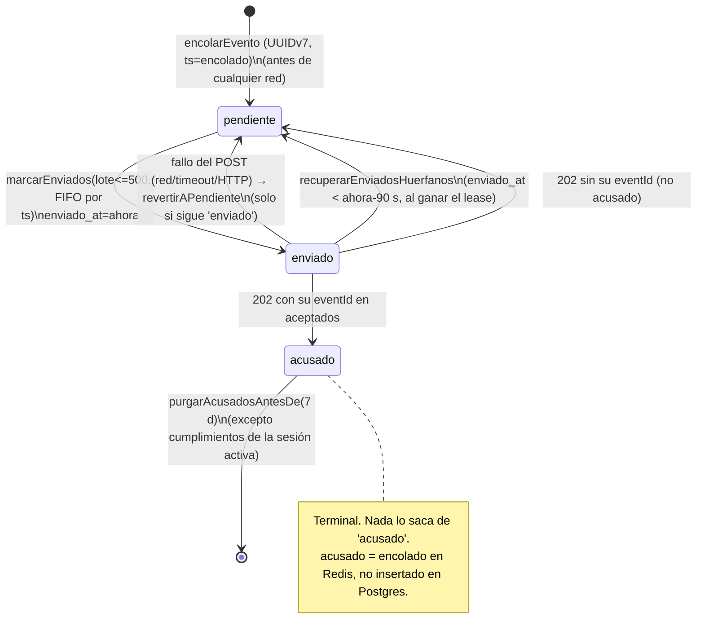

# SRS §4 — Operación del conductor y cadena de datos GPS

> Parte del [SRS](README.md). Reconstruido desde el código de `main@64125f7` el 2026-10-10 (sin el documento original de requisitos). Rutas relativas a la raíz del repo. "No encontrado" = buscado y ausente; "no verificado" = no comprobado en ejecución.
Convenciones: `RF-6x/7x` = numeración del documento técnico (§3, §6, §7) que **sí** aparece en comentarios del código; el número individual dentro de un rango (`RF-58..66`, `RF-69..72`) se perdió, así que los comportamientos sin número propio recuperable llevan `RF-GPS-nnn` provisional y citan el rango padre en *Fuente*. Estado: `implementado` / `parcial` / `pendiente` / `descartado` / `inferido-validar`.
Abreviaturas de archivo: `cfg` = `apps/mobile/src/gps/background-geolocation.config.ts`; `geo` = `apps/mobile/src/gps/geofence.ts`; `loc` = `apps/mobile/src/gps/location-task.ts`; `hl` = `apps/mobile/src/gps/headless-task.ts`; `ugo` = `apps/mobile/src/features/operacion/use-gps-operativo.ts`; `sob` = `apps/mobile/src/features/operacion/sync-outbox.ts`; `obx` = `apps/mobile/src/db/outbox.ts`; `iw` = `apps/api/src/modules/ingesta-worker/ingesta-worker.service.ts`; `evt` = `packages/shared/src/sync/evento.ts`.

---

## 1. Requisitos funcionales

### 1.1 Paquete del día, vencimiento y condiciones de arranque

| ID | Enunciado | Fuente | Estado | Código | Test |
|---|---|---|---|---|---|
| RF-68 | El sistema debe entregar, en una sola llamada `GET /v1/mobile/asignacion-del-dia`, la asignación vigente, la geometría de la ruta, la línea, las paradas **activas** y los puntos de control **activos** (cada uno con `radioToleranciaM` e `obligatorio`), ordenados por `orden`. | doc técnico §6.1; `packages/shared/src/sync/paquete-dia.ts` | implementado | `apps/api/src/modules/tracking/paquete-dia.controller.ts:11-15`; `paquete-dia.service.ts:36-116` (filtro `estado='activo'` en :63,:67) | `paquete-dia.service.test.ts` |
| RF-GPS-001 | El sistema debe responder 401 al pedir el paquete si la asignación de la sesión no está en estado `vigente` o su `venceAt <= ahora` (reloj del servidor). | RF-68/73 | implementado | `paquete-dia.service.ts:43-45` | `paquete-dia.service.test.ts` |
| RF-GPS-002 | La app debe guardar el paquete en SQLite (`quivo-paquete-dia.db`) como **una única fila** (DELETE+INSERT en transacción) con `vence_at`. | doc §6.1 | implementado | `apps/mobile/src/db/paquete-dia.ts` (`guardarPaqueteDia`) | — (módulo nativo; solo se testea `interpretarFilaPaqueteDia`) |
| RF-GPS-003 | Si la descarga falla, la app debe servir el último paquete local **solo si** su `asignacion_id` coincide con el de la sesión guardada; si no coincide, está corrupto o no cumple `PaqueteDiaSchema`, debe tratarlo como "sin caché" y mostrar el error de red. | RF-67; plan-v2 §2.4 hallazgo 1 | implementado | `apps/mobile/src/db/paquete-dia-local.ts:46-71`; `use-paquete-dia.ts:57-79` | `paquete-dia-local.test.ts` |
| RF-73 | El sistema debe marcar el paquete como vencido cuando `vence_at <= Date.now()` (reloj del dispositivo), mostrar "Asignación vencida. Reconecta antes de iniciar otro recorrido." y deshabilitar "Iniciar recorrido". | doc §6.1; `paquete-dia.ts` shared (comentario) | implementado | `paquete-dia-local.ts:68`; `operation-screen.tsx:408-412`, `:475-478` | `paquete-dia-local.test.ts` (vencido); UI sin test |
| RF-GPS-004 | La app debe descargar el paquete **al montar la pantalla de operación** (una vez por montaje, `yaCargo`), no antes. | doc §6.1 ("al iniciar jornada con conexión") | parcial — no hay precarga previa ni refresco a mitad de jornada; `recargar()` existe pero no tengo evidencia de quién lo invoca | `use-paquete-dia.ts:83-87` | — |
| RF-GPS-005 | El paquete debe cubrir **un solo día/asignación**; no existe precarga de varios días. | enunciado del encargo ("días") | inferido-validar — no encontré ningún mecanismo multi-día; la tabla guarda 1 fila | `db/paquete-dia.ts` (`DELETE FROM paquete_dia`) | — |
| RF-GPS-006 | "Iniciar recorrido" debe estar deshabilitado si: no hay paquete, está vencido, está cargando, hay error de paquete, el permiso de ubicación es bloqueante, o el ajuste `trabajarOffline` está apagado y no hay conexión. | doc §6; QUI-338 | implementado | `operation-screen.tsx:475-486`, `:418` | `permiso-ubicacion.test.ts` (la decisión de permiso); la composición en pantalla — |
| RF-GPS-007 | El sistema debe distinguir estados de permiso (`listo`, `no_solicitado`, `servicio_desactivado`, `permiso_denegado`, `permiso_parcial` = "mientras se usa", `error_nativo`); solo `listo` y `no_solicitado` permiten iniciar, y el nivel requerido es "Siempre" (`AUTORIZACION_SIEMPRE=3`). | QUI-338 | implementado | `apps/mobile/src/gps/permiso-ubicacion.ts:46-259` | `permiso-ubicacion.test.ts` |
| RF-GPS-008 | Antes de arrancar el SDK la app debe pedir `POST_NOTIFICATIONS` sin bloquear el inicio si se deniega. | hallazgo de campo Entrega 7 | implementado | `ugo:1113` | `anuncio-punto-control.test.ts` (parcial) |
| RF-GPS-009 | El permiso `ACTIVITY_RECOGNITION` debe solicitarse en Android SDK ≥ 29. | QUI-P0 (flecha no se mueve) | implementado | `apps/mobile/src/gps/permiso-actividad.ts` (`debeSolicitarPermisoActividad`) | `permiso-actividad.test.ts` |

### 1.2 Iniciar / finalizar recorrido

| ID | Enunciado | Fuente | Estado | Código | Test |
|---|---|---|---|---|---|
| RF-67 | El sistema debe operar el recorrido completo (iniciar, tracking, detección de PC, registro de eventos) contra SQLite local sin depender de red. | doc §6.2 | implementado (la captura y la detección no tocan red; ver 1.7 para el transporte) | `hl:241-306`, `loc:181-` | `headless-task.test.ts`, `location-task.test.ts` |
| RF-GPS-010 | Al iniciar, la app debe: `ready(gpsSpikeConfig)` → `start()` → `changePace(true)` + `disableStopDetection:true`, marcando `tracking=true` en cuanto `start()` resuelve **aunque** falle después la escritura en el outbox. | QUI-P0; Entrega 31a G2 | implementado | `ugo:931`, `:1255-1330`; `apps/mobile/src/gps/seguimiento-continuo.ts:71-125` | `seguimiento-continuo.test.ts`, `resultado-iniciar-recorrido.test.ts` |
| RF-GPS-011 | Las suscripciones `onLocation`/`onHeartbeat`/`onMotionChange` deben instalarse **antes** de `start()` para no perder fixes de la ventana de arranque. | comentario `ugo` ~1240-1255 | implementado | `ugo:1240-1260` | — (hook) |
| RF-GPS-012 | Al iniciar, el sistema debe encolar un evento `inicio_recorrido` con un `eventId` estable generado una vez por intento de `iniciar()`, reintentándolo (en `onLocation`, heartbeat y `detener()`) hasta que quede persistido, sin duplicar ante reintento. | QUI-247 / RNF-24 | implementado | `apps/mobile/src/features/operacion/inicio-recorrido-retry.ts`; `ugo:485,:578`; `obx:500-517` (`INSERT OR IGNORE` con `eventId` dado) | `inicio-recorrido-retry.test.ts` |
| RF-GPS-013 | "Finalizar recorrido" debe pedir confirmación explícita ("¿Finalizar el recorrido?") antes de ejecutar `detener()`. | checklist (Jornada en campo) | implementado | `operation-screen.tsx:604-613` | — |
| RF-GPS-014 | `detener()` debe, en este orden: esperar un `iniciar()` en vuelo, `stop()` nativo, quitar suscripciones, reintentar `inicio_recorrido` si faltó, **confirmar todas las visitas de PC pendientes** (umbral 0) y encolar `fin_recorrido` con `{sesionId}`. | QUI-247; Entrega bug 2 diseño B | implementado | `ugo:1424-1560` (`fin_recorrido` en :1560) | `seguimiento-continuo.test.ts` (serializador); el flujo completo — |
| RF-GPS-015 | El sistema debe garantizar `inicio_recorrido` antes de `fin_recorrido` aunque el chofer toque los dos botones en sucesión rápida. | QUI-247 hallazgo MEDIO | implementado | `ugo:1418-1430`; `seguimiento-continuo.ts:275-324` | `seguimiento-continuo.test.ts` |
| RF-GPS-016 | `detener()` debe restaurar `disableStopDetection:false` (best-effort) y el próximo `iniciar()` debe esperar esa restauración antes de reafirmar movimiento. | R1 Entrega 31a | implementado | `seguimiento-continuo.ts:134-160`; `ugo:1446-1470` | `seguimiento-continuo.test.ts` |
| RF-GPS-017 | El servidor debe persistir `inicio_recorrido`, `fin_recorrido` y `observacion` en `eventos_operativos` (idempotente por `eventId`) y derivar `sesiones_operativas.recorridoEstado` (`en_curso`/`finalizado`) solo si el insert fue nuevo, el `ts` es posterior al watermark, el `deviceId` coincide y el `ts` no excede `+5 min` del reloj del servidor. | Fase A plan-ubicacion-fluida | implementado | `iw:567-570`, `:588-667` | `ingesta-worker.logic.test.ts:514-699` |
| RF-GPS-018 | El conductor debe poder registrar una observación de texto libre que se encola como evento `observacion {sesionId, texto}`; si el encolado falla debe verse un error accionable. | doc §6.3 | implementado | `operation-screen.tsx:233-262` | — (app); servidor: `ingesta-worker.logic.test.ts:514` |
| RF-GPS-019 | `fin_recorrido` **no** debe cerrar la sesión de login (`estado`/`fin` de `sesiones_operativas`); solo `logout` lo hace. | `iw:612-620` | implementado | `iw:630-665` | `ingesta-worker.logic.test.ts:575` |

### 1.3 Captura GPS (config del SDK)

| ID | Enunciado | Fuente | Estado | Código | Test |
|---|---|---|---|---|---|
| RF-GPS-020 | El SDK debe configurarse con `desiredAccuracy: High`, `distanceFilter: 15` m, `disableElasticity: true` (filtro constante) y `locationAuthorizationRequest: 'Always'`. | cfg (post-piloto: 50 m nominales medían 81-103 m reales) | implementado — **contradice doc §6/§14.11 (50 m)**, ver §5 | `cfg:56,63,68,83` | — (config; sin test de valores) |
| RF-GPS-021 | El SDK debe registrar también fixes idénticos (`allowIdenticalLocations: true`) y mantener tracking continuo: `stopOnStationary:false`, `stopTimeout:10` min, `stopDetectionDelay:2` min, `disableStopDetection:true` (default estático y reafirmado en runtime). | cfg (huecos 11/17/22/56 min con vehículo detenido) | implementado — **contradice doc §6 ("en parada prolongada no se registra")** | `cfg:75,82,91,100,112` | `seguimiento-continuo.test.ts` |
| RF-GPS-022 | El SDK debe emitir un `heartbeat` cada 60 s (`heartbeatInterval:60`, piso Android). | cfg | implementado | `cfg:176` | — |
| RF-GPS-023 | En foreground, cada heartbeat debe tomar una posición (`getCurrentPosition {samples:1, persist:true}`), reintentar `inicio_recorrido`, evaluar visitas vencidas y disparar el drenado oportunista. | Entrega 2 | implementado | `ugo:542-575` | — (hook) |
| RF-GPS-024 | En headless (app terminada), el heartbeat **no** debe escribir `gps_point`; solo evalúa visitas vencidas/anuncios y dispara el drenado oportunista. | `hl` docblock de `manejarHeartbeatHeadless` | implementado | `hl:1200-1207`, `:1325-1372` | `headless-task.test.ts` |
| RF-GPS-025 | El tracking debe sobrevivir a kill y reboot: `stopOnTerminate:false`, `startOnBoot:true`, `enableHeadless:true`, con `registerHeadlessTask(tareaHeadlessUbicacion)` en el entry point. | criterio C del spike | implementado en código; **no medido en campo** (ver §4) | `cfg:146,150,155`; `apps/mobile/index.js:29` | `headless-task.test.ts` |
| RF-GPS-026 | El SDK debe conservar su propia SQLite nativa 14 días (`maxDaysToPersist:14`) como copia de rescate; el rescate automático solo encola puntos de hasta 7 días (`TOLERANCIA_TS_FIX_PASADO_MS`). | H7; rescate día 1 | implementado | `cfg:132`; `evt:152` | `evento.test.ts` |
| RF-GPS-027 | El `autoSync` nativo debe estar apagado (`autoSync:false`, `autoSyncThreshold:0`); el envío lo hace solo el outbox propio. | cfg | implementado | `cfg:135-136` | — |
| RF-GPS-028 | Cada fix debe producir un evento `gps_point {sesionId, lat, lng, accuracy, speed, tsFix}` donde `tsFix` es el timestamp del **fix** normalizado a ISO-8601 con offset (no el de encolado). Un `tsFix` ilegible se omite (no se fabrica fecha). | RF-58..66; `evt:50-57` | implementado | `loc:163-208` | `location-task.test.ts` |
| RF-GPS-029 | La escritura de fixes al outbox debe serializarse en una cola FIFO por contexto JS, con timeout de 30 s por escritura y 5 s para el reintento de anuncios. | C2 hallazgo CRÍTICO | implementado | `hl:117,127,141,346-400` | `headless-task.test.ts` |
| RF-GPS-030 | En headless, sin sesión guardada o con `logout` solicitado, el sistema debe **detener** el tracking nativo (y con él `startOnBoot`) y descartar el punto; si la lectura de la marca de logout falla, debe descartar solo ese punto sin detener el tracker. | Punto 2 code review 2026-09-25 | implementado | `hl:753-800` | `headless-task.test.ts`, `headless-task.access-token.test.ts` |
| RF-GPS-031 | En headless, con la asignación vencida el sistema debe descartar el punto de inmediato, y **detener** el tracking nativo solo tras 2 h de gracia (`GRACIA_STOP_TRAS_VENCIMIENTO_MS`, valor provisional pendiente de confirmación del CTO). | A8a | implementado (valor provisional) | `hl:66`, `:820-830` | `headless-task.test.ts` |
| RF-GPS-032 | Si el outbox no puede escribir un fix (disco lleno, handle zombi), el chofer debe ver un aviso de CAPTURA ("El teléfono no pudo guardar tu recorrido. Revisá el espacio disponible."); las fallas de red no deben mostrarse. | `docs/estados-red-vs-captura.md` | implementado (aviso); la detección de disco lleno vía escritura canaria **pendiente** (Entrega 26) | `ugo:455-470`; `docs/estados-red-vs-captura.md:41-45` | — |
| RF-GPS-033 | Ante un handle SQLite muerto (regresión `expo-sqlite@16.0.10`), toda lectura/escritura del outbox debe reabrir una conexión nueva y reintentar **una vez**; `abrirOutbox()` debe ser singleton por proceso. | plan-v2 §2.1 | implementado | `obx:67-68,300-343,440-452` | `outbox.test.ts` |
| RF-GPS-034 | El canal visual de movimiento fluido (`watchPosition` 1 Hz, `persist:false`) debe estar apagado por defecto (`EXPO_PUBLIC_GPS_CANAL_VISUAL=1` para encender) y jamás generar `gps_point`. | Fase B plan-ubicacion-fluida | implementado (apagado por defecto) | `cfg:34`; `ugo:334` (`esFixVisual`), `:715-770` | `movimiento/fix-visual.test.ts`, `store-visual.test.ts` |
| RF-GPS-035 | El nivel de log del SDK debe ser ERROR en producción y VERBOSE si `__DEV__` o `EXPO_PUBLIC_GPS_LOG_VERBOSE=1`. | QUI-216/QUI-216 criterio A | implementado | `cfg:23,193-195` | — |
| RF-GPS-036 | El sistema debe poder evaluar un veredicto GO/NO-GO de una corrida: huecos entre fixes > 2 min = NO-GO; batería extrapolada ≥ 5 % por 8 h = NO-GO; ≥ 1 h de medición y ≥ 50 % de cobertura de batería para ser concluyente; cualquier error de escritura al outbox = NO-GO. | spike-gps (QUI-216) | implementado (instrumento); **el gate no se midió con la app propia** | `apps/mobile/src/gps/battery-gap-monitor.ts:7,22,40,60,140-218` | `battery-gap-monitor.test.ts` |

### 1.4 Detección de puntos de control, anuncios y feedback

| ID | Enunciado | Fuente | Estado | Código | Test |
|---|---|---|---|---|---|
| RF-64 | El sistema debe calcular en cada fix la distancia haversine a **cada** PC del paquete y marcar `cumplido` si `distancia <= radioToleranciaM` **de ese PC**. | RF-64..66; doc §6.2 | implementado | `geo:57-89` | `geofence.test.ts` |
| RF-GPS-037 | Un PC debe emitirse como pasada **en el mínimo local** de la visita (primer fix cuya distancia supera el mínimo guardado), no al entrar al radio. | Entrega 6 | implementado | `geo:492-826` (confirmación ~:700-780) | `geofence.test.ts` |
| RF-GPS-038 | Si la distancia nunca crece, la visita debe confirmarse tras **6 fixes consecutivos sin mejorar el mínimo** (`FIXES_FALLBACK_CONFIRMACION_SIN_MINIMO`); una serie estrictamente decreciente jamás dispara este fallback. | Entrega 6 fallback obligatorio | implementado (valor provisional, sin validar con datos reales) | `geo:140` | `geofence.test.ts` |
| RF-GPS-039 | Una visita sin confirmar y sin fixes nuevos debe confirmarse por heartbeat cuando el candidato tiene ≥ 90 s (`UMBRAL_ANTIGUEDAD_CANDIDATO_MS`); al finalizar el recorrido el umbral es 0. | bug 2 "vehículo detenido nunca confirma" | implementado | `geo:828`, `:893-965`; `hl:1048-1155`; `ugo:1512-1540` | `geofence.test.ts`, `headless-task.test.ts` |
| RF-GPS-040 | Una nueva pasada del mismo PC debe requerir **re-armado**: 2 fixes consecutivos (`FIXES_REARME_CONSECUTIVOS`) a más de `radio × 1.5` (`FACTOR_REARME_RADIO`) del PC, descontando la `accuracy` del fix (la precisión solo se descuenta al re-armar, nunca al entrar). | plan-v2 §2.3; A2, M3 | implementado | `geo:108,123,689-760` | `geofence.test.ts` |
| RF-GPS-041 | Entre dos pasadas del mismo PC (misma sesión) deben pasar ≥ 2 min de `tsFix` (`PASADA_MIN_MS`); una reentrada más pegada se trata como la misma visita (sin emitir). | A1/B5 | implementado | `geo:210` | `geofence.test.ts` |
| RF-GPS-042 | Un fix con `tsFix <= ultimoFixMs` del PC (fuera de orden, típico de ráfaga tras Doze) debe excluirse de la máquina de estados, pero su `gps_point` se encola igual. | A3 | implementado | `geo:532` | `geofence.test.ts` |
| RF-GPS-043 | Las transiciones de estado de PC deben aplicarse **solo después** de que el evento correspondiente quedó persistido en el outbox. | plan-v2 §2.4.4 | implementado | `loc:127-` (docblock), `hl:494-750` | `headless-task.test.ts` |
| RF-GPS-044 | El estado de pasadas debe sembrarse desde el outbox al arrancar (`pasadas = max(pasada en payloads, nº de filas)`, `dentro=true` siempre que haya emisión previa); si la siembra falla, el fix debe procesarse **solo como `gps_point`** hasta que hidrate. | M2, A1, Codex punto 5 | implementado | `loc:412-477`; `hl:894-960,1219-1230` | `location-task.test.ts`, `headless-task.test.ts` |
| RF-GPS-045 | El `eventId` de un cumplimiento debe ser determinístico `f(sesionId, puntoControlId, pasada)` (formato UUIDv7), para que un reenvío tras reciclado del contexto JS no duplique. | "eventId estable" | implementado | `loc:291`; `packages/shared/src/primitives.ts:106-114` | `location-task.test.ts` |
| RF-GPS-046 | El payload de `cumplimiento_punto_control` debe llevar `lat/lng/tsFix` del **fix candidato** (el más cercano de la visita, siempre dentro del radio), más `pasada`, `distanciaEntradaM`, `distanciaMinAproximacionM`. | bug 1 "servidor puede rechazar el paso" | implementado | `loc:300-340`; `evt:93-102` | `location-task.test.ts` |
| RF-GPS-047 | Mientras el vehículo esté a ≤ `RADIO_AVISO_M` = **150 m** de algún PC, la app debe emitir un **aviso de voz** ("Punto de control N, a X metros") del PC más cercano, una vez por PC, sin alterar la máquina de evidencia. | Entrega 6; `punto-control.ts:59` | implementado | `packages/shared/src/entities/punto-control.ts:59`; `loc:239-250`; `anuncio-punto-control.ts:246-275` | `anuncio-punto-control.test.ts`, `location-task.test.ts` |
| RF-GPS-048 | El aviso de voz de un PC debe re-armarse solo con histéresis propia: 2 fixes consecutivos a más de `RADIO_AVISO_M × 1.5` = 225 m (no con el re-armado de detección). | G1 | implementado | `geo:545-565`; `anuncio-punto-control.ts:230-232` | `geofence.test.ts`, `anuncio-punto-control.test.ts` |
| RF-GPS-049 | En foreground, la voz solo debe sonar si el ajuste `navegacionVoz` está activo (default `true`). | ajustes | implementado en foreground; **en headless la preferencia no se consulta** (`anunciarPuntoControl` no lee ajustes) → inferido-validar | `gps-provider.tsx:76-86`; `anuncio-punto-control.ts:246-275` | — |
| RF-GPS-050 | El sistema debe decidir **un único** anuncio de "llegaste" por visita con tres motivos: `proximidad` (fix a ≤ `RADIO_CONFIRMACION_M` = **40 m**), `fallback-tiempo` (visita activa ≥ 90 s sin anunciar, evaluado en fixes y heartbeats) y `fallback-salida` (re-armado sin haber anunciado). La evidencia nunca dispara el anuncio. | rediseño 2026-09-23 | implementado (40 m y 90 s **provisionales**, sin validar con datos reales) | `packages/shared/src/entities/punto-control.ts:74`; `decidir-anuncio.ts:53,116-145,175-230,235-285` | `decidir-anuncio.test.ts` |
| RF-GPS-051 | El anuncio de llegada debe ejecutarse como vibración 300 ms + notificación local en canal Android `importance: HIGH` con texto según motivo, deduplicado de forma **persistida** por `{sesionId, puntoControlId, pasada}` en `anuncios_punto_control`. | rediseño 2026-09-25 | implementado | `anuncio-punto-control.ts:284-345,431-470`; `obx:107-118,533-` | `anuncio-punto-control.test.ts`, `outbox.test.ts` |
| RF-GPS-052 | Un anuncio reclamado y no programado debe reintentarse hasta 5 veces (`ANUNCIO_MAX_INTENTOS`), solo para la sesión activa, con antigüedad máx. 24 h (`ANUNCIO_TTL_MS`); una fila `programando` se considera abandonada tras 2 min. | hallazgo 5 | implementado | `obx:645,653,659,678-` | `outbox.test.ts` |
| RF-GPS-053 | En foreground, la confirmación de paso debe dar feedback (sonido de confirmación según preferencia + toast) en ≤ 2 s con la app viva; en headless el cumplimiento se graba y se anuncia solo por notificación/vibración/voz de aproximación. | checklist "Jornada en campo" (:124-126) | parcial — el checklist dice que en headless no hay "toast ni voz", pero Entrega 7 añadió voz de aproximación y notificación desde headless; el umbral ≤2 s **no tiene medición** | `control-feedback-toast.tsx`, `confirmacion-sonido.ts`, `hl:1245-1262` | `control-feedback-toast.logic.test.ts` |
| RF-GPS-054 | El "próximo punto de control" mostrado debe ser el de menor `orden` no completado, y el conjunto de completados debe reiniciarse cuando alcanza el total de PC (nueva vuelta). | plan-v2 §2.5 | implementado | `apps/mobile/src/features/operacion/proximo-punto-control.ts:5-39` | `proximo-punto-control.test.ts` |
| RF-GPS-055 | Un fix con `accuracy` peor que el radio del PC **no debe descartarse**: se emite igual y se registra un breadcrumb Sentry (`emision-con-precision-degradada`). | M3 | implementado | `geo:176-195,:718` ; `hl` (breadcrumbs) | `geofence.test.ts` |

### 1.5 Regla captura vs transporte

| ID | Enunciado | Fuente | Estado | Código | Test |
|---|---|---|---|---|---|
| RF-GPS-056 | La pantalla del chofer **no debe tener ningún widget cuya valor dependa de la red** (banner offline, error de sync, backlog de pendientes): las fallas de transporte van a Sentry, no a la UI; las fallas de captura (GPS apagado, permiso revocado, no se puede escribir) sí se muestran, con acción. | `docs/estados-red-vs-captura.md:10-23` | implementado en lo documentado; `useSyncStatus` aún expone `errorSync`/`pendientes`/`syncFalloDefinitivo` al hook (no verifiqué qué consume la UI hoy) | `docs/estados-red-vs-captura.md`; `use-sync-status.ts:35,237` | — (el docblock cita `use-sync-status.test.ts`, que **no existe**) |
| RF-GPS-057 | `sesionIrrecuperable` (circuit breaker de refresh abierto > umbral sin probe exitoso) debe tratarse como falla de CAPTURA; el aviso visible lo construye la Entrega 26 (preflight). | `docs/estados-red-vs-captura.md:46-51` | parcial — flag/hook listos, aviso **pendiente** | `apps/mobile/src/shared/api/refresh-circuit-breaker.ts` | `apps/mobile/src/shared/api/refresh-circuit-breaker.test.ts` |

### 1.6 Outbox local

| ID | Enunciado | Fuente | Estado | Código | Test |
|---|---|---|---|---|---|
| RNF-09 / RF-GPS-058 | Todo evento (`gps_point`, `inicio_recorrido`, `fin_recorrido`, `cumplimiento_punto_control`, `observacion`) debe persistirse en la tabla `outbox` **antes** de cualquier intento de red. | RNF-09; doc §6.3 | implementado | `obx:78-86,500-524`; `evt:8-14` | `outbox.test.ts`, `outbox-ddl.test.ts` |
| RF-GPS-059 | Cada evento debe nacer con `event_id` UUIDv7 generado en el dispositivo (timestamp + 10 bytes aleatorios), `device_id` y `ts` = `new Date().toISOString()` **del encolado**. | doc §6.3 | implementado | `obx:463-466,509-515`; `packages/shared/src/primitives.ts:39` | `outbox.test.ts`, `primitives` tests |
| RF-GPS-060 | Un evento debe tener estado `pendiente` → `enviado` (con `enviado_at`) → `acusado`; `acusado` es terminal. | `obx:6-16` | implementado | `obx:32,1012-1030,1047-1066` | `outbox.test.ts` |
| RF-GPS-061 | Al fallar un POST el lote vuelve a `pendiente` **solo** para los `event_id` aún `enviado` (nunca pisa un `acusado`). | bug de producción documentado | implementado | `obx:1047-1066`; `sob:140-146` | `outbox.test.ts`, `sync-diff.test.ts` |
| RF-GPS-062 | Las filas `enviado` con `COALESCE(enviado_at, ts)` anterior a 90 s deben recuperarse a `pendiente` cada vez que se gana el lease (POST huérfano por kill del proceso). | hallazgo 3 | implementado | `obx:1103-1130`; `sob:149-154,295`; `drenaje-oportunista.ts:62,183` | `outbox.test.ts`, `drenaje-oportunista.test.ts` |
| RF-GPS-063 | El lote debe tomarse FIFO por `ts` ascendente (del sobre = encolado) con máximo **500** eventos. | doc §7; `SyncBatchSchema` | implementado | `obx:941-952`; `sob:24`; `evt:185-188` | `outbox.test.ts` |
| RF-GPS-064 | Solo un contexto JS a la vez debe drenar el outbox: lease en SQLite (`sync_lease`) con TTL 60 s, piso de 10 s entre intentos exitosos y backoff exponencial 10 s → 60 s tras fallo (en memoria) en el camino oportunista. | Entrega 2 | implementado | `obx:1223-1450`; `drenaje-oportunista.ts:143,260,272` | `sync-outbox.lease.test.ts`, `drenaje-oportunista.test.ts` |
| RF-GPS-065 | Un ciclo de drenado debe encadenar hasta 20 lotes (`TOPE_LOTES_POR_CICLO_DRENAJE`) mientras cada lote salga lleno (500 leídos), renovando el lease antes de cada lote; al cortar por tope con pendientes, liberar sin enfriamiento. | hallazgo 2, G1, G2, R1 | implementado | `sob:193-250,277-332` | `sync-outbox.lease.test.ts` |
| RNF-36 / RF-GPS-066 | El motor de sync de foreground debe disparar al recuperar conectividad (NetInfo) y reintentar con backoff exponencial 2 s → 60 s; con éxito y `enviados>0` debe reintentar a los 500 ms; además debe haber un latido de 15 s. **Nunca se rinde** (no hay tope de reintentos). | doc §7 RNF-36 | implementado | `sob:24-26,341-409`; `use-sync-status.ts:12,181-221` | `sync-outbox.lease.test.ts` (el latido/hook sin test) |
| RF-GPS-067 | Los `gps_point`/eventos `acusado` más viejos de 7 días deben purgarse, **excepto** los `cumplimiento_punto_control` de la sesión activa (de ellos se reconstruye el contador de pasadas); sin sesión activa la purga se posterga. | plan-v2 §2.1 "poda"; M2/M4/M5 | implementado | `sob:45-107`; `obx:1134-1180` | `outbox.test.ts` |
| RF-GPS-068 | Mientras haya conexión, el drenado oportunista en background debe correr dentro de una `startBackgroundTask` de Transistorsoft y solo con token de acceso renovable. | Entrega 2 | implementado | `drenaje-oportunista.ts:135-293`; `hl:1189-1196` | `drenaje-oportunista.test.ts` |
| RF-GPS-069 | El body del POST debe viajar gzip (`pako`) con el header `X-Content-Encoding: gzip` (no el estándar, que OkHttp descarta) y timeout de 20 s. | QUI-240 | implementado | `apps/mobile/src/shared/api/sync-api.ts:7,30-50` | — (no existe test de `sync-api`) |
| RF-GPS-070 | El outbox debe tener un respaldo en `AsyncStorage` (una clave por evento) si el INSERT a SQLite falla. | plan-v2 §2.1 | **pendiente** — no encontré `outbox-fallback` en el código | — | — |

### 1.7 Sync en el servidor (`POST /v1/sync/batches`)

| ID | Enunciado | Fuente | Estado | Código | Test |
|---|---|---|---|---|---|
| RF-69 | `POST /v1/sync/batches` debe requerir sesión móvil válida (`AuthMovilGuard`) y validar el body con `SyncBatchSchema`: 1 a 500 eventos; `eventId` UUIDv7; `deviceId` no vacío; `ts` ISO-8601 con offset; `tipo` ∈ {`gps_point`,`inicio_recorrido`,`fin_recorrido`,`cumplimiento_punto_control`,`observacion`}; `payload` objeto. | RF-69..72; doc §7 | implementado | `apps/api/src/modules/sync/sync.controller.ts:11,44-52`; `evt:8-28,185-188` | `sync.controller.test.ts` |
| RF-GPS-071 | El servidor debe descomprimir el body cuando `X-Content-Encoding: gzip` y aceptar hasta 3 MiB (`bodyLimit`). | QUI-240 | implementado | `apps/api/src/main.ts:32,81-90` | — (no encontré test) |
| RF-GPS-072 | El servidor debe rechazar con 400 **todo el lote** si algún evento trae un `deviceId` distinto del de la sesión; `sindicatoId`/`deviceId` del job vienen siempre de la sesión, nunca del body. | seguridad multi-tenant | implementado | `sync.controller.ts:53-65` | `sync.controller.test.ts:44` |
| RF-GPS-073 | El servidor debe limitar a **60 req/min por dispositivo** (clave `deviceId` de la sesión, no IP; contador en memoria por instancia → límite efectivo N×60). | CGNAT operadores móviles | implementado | `sync.controller.ts:46-47`; `sync-device-throttler.guard.ts:59-74` | `sync-device-throttler.guard.test.ts` |
| RF-GPS-074 | El servidor debe responder **202** con `{aceptados: [todos los eventId del lote]}` apenas el lote quede encolado en BullMQ `ingesta-sync` (no insertado); el cliente solo marca `acusado` lo que figure en `aceptados`. | RF-69..72; `evt:190-198` | implementado | `sync.controller.ts:45,60-69`; `sync-queue.service.ts:35-37` | `sync.controller.test.ts:29` |
| RF-72 | El reenvío del mismo lote N veces no debe producir duplicados: `gps_points` por `ON CONFLICT (event_id, ts) DO NOTHING`; `cumplimientos_pc` y `eventos_operativos` por `skipDuplicates` sobre `eventId`. | RF-72; RNF-33/34 | implementado — la clave real de `gps_points` es `(event_id, ts)`, no `event_id` solo como dice doc §7 | `iw:432`, `:517-558`, `:597-610` | `ingesta-worker.logic.test.ts:167,493,532` |

### 1.8 Worker de ingesta

| ID | Enunciado | Fuente | Estado | Código | Test |
|---|---|---|---|---|---|
| RF-GPS-075 | El worker (proceso separado `worker.ts`) debe consumir `ingesta-sync` y procesar cada lote agrupando por tipo: GPS en **un solo INSERT** multi-fila; cada cumplimiento y cada evento operativo en su **propia transacción**; un fallo de un evento no aborta el resto. | RF-58..66, QUI-241 | implementado | `iw:162-195` | `ingesta-worker.logic.test.ts:154` |
| RF-GPS-076 | El `ts` persistido de un `gps_point`/cumplimiento debe ser `tsFix` si existe, es parseable, no excede `+60 s` al futuro ni `-7 días` respecto del `ts` de encolado; si no, el `ts` de encolado, avisando por log (nunca rechazando). | `evt:111-182` | implementado | `iw:346-358,507-512`; `evt:128,152,168-182` | `evento.test.ts`, `ingesta-worker.logic.test.ts:195-290` |
| RF-39 / RF-GPS-077 | El worker debe **revalidar** cada cumplimiento con `ST_DWithin(pc.coord, punto(lat,lng), pc.radioToleranciaM)`, persistir `cumplido` (true/false, **no rechaza** los fuera de radio), `distancia_m`, `validado_por='worker'`, `pasada` (NULL si no es entero 1..2147483647) y el `ts` resuelto. | RF-39; RF-64..66 | implementado | `iw:487-558` | `ingesta-worker.logic.test.ts:362-500` |
| RF-GPS-078 | El worker debe rechazar (a `sync_errors`) un cumplimiento cuyo `puntoControlId` no exista **o pertenezca a otro sindicato**. | multi-tenant | implementado | `iw:487-501` | `ingesta-worker.logic.test.ts:462,476` |
| RF-GPS-079 | El worker debe mantener `gps_sesion_resumen` (por sesión+jornada boliviana UTC-4) **en el mismo statement** que el INSERT de `gps_points`: `total_puntos` solo suma filas realmente nuevas, y la última posición solo se pisa con un fix más nuevo. | plan-en-vivo-resumen-sesion | implementado | `iw:428-472` | `ingesta-worker.logic.test.ts:291` |
| RNF-35 / RF-GPS-080 | Todo evento que el worker no pueda procesar debe quedar en `sync_errors {sindicatoId, deviceId, sesionId?, eventId, payload, error, ts}` con motivo; nada se descarta en silencio. En GPS, el fallo del INSERT multi-fila registra **todos** los eventos del lote como error. | RNF-35, QUI-242 | implementado (granularidad de lote para GPS) | `iw:201-223,271-293` | `ingesta-worker.logic.test.ts:462,552` |
| RNF-35 / RF-GPS-081 | `GET /v1/sync-errores` debe permitir a `admin_quivo`/`admin_sindicato` listar errores (RLS por tenant), filtrar por `deviceId`, `sesionId`, `desde`, `hasta` (días boliviana), ordenar `ts desc`, 200 filas por página con `skip`. | QUI-242 | implementado | `sync-errores.controller.ts:14-23`; `sync-errores.service.ts:11-35` | `sync-errores.service.test.ts`, `sync-errores.controller.integration.test.ts` |
| RF-GPS-082 | El worker debe alertar (log WARN, sin rechazar) cuando el `ts` de un evento difiere > 5 min del reloj del servidor. | doc §12 riesgo drift | implementado | `iw:29,295-306` | — |
| RF-GPS-083 | El worker debe asegurar las particiones diarias de `gps_points` de hoy a hoy+5 al arrancar y cada 24 h, y **fallar el arranque** si la de hoy no existe. | QUI-241 | implementado | `iw:21-24,85-93,129-160` | `particiones.integration.test.ts` |
| RF-GPS-084 | `gps_points` debe tener RLS por `sindicatoId` (tomado del job, no del payload) y el worker escribe como `admin_quivo` con el tenant fijado. | QUI-358 | implementado | `iw:203-205,360-370` | `ingesta-worker.logic.test.ts` (parcial) |

### 1.9 Retención GPS

| ID | Enunciado | Fuente | Estado | Código | Test |
|---|---|---|---|---|---|
| RF-GPS-085 | Las particiones diarias de `gps_points` con fecha anterior a `CURRENT_DATE − 6 meses` (`GPS_RETENTION_MONTHS`, default 6) deben archivarse, máx. 1 por corrida (`GPS_ARCHIVE_MAX_PARTITIONS_PER_RUN`), cada 24 h (`GPS_ARCHIVE_SCHEDULE_MS=86400000`). | doc §15.4; runbook | implementado en código; **desactivado** (`GPS_ARCHIVE_ENABLED=false`) y sin bucket | `retencion-gps.service.ts:57-90,121-135`; `.env.example:61-66` | `retencion-gps.logic.test.ts`, `retencion-gps.service.integration.test.ts` |
| RF-GPS-086 | El archivador debe: tomar advisory lock, `ACCESS EXCLUSIVE` sobre la partición, exportar CSV gzip `quivo-gps-v1` por páginas de 10 000 filas, subir a S3/R2 con conteo/tamaño/SHA-256, **re-descargar y verificar** tamaño + SHA-256, y solo entonces registrar `gps_archives`, `DETACH` y `DROP` en una transacción (rollback ante error). | RNF-37; runbook | implementado | `retencion-gps.service.ts:26,157-196,232-335` | `retencion-gps.service.integration.test.ts` |
| RF-GPS-087 | El export debe incluir `sindicatoId` y fijar `app.rol='admin_quivo'` en la transacción (sin eso RLS devolvía 0 filas y se archivaba/borraba vacío). | hallazgo 1 code-review piloto | implementado | `retencion-gps.service.ts:216-230`; `retencion-gps.logic.ts:44-63` | `retencion-gps.service.integration.test.ts` |
| RF-GPS-088 | `gps_sesion_resumen`, `cumplimientos_pc`, `eventos_operativos` y `sync_errors` no deben archivarse ni borrarse por la retención de `gps_points`. | RNF-37; runbook | implementado (no hay job que las toque); **sin política de retención para `sync_errors`** | `docs/runbooks/retencion-gps.md:66-75` | — |
| RF-GPS-089 | Una llegada tardía con `ts` en una partición ya archivada debe quedar como error de sync (no se restaura automáticamente). | runbook | implementado (por comportamiento: no hay partición) / **sin reproceso** | `docs/runbooks/retencion-gps.md:132-133` | — |
| RF-GPS-090 | La restauración de una partición archivada debe poder hacerse por procedimiento manual (SHA-256, tabla staging, `\copy`, re-attach). | runbook | parcial — procedimiento documentado, **nunca ensayado** (deuda E2) | `docs/runbooks/retencion-gps.md:37-64` | — |

---

## 2. Secuencia de extremo a extremo

```mermaid
sequenceDiagram
  autonumber
  participant SDK as SDK Transistorsoft (nativo)
  participant APP as App RN (JS fg / headless)
  participant OBX as SQLite outbox (quivo-outbox.db)
  participant API as API Nest POST /v1/sync/batches
  participant Q as BullMQ ingesta-sync (Redis)
  participant W as Worker ingesta
  participant PG as Postgres (gps_points, gps_sesion_resumen, cumplimientos_pc, eventos_operativos, sync_errors)
  participant WEB as Panel /en-vivo (lectura)

  SDK->>APP: onLocation(fix) / headless 'location' (distanceFilter 15 m)
  APP->>APP: cola FIFO registrarPuntoGps (timeout 30 s)
  APP->>APP: construirEventosDeUbicacion: gps_point{tsFix} + detectar PC (haversine por radio) + filtrarNuevosCumplimientos
  APP->>OBX: INSERT gps_point (+ cumplimiento_punto_control con eventId determinístico) estado='pendiente'
  OBX-->>APP: persistido (recién ahora se aplican transiciones de estado de PC)
  APP-->>SDK: (voz aprox. si ≤150 m; vibración+notificación si decidirAnuncio)
  Note over APP,OBX: heartbeat 60 s / onLocation / NetInfo / latido 15 s disparan el drenado
  APP->>OBX: adquirirLease(drenaje-outbox, TTL 60 s) + recuperar 'enviado' huérfanos >90 s
  APP->>OBX: SELECT 'pendiente' ORDER BY ts LIMIT 500 → marcarEnviados(enviado_at)
  APP->>API: POST gzip (X-Content-Encoding) Bearer, timeout 20 s
  API->>API: AuthMovilGuard → throttle 60/min/device → SyncBatchSchema (≤500) → deviceId==sesión
  API->>Q: queue.add('lote', {sindicatoId, deviceId, eventos})
  API-->>APP: 202 {aceptados:[eventId…]}
  APP->>OBX: marcarAcusados(aceptados); revertir a 'pendiente' los no acusados
  Note over APP,OBX: en fallo de red/timeout/4xx/5xx: revertirAPendiente(enviados), backoff 2→60 s (fg) o 10→60 s (oportunista)
  Q->>W: job 'lote' (concurrencia 1, sin attempts)
  W->>W: detectarDriftReloj (>5 min WARN)
  W->>PG: 1 INSERT gps_points ON CONFLICT (event_id,ts) DO NOTHING + upsert gps_sesion_resumen (mismo statement)
  loop por cumplimiento
    W->>PG: ST_DWithin(pc.coord, fix, radioToleranciaM) → INSERT cumplimientos_pc (cumplido, validado_por='worker', pasada) skipDuplicates
  end
  loop por inicio/fin/observación
    W->>PG: INSERT eventos_operativos skipDuplicates + UPDATE sesiones_operativas.recorridoEstado (guard ts/deviceId/drift)
  end
  alt evento/lote falla
    W->>PG: INSERT sync_errors (evento, motivo)
  end
  WEB->>PG: lectura de gps_sesion_resumen / gps_points / cumplimientos_pc
```

Observación clave de la secuencia: **el 202 acusa "encolado en Redis", no "persistido en Postgres"**. Desde ese momento el evento sale del conjunto `pendiente` del dispositivo y solo la purga de 7 días lo borra; su única otra copia es el job de BullMQ (ver §5, huecos H-1 a H-3).

---

## 3. Máquinas de estado

### 3.1 Detección de punto de control con histéresis (por clave `sesionId:puntoControlId`, `geo:492-826`)

```mermaid
stateDiagram-v2
  [*] --> Fuera
  Fuera: dentro=false
  Visita: dentro=true, confirmado=false\n(sigue minDistanciaM y candidato)
  Asentada: dentro=true, confirmado=true\n(pasada emitida)
  Fuera --> Visita: fix cumplido (d<=radio) Y tsFix-ultimoEmitido>=2 min\n[arranca mínimo local; fix fuera de orden se descarta]
  Fuera --> Asentada: fix cumplido pero <2 min desde la última emisión\n(misma visita, sin emitir)
  Visita --> Visita: d<mínimo guardado → nuevo candidato\n(resetea contador de fixes sin mejorar)
  Visita --> Asentada: d>mínimo (creciendo) O 6 fixes sin mejorar\nO heartbeat con candidato >=90 s (o umbral 0 al finalizar)\n→ EMITE cumplimiento(pasada+1, lat/lng/tsFix del candidato)
  Asentada --> Asentada: d<=radio*1.5 (resetea fixes fuera)
  Asentada --> Fuera: 2 fixes consecutivos con d-accuracy > radio*1.5\n(re-armado)
  Visita --> Fuera: re-armado (la confirmación se evalúa ANTES y siempre dispara)
  note right of Visita
    Voz de aproximación: máquina aparte (avisoVozDentro)
    entra a <=150 m, re-arma a >225 m x2 fixes.
    Anuncio "llegaste": decidirAnuncio (40 m / 90 s / salida).
  end note
```



### 3.2 Estado de un evento en el outbox (`obx:32`, `:1012-1130`)



### 3.3 Recorrido (cliente) y estado derivado (servidor)

```mermaid
stateDiagram-v2
  [*] --> SinRecorrido
  SinRecorrido --> Iniciando: "Iniciar" (canStart: paquete vigente, permiso OK,\nno vencido, online u offline permitido)
  Iniciando --> EnCurso: ready()+start()+changePace(true) OK\n→ tracking=true (aunque falle el outbox)
  Iniciando --> SinRecorrido: start() falla (licencia/Play Services)\n→ errorGps, reintentable
  EnCurso --> EnCurso: inicio_recorrido se reintenta con el MISMO eventId\n(onLocation/heartbeat) hasta quedar persistido
  EnCurso --> Finalizando: "Finalizar" + confirmación
  Finalizando --> Finalizado: espera iniciar en vuelo; stop(); confirma visitas pendientes (umbral 0);\nencola fin_recorrido; restaura disableStopDetection
  Finalizado --> Iniciando: nuevo "Iniciar" (nuevo eventId de inicio)
  EnCurso --> SinRecorrido: headless: sin sesión/logout/asignación vencida >2 h\n→ stop() nativo + descarta puntos (sin fin_recorrido)
  state "Servidor: sesiones_operativas.recorridoEstado" as SRV {
    [*] --> null
    null --> en_curso: inicio_recorrido nuevo, ts>watermark, deviceId coincide, drift<=5 min
    en_curso --> finalizado: fin_recorrido nuevo, ts>watermark
    finalizado --> en_curso: inicio_recorrido posterior
  }
```



---

## 4. Requisitos no funcionales

### 4.1 Con prueba o medición

| ID | Requisito | Valor | Fuente / evidencia | Estado de la evidencia |
|---|---|---|---|---|
| RNF-GPS-01 | Idempotencia del servidor ante reenvío (0 duplicados) | `ON CONFLICT` / `skipDuplicates` | tests `ingesta-worker.logic.test.ts:167,493,532` | **probado por unit/integración con mocks y Postgres de test**; **no** probado en campo ("tres reenvíos" del checklist sin ejecutar) |
| RNF-GPS-02 | Rechazo/atribución multi-tenant en ingesta | PC de otro sindicato rechazado; `sindicatoId` de la sesión | tests `ingesta-worker.logic.test.ts:476`, `sync.controller.test.ts:44` | probado en test |
| RNF-GPS-03 | Throughput de inserción de la base | 1 vCPU/3,75 GB: 300-1000 pts/s PASA (p95 lote ≈ 10-11 ms); 2000 pts/s degrada (87,9 %, CPU 99 %); 2 vCPU: hasta 3000 pts/s PASA | `docs/costos-gcp-2000.md:393-399`, `docs/plan-experimento-puntos-gps.md:112-113` | **medido contra Postgres local en Docker, solo INSERT**; no incluye API+Redis+worker |
| RNF-GPS-04 | Latencia captura→servidor **antes** de los fixes de drenado | mediana 153-166 s, p95 684-814 s, máx 4275 s | `docs/issues-pendientes-gps.md:178-179`; `docs/costos-gcp-por-escala.md:77` | medido en piloto; **no re-medido tras Entrega 2** |
| RNF-GPS-05 | Distancia real entre fixes con `distanceFilter` 50 | 81-103 m reales; cadencia en movimiento mediana 17-21 s | `docs/costos-gcp-por-escala.md:73-76` | medido en piloto (config vieja); con 15 m **no medido** |
| RNF-GPS-06 | Huecos con vehículo detenido (config previa) | 11, 17, 22, 56 min | `cfg:69-81`; `docs/issues-pendientes-gps.md:98-99` | medido; el residual esperado "~60-90 s" tras los 4 ajustes es una **estimación**, no medición |
| RNF-GPS-07 | Resiliencia a handle SQLite muerto | reintento único con conexión nueva | `outbox.test.ts` | probado en test; causa raíz (`expo-sqlite@16.0.10`) sin fix upstream |
| RNF-GPS-08 | Rate limit de sync | 60 req/min/dispositivo | `sync-device-throttler.guard.test.ts` | probado en test (no contra CGNAT real) |
| RNF-33/34 | Sin duplicados ante reintentos | ver RNF-GPS-01 | `evt:20`, `iw` | ver RNF-GPS-01 |
| RNF-35 | Errores de sync visibles | `GET /v1/sync-errores` | tests de `sync-errores.*` | probado en test |

### 4.2 Sin prueba ni medición (solo declarados)

| ID | Requisito | Valor declarado | Fuente | Estado |
|---|---|---|---|---|
| RNF-GPS-10 | Batería por jornada | `<5 %/jornada` (doc técnico §6, §14.12; `evaluarCriteriosGo`: `<5 %` extrapolado a 8 h); checklist: `≤10 %/h` umbral, `≤5 %/h` objetivo | `docs/documento-tecnico-cto.md` §6; `battery-gap-monitor.ts:200`; `docs/piloto/checklist-aceptacion-e2e.md:85,175` | **no medido con la app propia** (`docs/deuda-abierta.md:136-142`, `docs/spike-gps.md`). Las tres cifras son **mutuamente inconsistentes** (ver §5) |
| RNF-GPS-11 | Huecos GPS | ninguno > 2 min; ≥ 95 % de intervalos ≤ 60 s (checklist); objetivo ninguno > 60 s | checklist `:86,177`; `battery-gap-monitor.ts:60` | **no medido** (trazas del 17-18/ago salieron de Geo Tracker) |
| RNF-GPS-12 | p95 de sincronización tras recuperar red | ≤ 5 min (aceptación), ≤ 1 min (objetivo) | checklist `:88,178`; `docs/plan-apk-build-11.md:253` | **no medido** tras el rediseño del drenado |
| RNF-GPS-13 | Tracking en background con pantalla apagada y reanudación tras kill/reboot | 0 interrupciones ≥ 60 min; reanuda ≤ 5 min sin re-login | checklist `:83-84` | **no medido** |
| RNF-GPS-14 | Detección de PC | ≥ 90 % de pasos anotados por acompañante; 0 falsos positivos | checklist `:87,179-180` | **no medido**; además el contraste servidor-vs-app es tautológico (mismas coordenadas, checklist `:63-68`) |
| RNF-GPS-15 | Feedback de PC con app viva | ≤ 2 s | checklist `:124` | **no medido** |
| RNF-GPS-16 | Escala año 1 | 2 sindicatos, 2000-3000 vehículos, ~8-9 M pts/día, ~300 pts/s pico, ~1 GB/día | doc §15.2 | **load test k6 nunca ejecutado** (`docs/deuda-abierta.md:90-91`); gate acordado: 5× carga del piloto con `lostEvents=0` |
| RNF-GPS-17 | Umbrales del load test | p95 < 500 ms sostenido, p95 < 1500 ms ráfaga, < 1 % lotes rechazados | `tests/load/k6/sync-ingestion.js:35-41` | definido, **nunca corrió** |
| RNF-GPS-18 | Retención GPS caliente | 6 meses; luego S3/R2; nunca se borra evidencia | doc §15.4; `retencion-gps.service.ts:121` | implementado pero **inactivo** (`GPS_ARCHIVE_ENABLED=false`, sin bucket, restauración nunca ensayada: `deuda-abierta.md:104-108`); `scripts/deploy-gcp.sh` no setea `GPS_ARCHIVE_*` (grep sin hits) |
| RNF-GPS-19 | BullMQ exige `maxmemory-policy noeviction` | actual `volatile-lru` | `docs/deuda-abierta.md:133` | riesgo abierto de **pérdida de lotes ya acusados** |
| RNF-37 | Nunca se borra evidencia; discrepancias app-vs-servidor se marcan como observación | doc §7 | doc §7 | **parcial**: ver §5 (C-9) |
| RNF-GPS-20 | Cero eventos perdidos / cero duplicados / 0 pendientes al cierre | umbrales binarios del checklist | checklist `:128-129,136,139,172-173` | **no medido en campo**; el diseño actual tiene al menos tres caminos de pérdida silenciosa (§5 H-1..H-3) |

---

## 5. Contradicciones doc↔código y huecos

### 5.1 Contradicciones

| # | Documento dice | Código dice | Dónde |
|---|---|---|---|
| C-1 | `distanceFilter` **50 m** ("punto cada 10 s o 50 m", §6, §14.11, `docs/spike-gps.md`, `docs/costos-gcp-por-escala.md:62`) | **15 m**, con `disableElasticity:true` | `cfg:63` vs `cfg:38` (el propio comentario de cabecera del archivo sigue diciendo "10s o 50m") |
| C-2 | "cada 10 s" / `locationUpdateInterval: 10000` (varios comentarios) | esas claves se **borraron**: con `distanceFilter>0` el SDK las ignora; no existe intervalo temporal, solo distancia + heartbeat 60 s | `cfg:84-88`; comentarios obsoletos en `geo:112-123` ("`locationUpdateInterval: 10_000`") |
| C-3 | "en parada prolongada no se registra — ahorro de batería" (§6) | tracking continuo: `disableStopDetection:true`, `allowIdenticalLocations:true`, `changePace(true)` | `cfg:75,112`; `seguimiento-continuo.ts:71` |
| C-4 | "la app escribe en SQLite por lotes, no punto a punto" (§6) | un `INSERT` por fix | `obx:500-517` |
| C-5 | Batería: `<5 %/jornada` (doc §6) vs `<5 %/8 h` extrapolado (código) vs `≤10 %/h` umbral y `≤5 %/h` objetivo (checklist) | tres definiciones; 5 %/jornada ≈ 0,6 %/h, mientras el objetivo del checklist es 5 %/h (≈ 8× más laxo) | `battery-gap-monitor.ts:200`; checklist `:85,175` |
| C-6 | Idempotencia `ON CONFLICT (event_id)` (§7) | `gps_points`: `(event_id, ts)` (PK debe incluir la columna de partición); cumplimientos/operativos: solo `eventId` | `iw:432`; migración `20260802160000_ingesta_gps_worker` |
| C-7 | `pg_partman` para particiones (§4.2/§4.3/§15.4) | particionado nativo + función `crear_particion_gps_points`; el worker crea hoy..+5 | `iw:129-160`; migración `20260802160000`; `docs/runbooks/retencion-gps.md:5-9` |
| C-8 | Esquema `gps_points(event_id, sesion_id, ts, coord, speed, accuracy, battery, synced_at)` y tabla `eventos_recorrido` (§4.2) | columnas reales `lat, lng, accuracy, speed, received_at, device_id, sindicatoId`, sin `battery`; la tabla se llama `eventos_operativos` | `iw:430`; `docs/runbooks/retencion-gps.md:46` |
| C-9 | RNF-37: "discrepancias (cumplimiento validado en app pero no en server) se marcan como observación" (§7) | el worker persiste `cumplido` según `ST_DWithin` pero **no guarda el veredicto/distancia de la app** (`distanciaM`, `distanciaEntradaM`, `distanciaMinAproximacionM`, `validadoPor:'app'` solo viajan en el payload del outbox, que no se almacena para este tipo) ni genera observación | `iw:517-558`; `evt:80-91` (dice "evidencia adicional"); `loc:313-326` |
| C-10 | Checklist `:124-126`: "en headless el cumplimiento se graba en silencio, sin toast ni voz" | desde Entrega 7 headless ejecuta voz de aproximación + notificación de llegada | `hl:1245-1262`; `anuncio-punto-control.ts:519-548` |
| C-11 | Checklist `:121`: "estado GPS, offline y **eventos pendientes visibles**" | regla vigente: transporte invisible, sin banner offline ni de pendientes | `docs/estados-red-vs-captura.md:10-40` |
| C-12 | Checklist `:138`: "un evento inválido queda en `sync_errors` con motivo visible" | un evento que **no pasa el schema Zod** devuelve 400 y el lote entero se rechaza (nunca llega al worker ni a `sync_errors`); solo los fallos del worker (FK/dato/partición) llegan a `sync_errors` | `sync.controller.ts:44-52`; `iw:201-293` |
| C-13 | plan-v2 §2.3: `dentro` derivado como **función del tiempo** (3 h ⇒ `dentro:false`) | A1 lo revirtió: se siembra `dentro:true` siempre que haya emisión previa | `loc:412-477` (docblock "Por qué `dentro` YA NO depende del tiempo") |
| C-14 | plan-v2 §2.1: respaldo de eventos en `AsyncStorage` y migración con `PRAGMA user_version` | no encontrado (`outbox-fallback` sin hits; sin `user_version`); la migración de columnas usa `PRAGMA table_info` | `obx:147-230` |
| C-15 | Radio de tolerancia: checklist `:100` exige **150 m** (el panel propone 30 por defecto); semilla Z12 = 100 m (`geo:158-162`, comentario M3) | `RADIO_AVISO_M=150` "igual al radio de producción"; comentarios de `geo` citan radios de 30 y 100 m | `punto-control.ts:59`; `geo:313-326` |
| C-16 | `docs/estados-red-vs-captura.md:32-34` cita `outbox.ts:320` y `:502` | hoy `contarEventosPendientes` está en `:928` y `purgarAcusadosAntesDe` en `:1173` | `obx:928,1173` |
| C-17 | `docs/costos-gcp-por-escala.md:62-76` dimensiona con 50 m / 81-103 m / ~2.500 pts por conductor-día | con 15 m el volumen por vuelta sube (estimación mía sin medir: ~5×) | `cfg:63` |

### 5.2 Huecos (comportamientos sin requisito, sin test o con riesgo)

| # | Hueco | Evidencia |
|---|---|---|
| H-1 | **El 202 se da al encolar en Redis y el cliente deja de reintentar**; el job de BullMQ no tiene `attempts`/backoff (default 1) y el consumidor no declara concurrencia ni `removeOnComplete/Fail`. Si `registrarErrorSync` también falla (p. ej. Postgres caído), el job queda *failed* sin reproceso automático. | `sync-queue.service.ts:32,36`; `iw:68-76,271-293` |
| H-2 | `sync_errors` **no tiene reproceso** ni retención definida; un lote GPS que falla en 1 fila (ej. `sesionId` no-UUID, partición ausente) manda **las ≤500 filas** a `sync_errors`, ya acusadas y a punto de purgarse del móvil. | `iw:201-223`; `evt:131-143` (comentario); `packages/shared/src/sync/evento.ts` `PayloadGpsPointSchema` no se aplica en el controller (`payload: z.record(z.unknown())`) |
| H-3 | Redis `volatile-lru` en prod: puede desalojar jobs de BullMQ ya acusados. | `docs/deuda-abierta.md:133` |
| H-4 | **Lote "veneno"**: un evento que viole `SyncBatchSchema` provoca 400 en todo el lote; el cliente revierte a `pendiente` y reintenta indefinidamente (FIFO por `ts`), bloqueando los eventos más nuevos. No hay cuarentena por evento ni límite de reintentos. | `sob:140-146`; `obx:941-952` |
| H-5 | Tras `logout` (sesión revocada) el outbox pendiente solo puede subirse con un token de una sesión posterior del mismo `deviceId`; el comportamiento exacto con eventos de sesiones anteriores no está especificado ni testeado. | `auth-movil.service.ts:442-453`; `sync.controller.ts:53` — **inferido-validar** |
| H-6 | `sync/batches` acepta eventos de una sesión cuya asignación ya venció (solo mira `sesion.estado='activa'`); `payload.sesionId` no se contrasta contra la sesión autenticada (solo `deviceId`); `gps_points.sesion_id` no tiene FK. | `auth-movil.service.ts:446-453`; `sync.controller.ts:53-58`; migración `20260815120000` |
| H-7 | El throttle de 60/min/dispositivo (contador en memoria por instancia) puede interactuar con ráfagas de drenado (20 lotes por ciclo con cooldown 0); y el k6 usa **un** `DEVICE_ID` a 3 req/s sostenido (> 60/min) sin contemplar el throttle → resultado del load test probablemente 429 (**inferido-validar**, no ejecutado). | `sob:193,316`; `tests/load/k6/sync-ingestion.js:5-9`; `sync.controller.ts:47` |
| H-8 | La voz de aproximación en headless no respeta `navegacionVoz`. | `anuncio-punto-control.ts:246-275` |
| H-9 | `RADIO_AVISO_M` (150 m, global) y `RADIO_CONFIRMACION_M` (40 m) son **provisionales**; la Entrega 18 (replay SQL) que debía validarlos no aparece hecha. | `punto-control.ts:61-74`; `geo:140` |
| H-10 | `GRACIA_STOP_TRAS_VENCIMIENTO_MS = 2 h` "pendiente de confirmación del CTO". | `hl:55-66` |
| H-11 | `vence_at` se evalúa con el reloj del dispositivo (puede estar corrido); no hay chequeo de reloj contra el servidor en la app. | `paquete-dia-local.ts:68`; `hl:820-821` |
| H-12 | No hay refresco del paquete a mitad de jornada (cambios de PC/radio del admin no llegan hasta el próximo montaje). | `use-paquete-dia.ts:83-87` |
| H-13 | Aviso de disco lleno por escritura canaria (Entrega 26) pendiente; hoy solo se detecta tras un fallo de escritura. | `docs/estados-red-vs-captura.md:36-40` |
| H-14 | Retención: `finalizar_archivo_gps`/DROP solo corre tras verificación, pero el archivado nunca corrió contra un bucket real; el límite de 1 partición/corrida no se contrasta con un backlog inicial. | `retencion-gps.service.ts:123-125`; `deuda-abierta.md:104` |
| H-15 | Faltan tests de: gzip/bodyLimit en `main.ts`, `use-gps-operativo` (hook completo: iniciar/detener), `observacion` en la app, y un test de integración end-to-end app→API→worker. | búsqueda en `apps/api/src` y `apps/mobile/src` |
| H-16 | El gate GPS (QUI-216: 8 h, batería, huecos, kill/reboot) sigue **sin medirse con la app propia**. | `docs/deuda-abierta.md:136-142`; `docs/spike-gps.md` |
| H-17 | El campo `obligatorio` viaja en el paquete pero `grep` no lo encuentra usado en `apps/mobile/src` (detección ni UI); no revisé `apps/web`. | `packages/shared/src/sync/paquete-dia.ts:17`; **inferido-validar** |

---

## 6. Preguntas para el CTO

1. **`distanceFilter` definitivo.** ¿Se confirma 15 m (código) y se actualiza el doc técnico (§6, §14.11) y el dimensionamiento de costos (`costos-gcp-por-escala.md`), que asume ~90 m/punto? Con 15 m el volumen sube (estimación mía, ~5×, **no medida**); el sizing de Cloud SQL y el ciclo de sync dependen de esto.
2. **Parada prolongada.** El doc dice "en parada no se registra"; el código registra siempre (evidencia de layover). ¿Se acepta el costo de batería, o se quiere modo ahorro configurable?
3. **Una sola definición de batería.** ¿`<5 %/jornada`, `<5 %/8 h`, `≤10 %/h` o `≤5 %/h`? Hoy tres documentos dan tres umbrales.
4. **Semántica del acuse (202).** ¿Se acepta "acusado = encolado en Redis"? Si no: ¿`attempts` + backoff en BullMQ, `noeviction` en Redis y reproceso de `sync_errors` son requisito del piloto o de después?
5. **Granularidad de fallos en GPS.** ¿Se acepta que 1 fila mala mande el lote GPS completo a `sync_errors`, o se exige aislar por fila/sub-lote?
6. **Lote inválido (400).** ¿Qué debe hacer la app con un evento que el servidor nunca acepta: cuarentena local, límite de reintentos, o bloquear el resto como hoy?
7. **RNF-37 (observación de discrepancia).** ¿Debe persistirse el veredicto/distancia de la app junto al del worker (`cumplimientos_pc`) para auditar discrepancias? Hoy se descarta y el checklist pide "diferencias app/worker" en la reconstrucción.
8. **Radio de tolerancia por defecto.** ¿150 m (checklist/aviso) vs 100 m (semilla) vs 30 m (formulario del panel)? ¿Se corrige el default del panel?
9. **Valores provisionales:** `RADIO_CONFIRMACION_M=40`, fallback 90 s, 6 fixes, `GRACIA_STOP_TRAS_VENCIMIENTO_MS=2 h`. ¿Se fijan como requisito o se validan primero con datos reales (Entrega 18)?
10. **Voz en headless.** ¿Debe respetar `navegacionVoz`? ¿Y debe haber voz con la app terminada (el checklist dice que no)?
11. **Paquete del día.** ¿Debe precargarse antes de iniciar la jornada (y refrescarse durante ella)? ¿Se requieren varios días de anticipación (zonas sin cobertura prolongada)?
12. **Retención.** ¿Cuándo se activa el archivado (bucket, IAM, ensayo de restauración)? ¿Qué retención tienen `sync_errors`, jobs de BullMQ y `gps_sesion_resumen`? ¿Se mantiene "nunca se borra evidencia" como requisito legal aun con DROP posterior al archivo verificado?
13. **p95 de sync.** ¿El criterio es ≤5 min (aceptación) o ≤1 min (objetivo)? ¿Medido sobre qué periodo/muestra (el p95 de 684-814 s es previo al rediseño del drenado)?
14. **Sesión revocada con pendientes.** ¿Qué garantía se exige para subir el outbox de un chofer que cerró sesión (o cuyo token se revocó) antes de drenar?
15. **Gate GPS (QUI-216).** ¿Se ejecuta la corrida de 8 h con la app propia antes de ampliar más allá del piloto, o se acepta el riesgo documentado en `deuda-abierta.md`?
